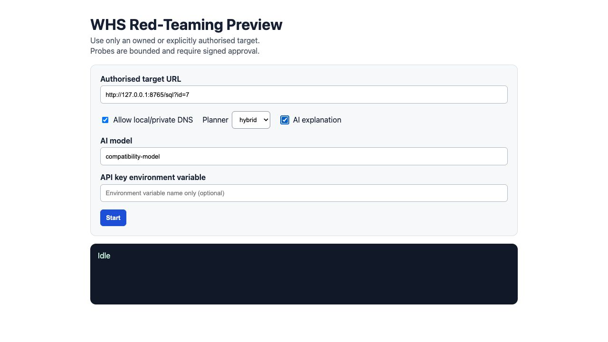
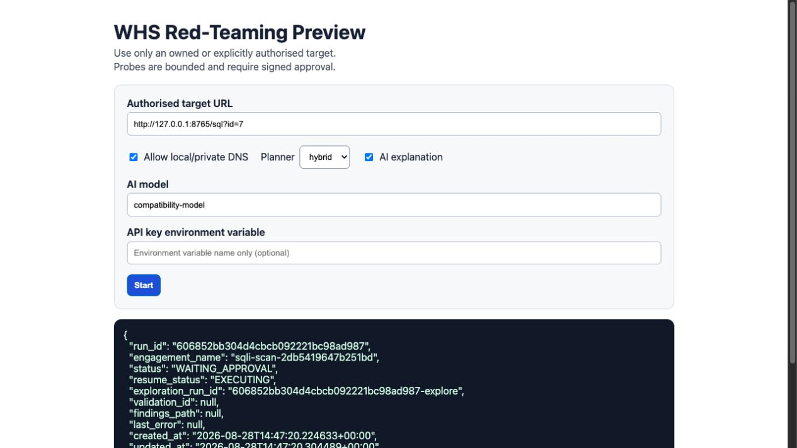
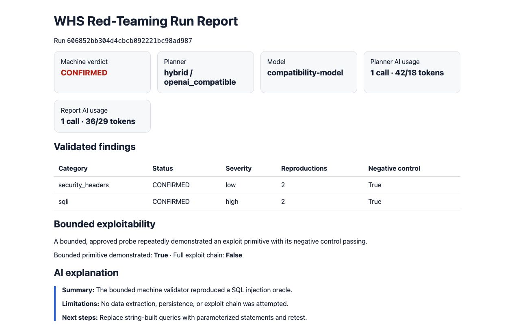
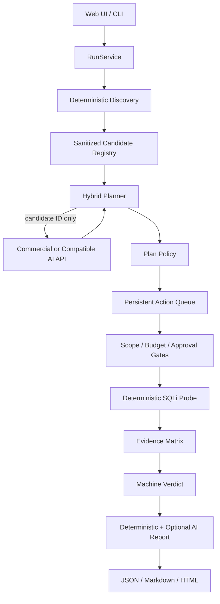

# WHS Red-Teaming Agent 프로토타입 실행·상용 API 검증 보고서

작성일: 2026-08-28  
대상 브랜치: `lightweight-agent`  
검증 대상: 명시적으로 취약하게 만든 로컬 데모 `http://127.0.0.1:8765/sql?id=7`

## 1. 결론

이 프로토타입은 **URL 입력부터 AI 계획, 승인 대기, 제한 SQLi 검증, 기계 판정,
JSON·Markdown·HTML 보고서 생성까지 연결되는 하나의 완성된 수직 기능**이다.

이번 실행에서 확인한 결과는 다음과 같다.

| 항목 | 결과 |
|---|---|
| 최종 상태 | `COMPLETED` |
| Planner 모드 | `hybrid` |
| AI provider | `openai_compatible` |
| Planner fallback | `false` |
| AI가 선택한 SQLi 후보 | 1개 |
| Planner API 사용량 | 1회, 입력 42·출력 18 tokens |
| Report Writer API 사용량 | 1회, 입력 36·출력 29 tokens |
| SQLi 판정 | `CONFIRMED`, high |
| SQLi 재현 횟수 | 2회 |
| Negative control | 2회 모두 통과 |
| 제한 exploit primitive | 입증됨 |
| 데이터 추출·전체 exploit chain | 수행하지 않음 |
| 전체 회귀 테스트 | 206 passed |

중요한 한계가 있다. 현재 환경에는 상용 API 키가 설정되어 있지 않아 실제 유료 API
계정·과금까지 검증하지 않았다. 실행 사진은 동일한 `/v1/chat/completions` 요청·응답·usage
계약을 구현한 로컬 OpenAI-compatible 서버를 사용했다. 따라서 **에이전트 내부의 API 연결
계약은 입증됐지만, 특정 상용 모델의 계정 권한·모델별 파라미터 호환성·실제 비용은 별도
검증이 필요하다.**

## 2. 실행 화면 증거

### 2.1 URL과 Hybrid Planner 설정

아래 화면에서 허가된 URL, `hybrid` planner, 모델 이름, 선택적 AI 설명을 설정했다.
상용 API를 사용할 때도 API 키 자체를 입력하지 않고 환경변수 이름만 입력한다.



### 2.2 AI 계획 완료 후 승인 대기

AI는 허용된 후보 ID 하나를 선택했다. 오케스트레이터는 즉시 SQLi를 실행하지 않고
민감 action 하나를 `WAITING_APPROVAL`에 저장했다. 이 시점의 Queue는 내부 단계 5개가
성공했고 SQLi action 1개가 승인 대기 중이었다.



### 2.3 승인 후 검증·판정·보고서

서명된 `sqli_safe` 승인 토큰을 1회 사용해 action을 해제한 뒤 실행을 재개했다. 결과는
SQLi `CONFIRMED`, high, 2회 재현, negative control 통과였다. AI 설명은 기계 판정을
바꾸지 않고 요약·한계·수정 방향만 추가했다.



## 3. 프로토타입 구조



핵심 구성요소는 다음과 같다.

| 계층 | 역할 | 주요 파일 |
|---|---|---|
| CLI·Web | URL 입력, 상태 조회, 웹 미리보기 | `src/whs_redteam/cli.py`, `src/whs_redteam/web/app.py` |
| RunService | CLI와 Web이 공유하는 실행 진입점 | `src/whs_redteam/run_service.py` |
| AI Provider | OpenAI-compatible 요청, timeout·retry·usage 수집 | `src/whs_redteam/ai/provider.py` |
| Hybrid Planner | AI 우선 후보 선택, 검증, rules fallback | `src/whs_redteam/planning/hybrid.py` |
| Orchestrator | 단계 전환, 재개, 재계획, 최종 보고 | `src/whs_redteam/orchestration/orchestrator.py` |
| Queue·Approval | action 영속화와 서명 승인 | `src/whs_redteam/orchestration/queue.py`, `approvals.py` |
| SQLi Probe | 승인된 제한 GET 변형과 반복 검증 | `src/whs_redteam/injection.py` |
| Inventory | run·action·evidence·finding SQLite 저장 | `src/whs_redteam/inventory.py` |
| Reporting | JSON·Markdown 및 HTML 요약 | `src/whs_redteam/reporting.py`, `web/app.py` |

AI가 직접 HTTP 도구를 호출하지 않는다는 점이 중요하다. AI는 저장소가 만든 후보 ID와
허용 action만 선택한다. URL, 변형값, 요청 횟수, 실제 실행 여부는 로컬 정책 계층과
결정론적 Probe가 통제한다.

## 4. URL을 넣으면 작동하는 과정

예시 입력은 다음과 같다.

```text
http://127.0.0.1:8765/sql?id=7
```

처리 과정은 다음 순서다.

1. `RunService`가 URL scheme, hostname, userinfo, fragment를 검사한다.
2. query를 제거한 `http://127.0.0.1:8765/sql`을 engagement scope로 만든다.
3. query 이름 `id`와 값의 **자료형만** 추론한다.
4. 사용자가 입력한 실제 값 `7`은 재개용 YAML에 저장하지 않고, integer형 테스트 기준값을
   내부 fixture에 만든다.
5. fixture에서 안정적인 `candidate_id`를 생성한다.
6. AI에는 후보 ID, endpoint template, `GET`, 파라미터 이름, 자료형, 남은 예산만 보낸다.
7. AI가 반환한 candidate ID가 registry에 실제로 존재하는지 재검사한다.
8. 통과한 action을 SQLite Queue에 저장한다.
9. `sqli_safe` 서명 승인이 없으면 `WAITING_APPROVAL`에서 정지한다.
10. 승인 후 ScopeGuard, capability, HTTP method, 요청 예산을 다시 검사한다.
11. SQLi Probe가 제한된 테스트 행렬을 반복 실행한다.
12. 기계 판정기가 evidence를 판정하고 JSON·Markdown·HTML 보고서를 생성한다.

오케스트레이터 상태는 다음처럼 이동한다.

```text
CREATED
  -> DISCOVERING
  -> INVENTORY_READY
  -> API_SCHEMA_MODELING
  -> ACTOR_SESSION_MODELING
  -> RESOURCE_MODELING
  -> ATTACK_SURFACE_MODELING
  -> PLANNING
  -> EXECUTING
  -> WAITING_APPROVAL
  -> EXECUTING
  -> EXPLOITABILITY_DECISION
  -> CLEANING_UP
  -> REPORTING
  -> COMPLETED
```

## 5. 실제 Injection과 판정 방식

현재 URL 직접 실행 경로는 `GET` query SQLi만 자동 구성한다. SQLi action 하나가 승인되면
각 반복에서 다음 다섯 종류의 요청을 보낸다.

1. 정상 기준 요청
2. 같은 자료형을 유지하는 negative control 요청
3. 인용부호 처리 오류를 확인하는 제한 변형 요청
4. 논리식이 참이 되는 제한 요청
5. 논리식이 거짓이 되는 제한 요청

기본 반복 횟수는 2회이므로 SQLi Probe 자체는 총 10개의 GET 요청을 사용한다. Queue의
action 수와 실제 HTTP 요청 수는 다른 개념이다.

판정 조건은 다음과 같다.

- 기준값과 negative control에는 SQL 오류 신호가 없어야 한다.
- 오류 확인 변형에만 알려진 DB 오류 신호가 나타나면 `error_signal` 후보가 된다.
- 기준 응답과 참 응답의 상태·content type·body hash가 같고, 거짓 응답의 body hash만
  달라지면 `boolean_signal` 후보가 된다.
- 같은 signal이 모든 반복에서 재현되어야 한다.
- negative control이 깨지면 `CONFIRMED`로 승격하지 않는다.

현재 Probe가 의도적으로 하지 않는 작업은 다음과 같다.

- 데이터베이스 이름·테이블·레코드 추출
- time-based blind SQLi
- INSERT·UPDATE·DELETE 같은 상태 변경
- SQL shell 생성
- 파일 읽기·쓰기
- 후속 lateral movement 또는 persistence

따라서 보고서의 `bounded_exploit_demonstrated=true`는 **SQL 응답 oracle이라는 제한된
취약점 primitive를 입증했다**는 의미다. `exploit_chain_demonstrated=false`는 실제 침투
체인을 수행하지 않았다는 의미다.

## 6. 상용 AI API를 사용하면 달라지는 점

### 6.1 설정

OpenAI API를 예로 들면 key는 서버 환경변수에만 둔다. OpenAI의 공식 Quickstart도 API
key를 환경변수로 내보내는 방식을 안내한다.

- [OpenAI Developer Quickstart](https://platform.openai.com/docs/quickstart/make-your-first-api-request)
- [Chat Completions API reference](https://developers.openai.com/api/reference/resources/chat)
- [API data controls](https://platform.openai.com/docs/models/default-usage-policies-by-endpoint)

```bash
export OPENAI_API_KEY="<real-key>"

whs-redteam sqli-scan 'https://authorised.example/items?id=7' \
  --planner hybrid \
  --ai-base-url https://api.openai.com/v1 \
  --ai-model '<account-accessible-model>' \
  --ai-api-key-env OPENAI_API_KEY \
  --ai-report
```

모델 이름은 계정에서 실제 사용할 수 있고 현재 Chat Completions 요청 파라미터와 호환되는
모델을 선택해야 한다. 모델별 지원 파라미터는 달라질 수 있으므로 실제 상용 검증에서는
먼저 작은 후보 1개로 contract test를 수행해야 한다.

### 6.2 전송되는 정보

상용 API로 전송되는 planner context는 다음과 같은 metadata다.

```json
{
  "schema_version": "planning-context-v1",
  "candidates": [
    {
      "candidate_id": "auto-...",
      "endpoint_template": "https://authorised.example/items",
      "method": "GET",
      "parameter": "id",
      "parameter_kind": "integer",
      "checks": ["sqli"]
    }
  ],
  "allowed_actions": ["run_sqli_safe", "skip_candidate", "finish"],
  "remaining_requests": 100,
  "planning_round": 0,
  "prior_results": []
}
```

전송하지 않는 정보는 다음과 같다.

- API key 원문
- Authorization header·cookie·session token
- 사용자가 입력한 query 값 원문
- SQLi 테스트 변형값
- 원본 응답 본문
- scope 밖 URL
- 승인 토큰

Report Writer도 전체 보고서를 보내지 않고 기계 verdict와 finding 요약만 별도로 redaction한
뒤 전송한다.

### 6.3 상용 API 호출 결과 처리

AI는 아래와 같은 구조화 JSON만 반환해야 한다.

```json
{
  "schema_version": "planner-decision-v1",
  "selected_actions": [
    {
      "candidate_id": "auto-...",
      "action": "run_sqli_safe",
      "reason": "bounded candidate selected",
      "confidence": 0.9
    }
  ],
  "finish": false
}
```

응답은 Pydantic schema와 candidate registry를 모두 통과해야 한다. AI가 URL, 파라미터,
payload 또는 알 수 없는 candidate ID를 새로 만들면 실행하지 않는다.

### 6.4 실패와 비용 통제

- timeout, HTTP 429, 5xx는 설정 범위 안에서만 재시도한다.
- 실제 재시도를 포함해 `max_api_calls_per_run`을 넘지 않는다.
- 잘못된 JSON, 알 수 없는 candidate, API key 누락은 rules fallback 대상이다.
- planner와 report writer의 호출 수·입력 tokens·출력 tokens를 분리해 보고한다.
- 상용 비용은 선택한 모델의 당시 입력·출력 단가에 따라 계산해야 한다.
- 모델 API가 중단되어도 결정론적 rules planner와 보고서는 계속 동작한다.

이번 mock 실행의 합계는 2 API calls, 입력 78 tokens, 출력 47 tokens였다. 이 값은 contract
검증용 고정 usage이며 상용 API의 실제 token 수나 비용을 의미하지 않는다.

## 7. 이번 실제 실행 결과

실행 run ID:

```text
606852bb304d4cbcb092221bc98ad987
```

최종 JSON 보고서:

```text
outputs/web-runs/2db5419647b251bd/findings-45aebe68ad9d45d68d216f35546956cf.json
```

핵심 provenance:

```json
{
  "planning": {
    "mode": "hybrid",
    "provider": "openai_compatible",
    "model": "compatibility-model",
    "fallback_used": false,
    "api_calls": 1,
    "input_tokens": 42,
    "output_tokens": 18
  },
  "ai_report": {
    "enabled": true,
    "provider": "openai_compatible",
    "fallback_used": false,
    "api_calls": 1,
    "input_tokens": 36,
    "output_tokens": 29
  }
}
```

취약점 판정:

```json
{
  "category": "sqli",
  "status": "CONFIRMED",
  "severity": "high",
  "reproduction_count": 2,
  "negative_control_passed": true
}
```

안전한 대조 서버에서도 별도 E2E를 실행했다.

```json
{
  "status": "COMPLETED",
  "verdict": "HARDENING_GAPS",
  "confirmed_injection_findings": 0
}
```

품질 검증 결과:

```text
ruff: All checks passed
pytest: 206 passed
web health: HTTP 200
web report after server restart: HTTP 200
```

## 8. 검증 중 발견하고 수정한 결함

1. 체크박스에 일반 text input 폭이 적용되던 웹 레이아웃을 수정했다.
2. URL profile을 YAML로 재로딩할 때 `30`과 `30.0`이 다른 config hash를 만들던 문제를
   숫자 정규화로 수정했다.
3. 웹 서버 재시작 후 `outputs/web-runs/*/engagement.yaml`에서 기존 run을 안전하게 다시
   찾도록 보완했다.
4. planner API usage만 기록하고 report-writer 호출을 누락하던 provenance를 분리했다.
5. AI가 생성한 보고서 문자열을 HTML에 표시할 때 escape 처리하고 회귀 테스트를 추가했다.

## 9. 현재 입증된 것과 입증되지 않은 것

### 입증된 것

- URL에서 SQLi 후보를 자동 구성할 수 있다.
- AI API가 허용된 후보 ID를 선택할 수 있다.
- AI가 실제 HTTP mutation을 직접 만들거나 실행하지 못한다.
- 승인 전에는 SQLi action이 실행되지 않는다.
- 승인 후 동일 SQLi signal을 2회 재현하고 negative control을 비교한다.
- AI 장애 시 rules fallback할 수 있다.
- 기계 verdict와 AI 설명이 분리된다.
- API 호출·token usage·fallback provenance가 보고서에 남는다.
- 재시작 후 run과 보고서를 다시 읽을 수 있다.

### 아직 입증되지 않은 것

- 실제 상용 계정의 billing과 provider dashboard usage 일치
- 여러 상용 모델 간 JSON 준수율·latency·비용 비교
- 로그인·세션 갱신·MFA·복잡한 브라우저 상태
- POST form, JSON body, GraphQL parameter 자동 생성
- IDOR/BOLA를 위한 두 사용자 권한 비교
- CSRF, SSRF, 파일 업로드, 경로 순회, 비즈니스 로직
- 분산 worker, 동시 run, 운영 secret manager
- 실제 exploit chain이나 데이터 추출

현재 수준을 객관적으로 표현하면 **경량 SQLi red-teaming vertical prototype**이다. 범용
자율 레드티밍 에이전트라고 부르기에는 아직 부족하지만, “AI 계획 + 정책 gate + 승인 +
결정론적 검증 + 보고서” 구조가 실제로 작동한다는 것은 입증했다.

## 10. 더 발전시키는 순서

### Phase 1. 실제 상용 API contract 검증

1. 전용 저권한 API project와 비용 한도를 만든다.
2. 모델별 1-candidate contract test를 실행한다.
3. 응답 schema 준수율, latency, 429·5xx fallback을 측정한다.
4. provider dashboard usage와 보고서 token usage를 비교한다.
5. 페이지·응답 metadata의 외부 전송 정책을 문서화한다.

### Phase 2. AI Planner 평가 체계

1. 후보 0개·1개·여러 개의 고정 평가셋을 만든다.
2. rules와 AI의 후보 선택 결과를 비교한다.
3. unknown candidate, prompt injection 문구, malformed JSON 평가를 자동화한다.
4. 비용 대비 candidate ranking 개선율을 측정한다.
5. 충분한 실패 데이터가 쌓인 뒤에만 fine-tuning을 검토한다.

### Phase 3. 실제 웹 상태 이해

1. 로그인·회원가입·세션 갱신을 actor session으로 모델링한다.
2. 두 개 이상의 승인된 테스트 계정으로 resource ownership을 비교한다.
3. OpenAPI·HTML form·XHR에서 POST/JSON schema를 만든다.
4. 상태 변경 action은 별도 capability와 승인 scope로 격리한다.
5. 브라우저 observation은 요약·redaction 후에만 AI에 전달한다.

### Phase 4. 취약점 수직 기능 확대

한 번에 종류를 많이 추가하지 않고 다음 순서로 각 취약점의 negative control과 E2E를 먼저
완성한다.

1. IDOR/BOLA
2. reflected XSS browser confirmation
3. CSRF safe validation
4. SSRF canary
5. benign file upload
6. path traversal canary
7. 제한된 business-logic invariant 검사

### Phase 5. 운영 안정화

1. API key를 OS keychain 또는 secret manager에서 로드한다.
2. per-run 비용·시간·request budget dashboard를 만든다.
3. worker 격리, 동시성 제한, 취소·cleanup을 강화한다.
4. immutable audit와 report 서명을 추가한다.
5. 상용 API 중단·지연·잘못된 출력 chaos test를 CI에 추가한다.

## 11. 재현 방법

설치:

```bash
cd /Users/kangjaemin/Desktop/WHS-Red-Teaming-Agent
python -m venv .venv
source .venv/bin/activate
python -m pip install -e '.[dev,web]'
```

외부 key 없이 API 계약 E2E:

```bash
python scripts/run_ai_api_demo.py
```

웹 미리보기:

```bash
whs-redteam serve --host 127.0.0.1 --port 8080
```

검증:

```bash
ruff check src tests examples scripts
pytest -o addopts='' -q
python scripts/run_safe_demo.py
```

반드시 본인 소유이거나 명시적 허가를 받은 대상만 사용해야 한다. 운영 데이터 추출,
서비스 거부, 자격증명 탈취, persistence를 목적으로 사용하면 안 된다.
