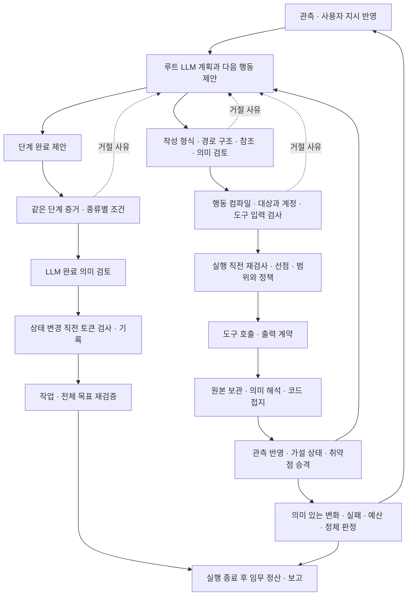

> 이 문서는 작성 당시의 감사·검토·작업 기록이다. 중간 상태와 검증 수준을 그대로 보존한다. 최신 구현·CI·병합 상태는 [목차](README.md)의 최종 계획을 기준으로 읽는다. 인용 행 번호는 검토 당시 기준이며 소스 링크에 현재 행 번호를 추정해 붙이지 않았다.

# 오케스트레이션 검증 계약 현황 감사

기준: 2026-10-03, `dev`, `c3f9728634ee9bed5b11075aaf6db8936ff0199d`.

저장소: `.`.

이 문서는 현재 소스의 검증 계약을 정리한 읽기 전용 감사다. 기존 폐쇄 루프 구현계획은 별도로 유지한다. 코드 수정, 실행 재현, 테스트, 커밋·푸시는 수행하지 않았다. 다른 컴퓨터에서 보고된 실행 기록은 제공된 설명만 사용하며, 해당 로그를 직접 확인하거나 재현했다고 주장하지 않는다.

조사에는 DeepSeek 4.1 Flash Max 오케스트레이터 2개와 Muse 1.3 Contributor XHigh 워커를 사용했다. 루트 포함 동시 7개 한도 안에서 완료된 워커 자리를 교대했다. 워커가 수집한 조건과 오케스트레이터가 대조한 호출관계를 루트가 통합했다. 보고 사이의 과장은 아래에서 정정했다.

## 1. 결론

현재 검증은 한 개의 알고리즘이 아니다. 계획 작성과 등록, 실행 후보 컴파일, 실행 직전 입장 검사, 범위·정책 통제, 도구 입출력, 증거 해석과 취약점 승격, 단계 완료, 작업·전체 목표 완료, 재개·복구가 서로 다른 계약을 적용한다.

핵심 간극은 **등록된 계획이 완료 가능한 계획임을 보장하지 않는다는 점**이다. 계획 등록은 형식·의존성·참조·허용된 완료조건과 의미 검토를 확인한다. 반면 단계 완료는 그 단계에서 생성된 원본 도구 증거를 요구한다. 선행 단계의 결과를 정리하는 목적이 일반적인 증거 수집 조건으로 표현되면, 앞쪽 검사를 거쳐도 뒤쪽 증거 소유 검사와 맞지 않을 수 있다.

현재 지원되는 여섯 완료조건 모두 동일 단계의 증거 풀에서 출발한다. 선행 단계가 완료됐다는 조건은 다음 단계를 시작할 자격이지, 선행 증거를 다음 단계 완료 증거로 가져올 권한이 아니다. 이전 버전의 같은 단계 증거를 계보 검사로 재사용하는 기능과도 구분해야 한다.

따라서 같은 단계 검사를 일괄 삭제하는 방식은 적절하지 않다. 먼저 실행 단계, 선행 결과를 종합하는 단계, 조사 종료가 각각 무엇을 증명해야 하는지 정해야 한다. 실행·대상·계정·호출·원본 출처 검사는 유지하고, 단계 목적에 따른 참조 범위를 명시하는 것이 후속 설계의 중심이다. 이는 향후 계약 결정에 관한 권고이며 현재 구현된 기능이 아니다.

## 2. 전체 연결 구조

실제 단일 실행 경로는 관측 → 계획 → 정책 → 실행 → 검증 → 갱신 → 재계획이다. 여러 제안이 있으면 워커로 분기하고 집계 후 재계획으로 돌아온다. 승인 대기 재개는 원본 제안을 복원해 정책 단계로 진입한다. 모든 노드가 매 턴 실행되는 것은 아니다. 완료 결정은 계획 과정의 별도 분기로 처리된다.

배선 근거: [그래프](../../../src/redteam/orchestration/graph.py), [분기](../../../src/redteam/orchestration/router.py), [LLM 결정 진입](../../../src/redteam/orchestration/engine.py).

## 3. 계획 작성·등록 계약

| 계약 | 확인하는 입력과 허용 조건 | 거절·실패 처리 | 상태 변경 |
|---|---|---|---|
| P01 새 계획의 완료조건 작성 | 허용된 종류, 비어 있지 않은 설명, 정수형 최소 증거 개수 1 이상. 가설 종류는 가설 참조 필요 | 원시 응답을 정규화 전에 검사하고 위치·수정 요구를 반환 | 없음 |
| P02 경로 구조 | 단계 식별자 유일성, 존재하는 선행 단계, 자기 의존·순환 금지 | 구조 오류로 등록 거절 | 없음 |
| P03 참조와 실행 연결 | 현재 실행·작업·경로 버전, 알려진 대상·역할·계정·증거·가설 참조 | 내부 자료 조회 실패와 참조 오류를 빈 자료로 취급하지 않음 | 수락 전에는 없음 |
| P04 계획 의미 검토 | 코드 검사를 거친 경로를 LLM이 검토. 수정안은 다시 코드·참조 검사 | 보류·거절과 수락을 구분. 수정·재시도는 공통 판단 예산 사용 | 수락된 경로만 활성화 |
| P05 경로 개정 | 정의가 같은 단계의 진행만 이월. 목표·조건·대상·계정·동작·의존성 등이 바뀌면 해당 단계와 후속 단계 무효화 | 낡은 버전 및 부당한 진행 초기화 거절 | 새 버전·스냅샷 보관, 변경 단계 초기화 |
| P06 작업 의존성과 상태 | 같은 임무의 작업 관계, 의존성 완료, 합법적 상태 전이, 차단 사유 | 불법 전이·순환·다른 임무 참조 거절 | 저장소 규칙과 트랜잭션으로 변경 |
| P07 LLM 호출 결과 | 응답 형식·스키마·의미 검토를 구분, 호출마다 판단 예산 소비 | 전송·형식·예산 실패를 분류하여 피드백 | 검토 기록 외 계획 상태는 수락 때만 변경 |
| P08 진행 기록의 소유 | 모델 초안이 제출한 단계 진행 상태·결과·완료 증거를 등록 시 초기화 | 모델이 계획에 완료됐다고 썼다는 이유로 진행을 인정하지 않음 | 기존 코드 기록의 이월은 별도의 정의 동일성 규칙 적용 |

근거: [새 조건의 작성 검사](../../../src/redteam/orchestration/paths/writing.py), [허용 종류와 모델](../../../src/redteam/orchestration/paths/models.py), [경로 구조](../../../src/redteam/orchestration/paths/models.py), [등록 진입](../../../src/redteam/orchestration/engine.py), [정의 동일성](../../../src/redteam/orchestration/paths/models.py), [변경 전파](../../../src/redteam/orchestration/paths/models.py), [경로 저장](../../../src/redteam/orchestration/paths/memory.py), [작업 상태 규칙](../../../src/redteam/orchestration/task_graph/rules.py), [판단 예산](../../../src/redteam/orchestration/cognition.py).

주의: 오래된 저장 자료를 읽을 때의 별칭·미상 조건 정규화와 새 LLM 응답의 엄격한 작성 검사는 별개다. 저장 모델이 값을 정규화한다고 새 계획 등록이 그 값을 허용한다는 뜻은 아니다. 반대로 허용된 종류로 작성됐다고 목적에 맞는 원본 증거를 생산할 수 있음까지 보장하지 않는다.

진행과 완료 증거는 코드가 관리한다. 모델의 초안에 완료 상태나 앞 증거를 써 넣어도 등록에서 기존 진행으로 받아들이지 않는다. 이후 저장소가 기존 코드 기록을 정의 동일성에 따라 이월하는 것과 구분한다. 근거: [초안 진행 초기화](../../../src/redteam/orchestration/engine.py).

## 4. 행동·도구·정책 계약

| 계약 | 허용 조건 | 거절·실패 처리 | 강제 위치 |
|---|---|---|---|
| A01 공통 동작 어휘 | 알려진 능력과 정식 동작 이름 | 미지원 능력·동작·잘못된 형식 진단 | 컴파일·실행 |
| A02 후보 컴파일 | 역할의 능력, JSON 인자, 해석 가능한 대상, 대상 동일성, 적격 도구, 입력 스키마 | 탈락 후보와 이유를 LLM에 반환 | 후보를 실행 제안으로 바꾸기 전 |
| A03 계획의 행동 범위 | 수락된 단계, 준비된 선행 조건, 단계 안의 대상·역할·계정·동작, 원본에 접지된 요구 사실 | 범위 밖 행동·참조·모호한 기존 실행을 거절 | 루트 행동 컴파일 |
| A04 실행 직전 재검사 | 현재 경로 버전·단계 상태·선행 완료·운영자 세대·작업 연결이 계속 유효 | 계획 당시 통과했어도 현재와 다르면 거절 | 정책 노드와 도구 실행 직전 |
| A05 실행 선점 | 검토한 단계·경로·운영자 상태에 대한 입장 기록 확보 | 상태 충돌 시 선점 실패 | 실행 직전 |
| A06 범위와 행동 규칙 | 허용 대상 범위, 정확한 정식 동작, 시간·동시 실행·가용성 제약 | 기본 거부, 명시적 거부가 허용보다 우선 | 통제 판단 |
| A07 위험·승인·회계 | 정책이 요구하는 승인, 속도·예산 여유 | 승인 대기와 거부 분리. 사전 조회는 소모하지 않음 | 통제 판단·승인 해결 |
| A08 도구 관문 | 등록·상태·입력 스키마·신뢰된 호출 맥락 | 제한시간·연결기 오류·출력 크기·출력 스키마 오류를 실패 결과로 반환 | 도구 호출 경계 |
| A09 제한 재시도 | 설정 허용, 남은 횟수, 낮은 위험, 코드상 읽기 전용 관측, 긴 작업 연결 없음 | 조건 중 하나라도 불충족하면 재시도 불가 | 실행 노드 |
| A10 특수 능력의 실행 조건 | 정적 분석은 등록 자산과 적격 도구, 실행 보조는 명시적 설정과 고정 조리법 | 설정·자산·대상 불일치 거절 | 분석 활성화·실행 연결 |

근거: [공통 동작](../../../src/redteam/core/action_semantics.py), [후보 컴파일](../../../src/redteam/orchestration/candidates/compiler.py), [행동 범위](../../../src/redteam/orchestration/engine.py), [선점](../../../src/redteam/orchestration/engine.py), [직전 재검사](../../../src/redteam/orchestration/engine.py), [정책 노드](../../../src/redteam/orchestration/nodes/policy.py), [통제 판단](../../../src/redteam/control/service.py), [도구 관문](../../../src/redteam/capability/gateway.py), [실행과 재시도](../../../src/redteam/orchestration/nodes/execute.py).

후보의 정렬·도구 동점자 선택은 적격 후보 안에서의 선택이다. 강제 검증과 동일시하면 안 된다. 도구가 정상 연결됐다는 상태 또한 실행 승인이나 취약점 입증이 아니다.

## 5. 원본 증거·해석·취약점 판정 계약

| 계약 | 인정하는 것 | 인정하지 않는 것·실패 처리 | 후속 기록 |
|---|---|---|---|
| E01 원본 보존 | 성공·실패 도구 결과를 원본 형태로 보관, 실행·행동·호출 연결 유지 | 요약문으로 원본을 대체하지 않음 | 원본 증거 추가 |
| E02 기대와 의미 해석 | 사전 기대와 결과 비교, LLM 판독 후 코드 접지 검사 | 도구 실패·근거 부족·실행/대상/계정/동작 불일치면 미결정으로 강등 | 검토 기록·다음 계획 피드백 |
| E03 최종 검토 기록 | 공개된 최종 승인 단계의 검토 기록을 소비 | 중간 기록의 긍정 판독만으로 최종 승인하지 않음 | 최종 기록으로 중간 판독 대체 |
| E04 가설 상태 | 접지된 판독과 관측·보안검사 구분에 따른 확정·반박·미결정 | 관측만으로 보안 가설 자동 확정 금지 | 가설 상태·근거 연결 |
| E05 취약점 승격 | 보안검사, 위반 판정, 증거, 확정 가설, 중복 아님 | HTTP 요청 성공·관측·미결정만으로 취약점 승격 불가 | 검증된 발견 기록 |
| E06 인증 비교 | 같은 조사 연결의 익명 기준 관측과 현재 대상·경로·방식 비교 | 기준 부재·불일치면 비교 불가. 상태코드 변화만으로 위반 확정하지 않음 | 접근 관측·모순 기록 |
| E07 원본 읽기 | 같은 실행 증거의 제한된 원본 구간 | 없음·다른 실행·원본 없음·잘림을 구분 | 읽기 응답만 반환 |
| E08 결과 해석기와 그래프 반영 | 정확한 도구 식별자에 연결된 해석 결과와 유효한 변경안 | 미등록·해석 실패·무효 변경을 도구 실행 실패나 취약점 부재와 혼동하지 않음 | 관측 반영·실패 감사 기록 |

근거: [검증 노드](../../../src/redteam/orchestration/nodes/verify.py), [원본 변환](../../../src/redteam/core/convert.py), [기대 비교](../../../src/redteam/orchestration/expectations.py), [의미 판독](../../../src/redteam/orchestration/analysis.py), [코드 접지](../../../src/redteam/orchestration/analysis.py), [최종 기록 판별](../../../src/redteam/orchestration/analysis.py), [취약점 승격](../../../src/redteam/orchestration/findings.py), [인증 비교](../../../src/redteam/orchestration/authentication.py), [증거 읽기](../../../src/redteam/orchestration/evidence_access.py), [해석기 등록](../../../src/redteam/orchestration/observations/mapper.py), [변경 반영](../../../src/redteam/orchestration/nodes/update.py).

최종 기록이 존재한다는 사실과 성공 판정이 최종 승인됐다는 사실은 다르다. 기록의 최종 여부, 판정 내용, 주장 지지 여부, 원본 연결을 각각 확인해야 한다. 해석기가 만든 그래프 서술과 검증된 취약점 기록도 같은 개념이 아니다.

실패·미결정 판독도 기록 쓰기가 성공하면 최종 검토 기록으로 남는다. 완료에 필요한 성공·반박 판정 요건을 충족하지 못할 뿐이다. 완료 검사에서 최종 기록을 읽을 때는 같은 실행의 공개 최종 기록만 골라 행동·호출 쌍별 생성 시각이 가장 늦은 것을 사용한다. 대체 기록 목록 자체를 추적하는 방식은 아니다. 근거: [강등 후 최종 기록](../../../src/redteam/orchestration/nodes/verify.py), [최신 최종 기록 선택](../../../src/redteam/orchestration/completion.py).

지식 투영에서는 선언 자료·측정 자료·가설·감사 자료를 구분한다. 사실로 제공하려면 측정 출처, 같은 실행의 보존된 원본, 값의 일치를 요구하며 가설과 발견 노드를 일반 사실 후보에서 제외한다. 사용자 선언은 선언이라는 이유만으로 측정 사실이 되지 않고 실제 관측의 뒷받침을 받아야 한다. 근거: [선언과 측정의 구분](../../../src/redteam/orchestration/knowledge.py), [주장 접지](../../../src/redteam/orchestration/knowledge.py), [선언 대상 확인](../../../src/redteam/orchestration/knowledge.py), [사실 투영](../../../src/redteam/orchestration/knowledge.py).

## 6. 단계 완료 계약

단계 완료는 먼저 코드 검사, 다음에 LLM 의미 검토, 마지막에 상태 변경 직전 검토 토큰 검사 순서다. 코드 검사 오류가 있으면 의미 검토나 완료 상태 기록으로 넘어가지 않는다.

공통으로 요구하는 것은 완료 결과·사유·증거 참조, 단계에 저장된 유효한 완료조건, 선행 단계 조건이다. 증거마다 같은 실행·경로·단계, 허용된 경로 버전, 대상·동작·계정 범위, 원본 도구 결과, 행동·호출 식별자, 저장된 원본 제안의 일치를 검사한다. 실패한 원본으로 성공을 주장할 수 없다.

| 완료조건 | 공통 증거 검사 뒤 추가로 확인하는 것 | 현재 지원의 한계 |
|---|---|---|
| 증거 수집 | 조건에 맞는 유효 증거 개수 | 목적의 충분성은 추가 의미 검토에 의존 |
| 관측 | 조건에 맞는 유효 증거 개수 | 다른 단계 증거를 허용하는 예외가 아님 |
| 검사 범위 | 조건에 맞는 유효 증거 개수 | 코드에 별도의 검사 항목별 범위 충족 분기가 없음 |
| 가설 확정 | 지정 가설의 확정 상태와 일치하는 최종 판정 기록 | 원본 풀 검사도 먼저 통과해야 함 |
| 가설 반박 | 지정 가설의 반박 상태와 일치하는 최종 반박 기록 | 취약점 입증 성공과 동일하지 않음 |
| 취약점 입증 | 성공 도구 증거, 최종 위반 판정, 연결된 검증된 발견 | 관측 성공·반박을 입증 성공으로 사용할 수 없음 |

증거 수집·관측·검사 범위는 **공통 출처와 조건별 증거 선택 검사를 거친 뒤의 코드상 추가 조건이 개수 중심**이라는 뜻이다. 아무 기록이나 세면 통과한다는 뜻은 아니다. 이후 LLM 완료 의미 검토도 남아 있다.

결과는 성공·반박·미결정·차단으로 구분한다. 반박은 적합한 반박 조건이 충족돼야 조사 단계의 완료로 인정될 수 있다. 미결정·차단은 성공 완료를 대신하지 못한다. 코드 검사 통과 뒤에도 의미 검토가 거절할 수 있으며, 거절 사유는 다음 LLM 입력으로 돌아간다.

근거: [공통 완료 검사](../../../src/redteam/orchestration/completion.py), [같은 실행](../../../src/redteam/orchestration/completion.py), [같은 단계](../../../src/redteam/orchestration/completion.py), [원본과 제안 연결](../../../src/redteam/orchestration/completion.py), [가설 조건](../../../src/redteam/orchestration/completion.py), [일반 증거 수](../../../src/redteam/orchestration/completion.py), [취약점 입증](../../../src/redteam/orchestration/completion.py), [반박 결과 일관성](../../../src/redteam/orchestration/completion.py), [단계 완료 진입·의미 검토·기록](../../../src/redteam/orchestration/engine.py).

### 증거 재사용 행렬

| 증거 상황 | 현재 단계 완료에 사용 | 이유 |
|---|---|---|
| 현재 실행·현재 경로·현재 버전·같은 단계 | 다른 출처 조건까지 맞으면 가능 | 기본 계약 |
| 같은 단계의 이전 경로 버전 | 계보와 정의 동일성 검사를 통과할 때 가능 | 단순히 오래된 증거라 허용하는 것이 아님 |
| 완료된 선행 단계의 증거 | 현재 단계의 직접 완료 증거로는 불가 | 단계 소유 불일치 |
| 같은 경로의 다른 단계 증거 | 불가 | 선행 관계와 무관하게 같은 단계 검사 |
| 다른 경로의 증거 | 불가 | 경로 불일치 |
| 다른 실행의 증거 | 불가 | 실행 불일치 |
| 같은 증거에 새 번호만 부여 | 번호만으로 적격성·새 진행을 만들 수 없음 | 원본 연결과 내용 기준 검사 |
| LLM 요약문·계획문 | 원본 도구 증거 대체 불가 | 원본·행동·호출 연결 없음 |
| 새 검토 기록만 생성 | 그 기록만으로 직접 완료 증거를 대체할 수 없음 | 원본 도구 결과와 제안 연결 요구 |
| 완료된 필수 단계들을 작업·목표 완료에서 확인 | 각 단계 자기 증거를 다시 검사하는 방식으로 가능 | 단계 증거를 다른 단계에 재귀속하지 않음 |

버전 계보 근거: [이전 버전 검사](../../../src/redteam/orchestration/completion.py). 선행 완료와 증거 소유는 서로 다른 축이다.

### 실행 기록과 대조할 원문 진단 키

다음 키는 소스의 거절 분기를 실제 실행 진단과 대조하기 위한 표다. 사용자에게 설명할 때는 왼쪽 역할을 사용하고, 로그를 추적할 때 오른쪽 키를 사용한다.

| 거절 이유 | 원문 진단 키 |
|---|---|
| 다른 실행의 증거 | `completion_evidence_reference_belongs_to_a_different_16` |
| 경로 연결 없음 | `completion_evidence_reference_has_no_path_linkage_18` |
| 다른 경로의 증거 | `completion_evidence_reference_belongs_to_a_different_19` |
| 허용되지 않는 경로 버전 | `completion_evidence_reference_belongs_to_a_different_41` |
| 다른 단계의 증거 | `completion_evidence_reference_belongs_to_a_different_20` |
| 정식 동작 증명 없음 | `completion_evidence_reference_has_no_canonical_operation_21` |
| 보존 원본 없음 | `completion_evidence_reference_has_no_preserved_raw_22` |
| 대상 연결 없음 | `completion_evidence_reference_has_no_target_linkage_23` |
| 원본 행동 제안 없음 | `completion_evidence_reference_has_no_stored_proposal_29` |

## 7. 작업·전체 목표 완료와 실행 종료

| 층 | 주요 계약 | 실패 시 |
|---|---|---|
| 단계 완료 | 자기 증거 검사 → 의미 검토 → 상태 변경 시점의 일관성 확인 | 단계 성공 기록 안 함, 거절 사유 반환 |
| 작업 완료 | 현재 작업 연결, 증거 있는 완료 필수 단계, 각 단계 재검증, 남은 실행과 불확실 실행 확인, 작업 의미 검토 | 작업 완료 안 함 |
| 전체 목표 완료 | 필수 단계·작업과 실행 잔여·정리 필요 확인, 각 단계 재검증, 목표 의미 검토, 운영자 원본 성공기준과 근거 대응 | 임무 완료 안 함 |
| 실행 종료 | 예산·횟수·연속 실패·정체·정책 중단·승인 대기 등에 따른 루프 종료 | 종료 자체는 목표 달성이 아님 |
| 종료 후 임무 정산 | 저장된 작업·증거·성공기준을 다시 확인하여 임무 상태 결정 | 미충족·차단·부분 결과와 완료 구분 |

완료 검사는 네 호출부에서 사용된다. 단계 완료 1곳, 전체 목표 완료 2곳, 작업 완료 1곳이다. 완료된 단계라는 저장 상태만 맹신하지 않고 증거를 다시 검증한다.

근거: [작업 완료](../../../src/redteam/orchestration/engine.py), [전체 목표 완료](../../../src/redteam/orchestration/engine.py), [종료 후 정산](../../../src/redteam/orchestration/replanning.py), [재계획의 종료 분기](../../../src/redteam/orchestration/nodes/replan.py).

조사 설정의 연결 범위는 검사 위치마다 다르다. 단계 완료와 원본 재처리 함수는 실행 식별자를 직접 검사하며, 조사 설정 식별자를 별도 인자로 받아 대조하지 않는다. 임무 정산에는 실행과 조사 설정을 함께 대조하는 구간이 있다. 인증 비교 등 다른 계층에도 조사 연결 검사가 있으므로, 이를 모든 검증이 같은 방식으로 적용된다고 표현하거나 곧바로 우회 취약점으로 단정해서는 안 된다.

지식 색인의 조사 설정 필터도 선택 인자다. 실행 필터는 적용되지만 조사 설정 인자를 전달하지 않는 일반 투영 경로에서는 추가 필터가 적용되지 않는다. 실행과 조사 설정의 결속 보장은 상위 바인딩과 저장소 계약까지 함께 판단해야 한다. 근거: [증거 색인](../../../src/redteam/orchestration/knowledge.py).

### 두 최종 판정 경로의 차이

루트의 전체 목표 완료와 종료 후 임무 정산은 동일한 함수를 호출하는 하나의 판정 경로가 아니다. 종료 후 정산은 필수 작업이 완료됐고 정산 기준이 충족되면 임무를 완료로 기록하는 별도 경로를 갖는다. 이때 루트 목표 완료의 정리 잔여 검사, 목표 검토의 기준 대응 검사, 기준별 작업 소유권 검사를 같은 형태로 다시 수행하지 않는다.

반대로 루트가 이미 임무를 완료했고 저장된 기준 결과가 원본 기준에 정확히 대응하며 모두 충족돼 있으면, 종료 후 정산은 재계산 없이 그 결과를 유지한다. 실패·취소·차단 상태를 유지하는 분기도 있다. 따라서 두 경로의 검사 차이는 확인됐지만, 외부 입력으로 임의 완료할 수 있다는 취약점이나 두 경로가 반드시 충돌한다는 실행 결함은 입증하지 않았다.

근거: [종료 정산 호출 순서](../../../src/redteam/app/bootstrap.py), [기존 완료 유지](../../../src/redteam/orchestration/replanning.py), [정산의 별도 완료 조건](../../../src/redteam/orchestration/replanning.py), [목표 검토의 원본 기준 대응](../../../src/redteam/orchestration/engine.py).

## 8. 재개·복구·진행 계약

| 계약 | 허용 | 거절·실패 처리 |
|---|---|---|
| R01 의미 있는 진행 | 같은 실행의 원본 내용과 증거 있는 완료 단계 변화 | 새 증거 번호·시각·검토 문구만으로 진행 취급하지 않음. 조회 실패는 진행 없음과 구분 |
| R02 정체 종료 | 설정된 무진행 횟수 도달 | 정체 사유로 실행 종료, 목표 달성으로 올리지 않음 |
| R03 일반 재개 | 재개 가능한 종료 사유와 의미 있는 상태 변화·명시적 깨움 등 실제 조건 | 예산·횟수·연속 실패 상한을 일반 변화로 부활시키지 않음 |
| R04 승인 재개 | 저장된 원본 제안·단계·승인·실행·작업 임대의 일치와 재개 선점 | 다른 승인·제안·실행이면 재개하지 않음 |
| R05 지정점 복원 | 안전한 체크포인트 | 다음 지점이 도구 실행·병렬 실행이면 재실행 위험 때문에 거절 |
| R06 원본 재처리 | 같은 실행의 보존된 원본과 원본 제안·호출·대상·계정 연결 | 원본 부족·불일치 상태를 분리. 도구를 다시 호출하지 않음 |
| R07 병렬 워커 | 지역 실행 상태에서 정책·실행·검증·갱신 후 결과 반환 | 워커 예외를 형제 작업과 격리. 승인 필요 작업은 보류 |
| R08 결과 집계 | 워커 결과를 실행 횟수·실패·예산·판정·승인 대기에 합산 | 집계는 조사 성공을 자동 선언하지 않음 |
| R09 진단 피드백 | 위치·규칙·요약과 재시도 가능 여부 | 무한 수리를 허용하지 않고 판단 예산·종료 상한 적용 |

근거: [공통 진행 지문](../../../src/redteam/orchestration/progress.py), [내용 중심 지문](../../../src/redteam/orchestration/progress.py), [정체 종료](../../../src/redteam/orchestration/nodes/replan.py), [재개 조정](../../../src/redteam/orchestration/runner.py), [승인 재개](../../../src/redteam/orchestration/runner.py), [위험한 복원 지점](../../../src/redteam/orchestration/runner.py), [원본 재처리](../../../src/redteam/orchestration/recovery.py), [워커](../../../src/redteam/orchestration/nodes/worker.py), [집계](../../../src/redteam/orchestration/nodes/aggregate.py), [진단](../../../src/redteam/orchestration/diagnostics.py).

복구는 해석·반영을 다시 수행하는 기능이다. 원본 도구 실행이 불확실할 때 같은 도구를 무조건 다시 실행하는 기능이 아니다. 병렬 워커 역시 현재 실행·검증·반영 단위를 처리하는 구성이다. 여러 단계의 자율 조사 계획을 수행하는 서브에이전트 계약과 동일시하면 안 된다.

### 함수 구현과 실제 연결의 구분

현재 소스의 정적 호출 검색에서 다음 공개 함수는 내부 프로덕션 호출자를 확인하지 못했다: 작업 그래프 재계획 진입, 별도 수렴 평가, 실행 모호성 판별 보조, 복구 요약. 외부 사용자가 호출할 수 있는 공개 API인지까지는 단정하지 않는다.

근거: [작업 그래프 재계획](../../../src/redteam/orchestration/replanning.py), [수렴 평가](../../../src/redteam/orchestration/convergence.py), [실행 모호성 보조](../../../src/redteam/orchestration/recovery.py), [복구 요약](../../../src/redteam/orchestration/recovery.py).

따라서 이 함수들의 조건을 현재 주 실행 경로에 이미 적용되는 조건으로 소개해서는 안 된다. 원본 재처리, 종료 후 임무 정산, 깨움, 전달, 보고는 각각 실제 호출 지점이 확인됐다.

## 9. 사용자 지시·초기 설정·LLM 맥락 계약

| 계약 | 현재 허용·제한 | 실패·후속 처리 |
|---|---|---|
| U01 운영자 지시 해석 | 지원하는 한국어·영어 지시 사전으로 분류 | 미지원 문장은 적용 지시로 접수하지 않음 |
| U02 지시 자료 검증 | 순수 지시·참조와 실행 명령 필드를 구분, 비밀 자료 처리 규칙 적용 | 부적합한 지시 자료 거절 |
| U03 지시 이력 | 수신·적용·거절을 이력으로 보존, 같은 식별자의 다른 내용 금지 | 뒤늦은 수신 기록이 적용·거절 결과를 덮어쓰지 못함 |
| U04 운영자 세대 | 중지·일시정지·재개·집중·재정렬·제외 등 실행에 영향을 주는 접수로 변경 | 계획 시점 세대와 실행 입장 시점 세대가 다르면 거절 |
| U05 집중·제외 | 기존 작업의 우선순위·선택과 제외 범위 조정 | 새 목표나 실행 권한을 만드는 기능으로 보지 않음. 경로 제외는 지정한 주소·경로 일치 규칙 적용 |
| U06 초기 목표 자료 | 목표·성공기준·초기 대기 작업 생성. 자연어 성공기준을 보존 | 초기 문장 정리의 대체 경로를 루트 조사 LLM의 대체 운영 모드로 해석하지 않음 |
| U07 실행 구성 복원 | 저장된 프로파일·버전·구성 식별자와 등록 구성 일치 | 모르는 구성·바뀐 식별자·재구성 불가 객체 거절 |
| U08 역할별 맥락 투영 | 선언된 자료 종류·주변 깊이·토큰 상한, 개정별 캐시 | 축소된 자료가 전체 원본이나 완료 근거를 대신하지 않음 |
| U09 모델 후보 제공 | 이미 제공된 대상, 공개 도구·인자 계약 안에서 후보 생성 | 미상 대상·부적합 도구·잘못된 인자 탈락. 뒤의 컴파일·정책도 별도 적용 |

근거: [운영자 해석](../../../src/redteam/orchestration/operator_intents/interpreter.py), [지시 이력](../../../src/redteam/orchestration/operator_intents/store.py), [지시 접수와 세대](../../../src/redteam/orchestration/operator_intents/service.py), [집중 적용](../../../src/redteam/orchestration/operator_intents/service.py), [경로 제외](../../../src/redteam/orchestration/operator_intents/suppression.py), [초기 기준](../../../src/redteam/orchestration/engagement_planner.py), [초기 작업 생성](../../../src/redteam/orchestration/mission_bootstrap.py), [실행 구성](../../../src/redteam/orchestration/component_binding.py), [맥락 투영](../../../src/redteam/orchestration/context_projection.py), [모델 후보](../../../src/redteam/orchestration/agents/llm_provider.py).

운영자가 제공하는 자연어 성공기준을 그대로 보존하는 것은 그 자체로 결함이 아니다. 초기 설정의 문자열 기준과 이후 경로의 정형 완료조건은 역할이 다르다. 목표 완료에서 원본 성공기준과 검토 결과의 대응을 확인하는 이유와 함께 봐야 한다.

승인 해결은 원래 제안과 설정에 대한 범위·행동 규칙·승인 정책을 다시 평가하지 않고 승인 결과 및 회계를 처리한다. 재개 후 오케스트레이션은 현재 제외·세대·경로·입력 조건을 다시 검사한다. 이것을 변경 가능한 모든 통제 설정이 자동 재평가된다는 보장으로 확대하면 안 된다. 승인 대기 중 설정 변경을 지원할지, 기존 설정 스냅샷에 결속할지는 별도의 계약 결정 대상이다. 근거: [승인 해결의 재평가 경계](../../../src/redteam/control/service.py), [재개 후 정책 입장 검사](../../../src/redteam/orchestration/nodes/policy.py), [운영자 세대 확인](../../../src/redteam/orchestration/engine.py).

역할별 맥락 제한, 역할 재활성화 조건, 루트의 다음 역할 선택은 같은 규칙이 아니다. 이번 판독에서 관측·등록·재개 영역의 조건을 확인했지만, 이를 모든 루트 역할 선택에 적용되는 전역 금지 규칙이라고 단정하지 않는다.

## 10. 상태 원자성·작업 임대·긴 실행 계약

| 계약 | 허용·거절 조건 | 기록·실패 처리 |
|---|---|---|
| S01 저장소 조합 | 호환되는 메모리 저장소 조합 또는 같은 파일의 SQLite 저장소 조합 | 혼합·다른 파일 조합 거절 |
| S02 실행과 임무 결속 | 실행·임무·조사 설정 결속 일치, 임무의 중복 실행 결속 금지 | 결속 부재·불일치 거절 |
| S03 검토 토큰 | 활성 임무, 접수된 실행 차단 지시 없음, 검토한 상태와 현재 상태 지문 일치 | 변경 충돌이면 완료·계획 기록 거절 |
| S04 원자적 변경 | 격리된 복사 상태에서 임무·경로·내부 기록을 함께 변경 | 전체 커밋 또는 롤백. 내부 변경 구간에서 외부 LLM·도구 효과를 실행하지 않음 |
| S05 작업 중복 | 같은 실행·후보의 살아 있는 작업 중복 억제. 대기 작업은 조건에 따라 갱신 | 실행 중 중복 거절, 종료 기록의 재실행 허용은 별도 조건 |
| S06 작업 임대 | 대기 상태, 선행 작업 성공, 충돌 키 없음, 유효 임대 시간 | 불충족이면 임대 거절·선행 실패에 따른 차단 |
| S07 임대 연장·완료 | 소유자와 만료 전 임대 일치, 허용된 종료 상태 | 소유 불일치·만료 처리. 적격 완료 때 임대 제거 |
| S08 반환·만료 회수 | 적격 임대를 대기로 반환하거나 만료 작업 무효화 | 만료를 성공으로 취급하지 않음 |
| S09 긴 실행 연결 | 실제 뒷단이 주입됐고 승인된 호출일 때 제출·상태·수집 위임 | 뒷단 부재는 미지원/동기 경로 조건. 조회는 새 도구 실행을 만들지 않음 |
| S10 긴 실행 결과 대조 | 같은 긴 실행 식별자와 지원하는 종료 상태 | 장부 상태와 뒷단 결과를 명시적으로 대조하여 기록, 불일치 거절 |

근거: [저장소 조합](../../../src/redteam/orchestration/coordination.py), [결속](../../../src/redteam/orchestration/coordination.py), [검토 토큰](../../../src/redteam/orchestration/coordination.py), [변경 입장](../../../src/redteam/orchestration/coordination.py), [원자적 변경](../../../src/redteam/orchestration/coordination.py), [작업 등록](../../../src/redteam/orchestration/work/memory.py), [작업 임대](../../../src/redteam/orchestration/work/memory.py), [완료 기록](../../../src/redteam/orchestration/work/memory.py), [긴 실행 대조](../../../src/redteam/orchestration/work/sqlite.py), [선택적 긴 실행 뒷단](../../../src/redteam/orchestration/long_jobs.py).

검토 토큰·운영자 세대 검사와 작업 임대 검사는 서로 다른 소유권을 보호한다. 하나를 통과했다는 이유로 다른 검사를 생략할 수 없다. 긴 실행 장부의 결과도 전체 목표 성공과는 별개다.

## 11. 확인된 간극과 후속 결정 대상

| 항목 | 현재 사실 | 판단·영향 | 후속 결정 |
|---|---|---|---|
| G01 계획 등록과 완료 가능성 | 등록의 형식·참조 검사가 자기 단계 원본 증거 생산 가능성을 보장하지 않음 | 정리 목적을 일반 증거 조건으로 표현하면 등록과 완료의 의미가 어긋날 수 있음 | 계획 수락 시 단계 목적과 완료 방식의 호환 검사 |
| G02 선행 결과 종합 | 모든 완료종류에 같은 단계 증거 검사 적용 | 선행 증거를 빌려 완료하는 별도 종합 규격 없음 | 종합 단계 필요 여부와 허용 참조 범위 명시 |
| G03 검사 범위 조건 | 공통 유효 증거 풀의 개수 중심 검사, 별도 범위 항목 분기 없음 | 증거 개수와 실제 검사 범위 충족은 다르므로 의미 검토의 책임이 큼 | 검사 대상·필수 항목·미검사 사유의 완료 규격 |
| G04 최종 판정의 층 | 단계·작업·목표·종료 후 정산이 각각 존재 | 한 층의 통과·종료를 다른 층의 성공으로 오해하기 쉬움 | 각 층의 책임과 중복 검사 이유 정리 |
| G05 출처 범위 검사 위치 | 실행·경로·단계·조사 설정 검사가 계층마다 다름 | 전 계층 동일 보장이라고 단정할 수 없음 | 바인딩 보장의 소유 위치와 전파 조건 명시 |
| G06 선언·관측·판정의 구분 | 원본 근거와 의미 판독·검토 기록을 구분 | LLM 요약이나 검토 기록 생성만으로 실제 관측을 대체할 수 없음 | 기존 출처 구분을 새 완료 방식에서도 유지 |
| G07 피드백과 계약 수리 | 완료 거절을 LLM에 전달하고 예산·정체로 중단 | 표현만 바꿔도 지원되지 않는 완료 방식이면 계속 실패 가능 | 오류를 단순 형식 수리와 계획 재구성 필요로 구분 |
| G08 미연결 공개 검사 | 구현돼 있지만 현재 내부 호출자가 없는 검사 있음 | 존재만 보고 폐쇄 루프에 이미 연결됐다고 판단하면 오류 | 연결할지 공개 보조로 둘지 결정 |
| G09 최종 판정 경로 간 차이 | 루트 목표 완료와 종료 후 정산의 필수 검사가 동일하지 않음 | 목표 달성의 공통 규격을 한 곳의 조건만 보고 설명할 수 없음 | 공통으로 강제할 조건과 정산 전용 조건 결정 |
| G10 승인 중 설정 변경 | 승인 해결 자체는 원래 범위·행동 규칙·승인 정책을 재평가하지 않음. 재개 후 현재 운영자·실행 입장 조건은 재검사 | 운영자 지시 변경과 통제 설정 변경의 보장이 같다고 할 수 없음 | 설정 스냅샷 결속 또는 변경 시 재평가 규격 |

G01·G02의 구조는 소스에서 확인됐다. 실제 계획 수락과 실행 정체를 포함한 특정 실행 재현은 하지 않았다. G03~G10은 확인된 구조를 바탕으로 한 계약 정리 대상이며, 모두 실행 결함이 입증됐다는 뜻은 아니다.

### 보고된 정리 단계 실패의 해석

앞의 세 단계가 만든 증거를 마지막 정리 단계의 증거로 제출하면, 같은 단계 검사에서 제외된다. 그러면 요구 증거 개수에 미달하여 완료가 거절된다. 새 원본 내용이나 완료 상태 변화가 없으면 진행 지문도 바뀌지 않아 정체 종료로 이어질 수 있다.

이 연쇄는 현재 소스의 검사·피드백·진행 판정과 부합한다. 다만 제공된 Mac 실행 보고서를 로컬에서 열어 확인하지 않았으므로 해당 실행을 직접 재현했다는 표현은 사용하지 않는다.

## 12. 루트의 설계 판단

유동적으로 만들어야 할 것은 LLM의 모든 표현을 무조건 받아들이는 검증기가 아니다. **LLM이 제안한 단계의 목적에 맞는 완료 규격과 증거 참조 범위**다.

계속 고정해야 할 신뢰 조건은 원본 보존, 실행·행동·호출 연결, 대상과 계정의 근거, 정책·사용자 지시 준수, 중간 판독의 무단 성공 승격 금지다. 계획에 따라 달라질 수 있는 것은 단계 목표, 요구 검사 범위, 선행 결과 참조, 성공·반박의 의미, 해당 단계가 직접 도구 증거를 만들어야 하는지 여부다.

후속 설계에서는 실행 단계는 자기 실행 증거를 요구하고, 종합을 지원한다면 검증된 선행 단계와 그 원본을 참조하는 별도 규격을 정하며, 전체 목표 완료는 사용자의 목표 기준으로 판단해야 한다. 이는 현재 규칙 전체를 느슨하게 만드는 방향이 아니라 각 규칙의 적용 대상을 분명히 하는 방향이다.

기존 폐쇄 루프 계획을 즉시 폐기할 필요는 없다. 먼저 이 계약 지도를 바탕으로 계획 작성·단계 완료·작업/목표 완료 사이의 규격을 정하고, 그 결정으로 영향받는 계획 항목만 재검토하는 것이 합리적이다. 구현 순서나 구체 패치는 이 문서의 범위가 아니다.

## 13. 판독 범위와 한계

직접 본문 판독과 워커의 범위 고지를 합쳐 다음 핵심 영역을 조사했다.

| 영역 | 판독 범위 | 제한 |
|---|---|---|
| 계획과 경로 | 경로 모델·작성 규칙·메모리/SQLite 저장소·작업 상태 규칙, 엔진 작성·등록·개정 관련 구간 | 엔진 전체를 한 사람이 통독한 것은 아님 |
| 실행과 정책 | 공통 동작·제안/대상 계약, 후보 컴파일·선택·대상 연결·분석 활성화·실행 연결, 엔진 컴파일/선점/입장 검사 구간 | 도구 서버 내부 업무 로직은 공개 경계 밖 |
| 증거와 판정 | 검증·의미 해석·기대·인증·취약점 승격·증거 읽기·변환·해석 등록·갱신 | 도메인별 해석기 전체의 업무 정확성은 별도 감사 대상 |
| 지식 | 지식 분리·색인·접지·사실 투영과 원본 수집 관련 본문 | 증거 저장소의 물리 격리를 완전 감사한 것은 아님 |
| 완료 | 완료 검증 전체, 단계·작업·목표 완료 엔진 구간, 임무 계약 | 실제 외부 실행 재현 없음 |
| 재개와 복구 | 복구·진행·상태·체크포인트, 관측/재계획/워커/집계, 실행 순환과 주요 재개 분기 | 보고 전반·동적 작업 생성 일부는 부분 판독·호출 검색 |
| 연결 확인 | 그래프·라우터와 공개 함수 호출자 검색 | 동적 외부 호출의 부재까지 증명한 것은 아님 |
| 사용자 지시와 맥락 | 지시 해석·모델·기록·제외, 처리 담당의 접수/적용/집중/상태 구간, 초기 목표·구성 복원·맥락 투영·모델 후보 | 지시 처리 담당의 증거 조립·이벤트 수집 일부는 부분 판독 |
| 원자성과 실행 장부 | 조정자·작업 모델/메모리/SQLite·스케줄러·긴 실행·SQLite 보조 | 개별 뒷단의 실제 외부 실행은 감사하지 않음 |

본문에서 사용하는 '구현됨'은 해당 조건이 소스에 존재함을 뜻한다. '연결됨'은 내부 호출관계를 확인했다는 뜻이다. 실행 테스트로 동작 전체를 보장했다는 뜻은 아니다. 모든 저장소 파일이나 모든 도구 서버를 완전 감사했다는 표현을 사용하지 않는다.

작성 당시 원본은 저장소 밖의 로컬 계획 폴더에 보관했다. 사용자 후속 요청에 따라 이 공유본을 docs에 게시한다.
