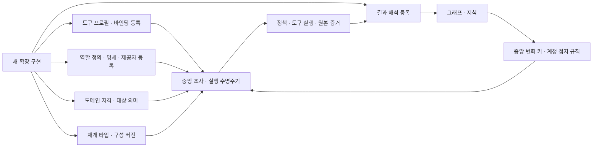
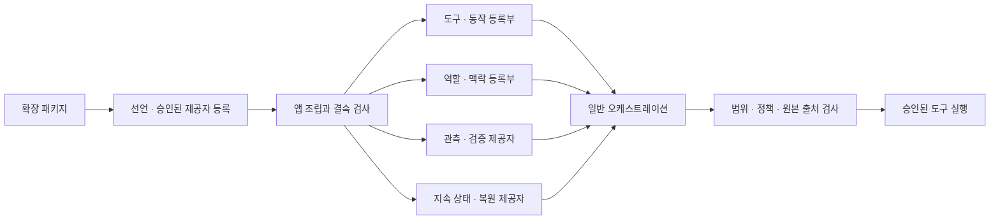

> 이 문서는 작성 당시의 감사·검토·작업 기록이다. 중간 상태와 검증 수준을 그대로 보존한다. 최신 구현·CI·병합 상태는 [목차](README.md)의 최종 계획을 기준으로 읽는다. 인용 행 번호는 검토 당시 기준이며 소스 링크에 현재 행 번호를 추정해 붙이지 않았다.

# 확장성과 팀 간 결합성 감사

작성일: 2026-10-04. 기준 브랜치: `dev`. 기준 커밋: `9eb70ed1f9fff1fbf15540731de87de89feaf7fe`.

저장소: `.`.

상태: 읽기 전용 감사와 교차 검토를 완료한 문서. 소스 수정·에이전트 대상 도구 실행·테스트 실행·커밋·푸시는 하지 않았다. 기존 폐쇄 루프 계획과 검증 계약 감사 문서는 수정하지 않았다.

## 1. 감사의 질문과 판단 기준

이 감사는 새 MCP·도구·스킬·전문 에이전트를 추가할 때 중앙 오케스트레이션과 다른 팀 구현을 함께 고쳐야 하는 이유를 찾는다. 사용자 목표는 확장 패키지의 구현·등록·설정으로 기능을 추가하고, 중앙 실행 루프를 매번 변경하지 않는 것이다.

다음 세 가지를 구분한다.

1. **정상적인 계약 준수**: 도구 입력·출력 스키마, 실행 범위, 승인, 원본 증거, 호출 연결을 지키는 일. 이 조건을 제거하는 것은 모듈화가 아니다.
2. **필요한 확장 구현**: 새 도구의 연결기, 새 도메인의 결과 해석, 새 역할의 조사 방식은 누군가 구현해야 한다. 그 구현을 확장 패키지에 넣을 수 있다면 중앙 코드 변경과는 다르다.
3. **불필요한 연쇄 수정**: 한 기능의 등록·의미·정책이 여러 팀의 중앙 목록과 조건문에 흩어져 있어 같은 정보를 여러 곳에 맞춰야 하는 일. 이 감사의 주 대상이다.

현재의 모든 의존성을 스파게티라고 부르지 않는다. 같은 팀의 내부 참조와 조립부의 구현체 선택은 정상일 수 있다. 실제 변경 사례, 강제 검사, 사설 접근, 의미 규칙의 중복, 미등록 기능의 실패 방식을 근거로 판단한다.

## 2. 현재 확인된 큰 구조

공통 계약과 포트, 도구 카탈로그, 연결기, 역할 등록부, 후보 제공자, 결과 해석기, 실행 구성 프로파일이 이미 있다. 따라서 현재 구조가 확장 통로를 전혀 갖고 있지 않은 것은 아니다.

문제는 확장 요소가 하나의 등록 단위로 모이지 않는다는 점이다. 도구 발견과 입력 검사를 통과해도 그래프 해석·역할 노출·도메인 자격·재개 조건은 별도 중앙 코드가 알고 있어야 한다. 새 동작 어휘와 새 저장 뒷단은 공통 목록이나 구체 구현체 제약에도 걸린다.

루트의 최종 판단은 **도구 호출 포트 분리는 이미 돼 있지만, 확장에 필요한 의미와 수명주기의 등록 계약이 분산돼 있다**는 것이다. 따라서 파일을 무작정 분할하거나 도구 허용 검사를 지우는 작업보다, 확장 단위의 결속과 규칙 소유자를 먼저 정하는 것이 효과적이다. 현재 소스에서 확인한 문제·결정 대상 30개와 조건부 영향·해결 방향을 아래에 정리했다.

특히 다음은 구분해야 한다.

| 확장 종류 | 중앙 변경이 생기는 조건 | 현재 가능한 경로 |
|---|---|---|
| 기존 능력·동작에 새 MCP 도구 추가 | 새 프로필·벤더 특례·구조화 관측이 필요할 때 | 호환 카탈로그·바인딩·스키마만으로 일반 실행이 가능한 경로가 있음 |
| 새로운 능력·동작 추가 | 공통 어휘와 복사된 목록, 동작별 의미 해석 | 현행 고정 어휘 안에서 다른 도구로 매핑하는 경로와 구분 |
| 새 전문 역할 추가 | 기본 역할·명세·제공자 조립, 도메인 자격 조건 | 직접 등록·실행 구성 주입 통로는 있음 |
| 새로운 구조화 관측 추가 | 결과 해석 등록과 그래프·지식의 의미 계약 | 원본 보존과 LLM 해석은 구조화 매퍼 유무와 별도 |
| 새 스킬 추가 | 참조 문서와 실행 확장의 책임 정의 | 현재 참고 자료 제공은 실행 스킬 등록과 동일하지 않음 |
| 새 저장 뒷단 추가 | 원자적 조정자가 아는 구체 타입·사설 저장 구조 | 일반 포트 준수만으로 교체되는지 별도 확인 필요 |

## 3. 실제 변경 사례: 모바일 분석 연결

이전 검증 감사 기준 `c3f97286`과 현재 커밋 사이의 소스 변경 이력을 확인했다. 모바일 분석 연결에는 도구 서버·연결기·명세 외에 아래 영역도 함께 바뀌었다.

- 도구 조립부에 특정 서버 식별자로 연결기를 선택하는 분기.
- 앱 조립과 실행 시작에 모바일 자격 뷰를 연결하는 호출.
- 오케스트레이션 안에 서버별 상태·대체 관계·승인된 APK 해시를 검사하는 연결 모듈.
- 특정 도구 결과를 해석하는 신규 관측 모듈과 조건부 등록.
- 내장 분석 역할의 조사 단계와 도구 상태 조건.

이는 하나의 PR에서 여러 영역이 바뀐 실제 사례다. 다만 같은 기간의 모든 오케스트레이션 변경이 모바일 연결에 필수였다는 뜻은 아니다. 진단·세션 검증 등의 별도 수정은 분리한다. 또한 일반적인 새 서버는 모바일 자격 뷰가 관리하는 서버 집합에 포함되지 않으면 그대로 통과하므로, 모든 새 MCP가 이 파일의 수정을 요구한다고 말하지 않는다.

근거: [특정 서버 연결기 선택](../../../src/redteam/capability/bootstrap.py), [앱 조립 연결](../../../src/redteam/app/bootstrap.py), [실행 시작 연결](../../../src/redteam/app/bootstrap.py), [모바일 자격 판단](../../../src/redteam/orchestration/mobile_mcp_binding.py), [조건부 해석 등록](../../../src/redteam/orchestration/mobile_mcp_binding.py), [내장 분석 단계](../../../src/redteam/orchestration/agents/builtin.py).

## 4. 문제 목록

우선순위는 수정 시급성과 사용자 목표에 미치는 영향이다. P0는 무수정 확장을 직접 막는 구조, P1은 연쇄 수정·팀 협업 오류를 만드는 구조, P2는 확장 운영·교체·복구 비용, P3는 문서·일관성 개선으로 분류한다. 실제 실행 장애를 재현하지 않았으므로 우선순위를 장애 등급으로 해석하지 않는다.

### M01. 실행 어휘의 확장 규격과 검사·입력 안내 복사본 — P1

새 최상위 능력이나 동작은 공통 코드의 고정 집합에 있어야 한다. 이것은 현재 계약의 정상적인 어휘 검사이며, 임의 이름을 승인하는 기능이 아니다. 사용자 목표처럼 새로운 의미도 등록으로 확장하려면 이 계약의 확장 규격을 먼저 설계해야 한다.

별도의 실제 연쇄 수정 문제는 능력 목록의 복사본이다. 입력 도우미는 같은 네 값을 프롬프트·휴리스틱 안내에 사용하고, 사전 점검은 독립된 목록으로 거절한다. 입력 초안 모델이 이 복사본으로 모든 능력 값을 검증·거절하는 것은 아니다. 공통 어휘만 확장하면 입력 안내와 사전 점검의 허용 범위가 어긋날 수 있다.

관련 영역: 공통 계약, 입력 도우미, 앱 사전 점검, 도구 등록, 오케스트레이션.

해결 방향: 우선 복사본은 공통 정의에서 파생한다. 사용자 목표에 맞춰 새 능력·동작도 등록 가능한 의미 계약으로 확장하되, 발견된 임의 이름을 실행 허가로 취급하지 않는다. 등록된 동작의 스키마·대상·정책 요건을 확인하는 일반 검사는 유지한다.

근거: [공통 능력·동작](../../../src/redteam/core/action_semantics.py), [입력 도우미 복사본](../../../src/redteam/intake/models.py), [사전 점검 복사본](../../../src/redteam/app/cli/commands/validate.py).

반례: LLM 작성 스키마는 이미 공통 어휘에서 열거 값을 생성한다. 이 부분은 복사된 목록이 아니다. [작성 스키마](../../../src/redteam/orchestration/paths/writing.py).

### M02. 전문 역할의 등록 정보와 기본 조립 경로가 분산 — P0

역할의 실행 명세와 스케줄·맥락용 정의가 각각 능력 목록을 갖는다. 등록 시 일치 검사가 있어 불일치를 막지만, 작성자는 두 곳을 함께 수정해야 한다. 기본 실행 역할과 후보 제공자도 각자의 목록에서 조립한다.

관련 영역: 역할 정의·계획 제공자·기본 구성 조립.

해결 방향: 역할 정의, 실행 명세, 제공자 연결을 하나의 확장 등록 단위로 묶는다. 능력 목록은 한 소유자로부터 파생하고, 등록 시 빠진 제공자·불일치·중복 식별자를 검사한다. 직접 주입이 가능한 현재 등록 API는 유지한다.

근거: [명세 능력의 일치 요구](../../../src/redteam/orchestration/agents/builtin.py), [역할 정의](../../../src/redteam/orchestration/agents/definition.py), [등록 검사](../../../src/redteam/orchestration/agents/registry.py), [기본 역할 조립](../../../src/redteam/orchestration/agents/registry.py), [기본 제공자 조립](../../../src/redteam/orchestration/agents/providers.py).

기본 등록부 테스트는 현재 내장 실행 역할 네 개와 보고 역할을 예상한다. 내장 기본 구성을 늘리면 이 기대값도 변경해야 한다. 다만 이 테스트가 모든 사용자 정의 등록부를 네 역할로 제한하는 것은 아니다. 실행 가능한 정의와 명세가 일치해야 한다는 불변식은 유지하고, 기본 구성의 샘플 기대값과 확장 등록 검사를 구분한다. [기본 구성 기대값](../../../tests/unit/test_agents.py), [정의·명세 일치 검사](../../../tests/unit/test_agents.py).

### M03. 도메인 자격 판단의 중앙 엔진 배선 — P0

정적 분석의 역할·도구 가시성을 판단하는 도메인 기능이 중앙 엔진의 프롬프트 구성, 참고 후보 구성, 행동 승인, 실행 직전 재검사에 연결돼 있다. 전용 모듈이 분석 자산과 적격 도구를 계산하지만, 행동 컴파일과 실행 직전에는 그 자산·도구 집합에 들어가는지를 각각 인라인 비교한다. 네 벌의 전체 규칙 복제는 아니며, 도메인 배선 반복과 일부 자격 조건의 별도 소비가 함께 있다.

관련 영역: 도메인 역할, 중앙 오케스트레이션, 도구 가시성.

해결 방향: 역할·도구 자격 판단을 등록 가능한 제공자로 만들고 중앙 엔진은 일반 수명주기 지점에서 호출한다. 자산·도구 연결의 공통 자격 술어도 한 소유자로 모은다. 계획 시 검사와 실행 직전 재검사를 모두 유지한다. 같은 규칙이더라도 검사 시점이 다르므로 단순히 하나를 삭제하면 안 된다.

근거: [프롬프트 가시성](../../../src/redteam/orchestration/engine.py), [참고 후보 가시성](../../../src/redteam/orchestration/engine.py), [행동 승인](../../../src/redteam/orchestration/engine.py), [실행 직전](../../../src/redteam/orchestration/engine.py), [정적 분석 조건](../../../src/redteam/orchestration/analysis_activation.py).

### M04. 모바일 벤더 정책이 오케스트레이션 내부에 위치 — P0

특정 서버의 승인된 해시, 범위, 상태, 주 서버와 대체 서버 관계를 오케스트레이션의 연결 모듈이 알고 있다. 새 대체 관계나 같은 정책 계열의 서버를 추가하려면 서버 집합·관계·연결 조건을 수정해야 한다.

관련 영역: 도구 제공, 모바일 도메인, 앱 조립, 오케스트레이션.

해결 방향: 벤더별 적격성·대체 관계는 확장 패키지의 정책과 등록 데이터로 옮기고, 일반 카탈로그·호출 뷰의 주입 경계는 유지한다. 승인된 해시와 범위 검사 자체는 유지한다. 제공자가 주장한 상태와 운영자가 승인한 정책 자료도 구분한다.

근거: [대체 관계](../../../src/redteam/orchestration/mobile_mcp_binding.py), [실행 관리 대상](../../../src/redteam/orchestration/mobile_mcp_binding.py), [연결 대상](../../../src/redteam/orchestration/mobile_mcp_binding.py).

반례: 관리 대상이 아닌 일반 서버는 이 모듈이 차단하지 않는다. 새 MCP마다 이 세 곳을 반드시 수정하는 구조는 아니다.

### M05. 결과 해석 등록이 중앙 목록과 조건부 연결로 분산 — P0

그래프에 구조화 관측을 추가하려면 도구 식별자와 결과 해석기의 연결이 필요하다. 기본 해석기 목록과 특정 모바일 서버의 조건부 등록이 서로 다른 위치에 있다. 도구 등록만 완료한 팀과 관측 반영까지 기대한 팀 사이에 연결 누락이 생길 수 있다.

관련 영역: 도구 제공, 관측 해석, 도메인 그래프, 앱 구성.

해결 방향: 도구와 함께 해석 제공자의 등록 정보를 제출하고 조립 시 한 경로로 결속한다. 구현 함수 자체를 직렬화하는 도구 메타데이터에 넣기보다, 선언 메타데이터와 실제 제공자 팩토리를 구분한다. 같은 해석기를 여러 도구가 공유하는 것도 허용한다.

근거: [정확한 해석기 등록](../../../src/redteam/orchestration/observations/mapper.py), [기본 목록](../../../src/redteam/orchestration/observations/mapper.py), [조건부 등록](../../../src/redteam/orchestration/mobile_mcp_binding.py), [기본 구성 조립](../../../src/redteam/app/runtime_components.py).

반례: 해석기 미등록은 도구 실행 전체 차단이 아니다. 원본 결과와 LLM 판독 경로는 별도로 존재한다. 구조화 그래프 반영·후속 자료 제공의 문제로 한정한다.

### M06. 동작별 대상 바인딩과 실행 조리법이 중앙 코드에 위치 — P1

페이지 읽기·웹 검색·탐색의 대상 의미와 제한된 명령 조리법을 중앙 후보·대상 연결·실행 연결 코드가 해석한다. 새 동작이 새로운 대상 바인딩이나 승인된 조리법을 요구하면 해당 분기를 함께 수정해야 한다.

관련 영역: 공통 동작 의미, 도구 스키마, 후보 컴파일, 대상·실행 연결.

해결 방향: 대상 바인딩 규칙과 승인된 조리법을 동작 제공자의 등록 계약으로 만든다. 중앙은 실제 대상 일치, 스키마, 승인과 고정 인자 적용을 검사한다. 제한된 명령 조리법을 임의 LLM 명령으로 바꾸는 방식은 해결안이 아니다.

근거: [후보의 동작 특례](../../../src/redteam/orchestration/candidates/compiler.py), [대상 연결](../../../src/redteam/orchestration/target_binding.py), [실행 동작 집합](../../../src/redteam/orchestration/execution_bridge.py), [실행 인자 연결](../../../src/redteam/orchestration/execution_bridge.py).

반례: 기존 대상·동작에서 LLM이 스키마에 맞는 새 인자를 직접 제공할 때는 정적 플레이북 자리표시자 표를 추가할 필요가 없다.

### M07. 제공자 연결 누락을 시작 시 전체 결속 검사하지 않음 — P1

역할의 후보 제공자 연결은 문자열 식별자로 이뤄진다. 참고 후보를 수집하는 시점에 제공자를 찾지 못하면 진단을 남기고 건너뛴다. 역할 정의와 제공자 등록이 다른 팀 작업으로 나뉘면, 기능이 준비된 것처럼 보이지만 참고 후보가 빠질 수 있다.

관련 영역: 역할 등록, 후보 제공자, 앱 조립.

해결 방향: 시작 시 확장 등록의 참조 관계를 검사하고 필수 제공자와 선택 제공자를 구분한다. 선택 제공자는 현재처럼 격리하되 누락 상태를 표시한다. 이것이 루트 LLM의 모든 행동 생성을 차단한다는 뜻은 아니다.

근거: [역할의 제공자 연결](../../../src/redteam/orchestration/agents/definition.py), [제공자 등록](../../../src/redteam/orchestration/agents/providers.py), [없을 때 처리](../../../src/redteam/orchestration/engine.py).

### M08. 재시도 의미를 실행 노드의 동작 목록이 소유 — P2

재시도 가능 여부는 낮은 위험 외에 읽기 전용 동작 목록과 웹 요청 방식·본문 조건을 확인한다. 새 읽기 동작은 목록에 없으면 재시도 혜택을 받지 못할 수 있다. 이는 안전한 방향으로 제한되는 확장 운영 비용이며 최초 실행 차단과는 다르다.

관련 영역: 도구 제공, 통제 회계, 실행 노드.

해결 방향: 승인된 도구·동작 계약에 재시도 의미와 필요한 인자 조건을 선언하고 일반 실행기가 소비한다. 제공자의 재시도 가능 주장만 신뢰하지 않고 운영자 승인과 검증 가능한 조건을 유지한다.

근거: [읽기 동작 집합](../../../src/redteam/orchestration/nodes/execute.py), [인자 조건](../../../src/redteam/orchestration/nodes/execute.py), [재시도 허용](../../../src/redteam/orchestration/nodes/execute.py).

### M09. 도구 배포 영역에서 앱 영역을 역으로 참조 — P1

도구 배포 기능이 함수 내부에서 앱의 배포 메타데이터 계산을 가져온다. 앱 역시 도구 배포 구현을 참조한다. 지연 import로 초기 모듈 로딩을 피하지만, 도구 제공 영역을 독립 배포하거나 앱 구성을 바꾸면 실행 시 영향을 받는다.

관련 영역: 도구 배포, 앱 조립·배포.

해결 방향: 배포 메타데이터 계산의 소유자를 도구 배포 영역이나 공통 계약으로 이동하고 앱은 이를 호출한다. 조립부가 도구 구현을 참조하는 정상 방향은 유지한다.

근거: [도구에서 앱 참조](../../../src/redteam/capability/deployment.py), [앱에서 도구 배포 참조](../../../src/redteam/app/mcp_deployment.py).

### M10. 입력 변환이 공통 어휘 대신 오케스트레이션 경유 — P1

입력 자료의 동작 명칭 검증을 오케스트레이션의 재노출 모듈에서 가져온다. 실제 명칭 규칙은 공통 영역에 있으므로 입력 기능이 중앙 오케스트레이션 패키지에 의존할 필요가 없다. 호환 재노출 모듈 자체를 독립된 규칙 복사본으로 보지는 않는다.

관련 영역: 입력 도우미, 공통 계약, 오케스트레이션.

해결 방향: 입력 변환은 공통 계약을 직접 사용한다. 기존 호환 경로를 유지해야 한다면 위치와 폐기 계획을 명확히 한다.

근거: [입력 변환의 참조](../../../src/redteam/intake/serializer.py), [공통 명칭 규칙](../../../src/redteam/core/action_semantics.py), [호환 재노출](../../../src/redteam/orchestration/action_naming.py).

### M11. 팀 경계 검사의 범위와 문서상 약속이 다름 — P1

주요 경계 검사 한 곳은 절대 경로의 특정 import 구문과 일부 팀 방향만 확인한다. 일반 import·상대 import·나머지 팀 방향을 동일한 방식으로 검사하지 않는다. 다른 지시 영역의 검사는 더 넓은 구문을 다루지만 해당 하위 영역에 한정된다.

관련 영역: 전 팀, 공통 아키텍처 규칙.

해결 방향: 실제 팀 경계 행렬을 기준으로 일반 import·상대 import·함수 내부 import를 해석하는 공통 검사를 둔다. 같은 팀 의존과 조립부의 정상 참조는 허용한다. 현재 테스트를 실행해 통과했다고 주장하지 않는다.

근거: [경계 검사 구현](../../../tests/unit/test_control_plane_bypass.py), [검사 방향](../../../tests/unit/test_control_plane_bypass.py), [지시 영역 검사](../../../tests/unit/test_operator_intents.py).

일반 import까지 다루는 도우미가 같은 테스트 파일 앞부분에 있지만 해당 테스트 경로에서 호출되지 않는 점도 확인됐다. 존재하는 검사가 실제로 배선됐는지까지 확인해야 한다. [미사용 도우미](../../../tests/unit/test_control_plane_bypass.py).

### M12. 설정 변환과 특수 실행 분기가 여러 진입점에 분산 — P1

공통 실행 설정을 오케스트레이션 설정으로 옮기는 변환, 실행·재개 프리셋 전달, 실행 시작의 덮어쓰기가 여러 위치에 있다. 또한 예시용 도구 분기를 실행 조립·도구 목록·사전 점검이 각각 알고 있다. 새 설정이나 특수 제공자 추가 시 전달 누락·조회와 실행의 불일치가 생길 수 있는 구조다.

관련 영역: 공통 설정, 앱 조립, CLI, 실행 설정.

해결 방향: 설정 해석·프리셋 적용·제공자 선택의 단일 소유자를 정하고 모든 진입점이 같은 결과를 소비한다. 입력 초안과 실제 실행 설정을 하나의 거대한 모델로 합치는 해법은 아니다.

근거: [설정 변환](../../../src/redteam/app/cli/_shared.py), [실행 전달](../../../src/redteam/app/cli/commands/run.py), [재개 전달](../../../src/redteam/app/cli/commands/resume.py), [실행 시작 적용](../../../src/redteam/app/bootstrap.py), [예시 도구 목록 분기](../../../src/redteam/app/cli/commands/tools.py), [예시 사전 점검 분기](../../../src/redteam/app/cli/commands/validate.py).

### M13. MCP 연결기·프로필·명세의 중앙 선택 사슬 — P1

새 서버가 기존 종류·프로필·바인딩에 맞으면 설정으로 연결할 수 있다. 새로운 연결기 종류나 관리형 프로필을 추가하는 경우에는 설정 해석, 연결기 선택, 기본 대상 의미, 명세 대조의 분기를 함께 추가해야 한다. 도구 계층 내부에서도 확장 제공자를 등록하는 일반 팩토리보다 중앙 선택 사슬이 우선한다.

관련 영역: 도구 설정, 연결기, 도구 조립, 관리형 명세.

해결 방향: 프로필의 설정 스키마, 연결기 팩토리, 대상 의미와 계약 검사를 승인된 제공자 등록으로 모은다. 종류에 맞는 기존 일반 연결기 경로는 유지한다. MCP의 원격 목록 발견과 실행 승인은 계속 구분한다.

근거: [프로필 설정](../../../src/redteam/capability/settings.py), [프로필별 검사](../../../src/redteam/capability/settings.py), [연결기 선택](../../../src/redteam/capability/bootstrap.py), [기본 대상](../../../src/redteam/capability/bootstrap.py).

### M14. 서버를 포함하지 않는 도구 식별자가 다중 MCP 확장을 제한 — P1

현재 도구 이름은 능력 이름과 정규화된 원격 도구 이름으로 생성된다. 서버 식별자는 들어가지 않는다. 따라서 같은 능력의 두 서버가 동일한 원격 이름을 제공하면 같은 도구 식별자가 만들어지고, 등록부는 다른 서버의 동일 식별자를 충돌로 거절한다.

예를 들어 웹 능력의 두 서버가 모두 `get`을 제공하는 경우는 현재 명명 공식에서 충돌한다. 이는 소스 공식으로 구성한 사례이며 실제 설치 조합을 실행해 재현한 것은 아니다. 단순히 네임스페이스를 서버 이름으로 바꾸면 후보 조회가 능력 이름과의 일치를 요구해 제외할 수 있다.

현재 설정 경로에 서버별 원격 이름 별칭이나 도구 식별자 재명명 항목은 확인되지 않았다. 허용 목록은 이름을 거르는 기능이며 이름을 바꾸지 않는다. 서로 다른 원격 이름이 정규화로 같은 이름이 되는 경우도 같은 충돌 경로를 갖는다. 충돌은 조립·등록 시 거절되므로 잘못된 서버로 호출하는 런타임 오답과는 구분한다.

관련 영역: 도구 명명·등록·카탈로그, 실행 제안·증거의 도구 식별자 소비자.

해결 방향: 안정적인 서버별 도구 신원과 능력·동작 의미를 분리한다. 단기적으로 기존 능력 접두사를 유지하면서 서버 구분을 도구 신원에 포함하는 방식을 검토할 수 있다. 기존 승인 목록·바인딩·저장 증거의 식별자 호환은 별도 결정해야 한다. 충돌 검사를 제거해서 나중 서버가 앞 서버를 덮게 해서는 안 된다.

근거: [이름 생성 공식](../../../src/redteam/capability/adapters/mcp/naming.py), [다른 서버와 충돌 거절](../../../src/redteam/capability/registry.py), [능력 접두사 필터](../../../src/redteam/capability/catalog.py), [명세의 능력 검사](../../../src/redteam/capability/manifest.py).

### M15. 대상 종류와 인자 신원 연결의 확장 계약이 닫힘 — P1

공통 대상 계약과 범위 판단이 알려진 대상 종류를 열거한다. 새로운 계정·자원 표현에 허용 의미를 부여하려면 대상 계약과 범위 해석을 함께 확장해야 한다. 이는 새 도구가 기존 대상 형식을 쓰는 경우와 구분한다.

자산 대상의 경우 범위 판단에 특정 자산 인자 이름의 일치 검사가 있다. **그 인자가 없으면 곧바로 거절하는 것은 아니다.** 다른 이름을 쓰는 새 도구에 같은 신원 대조를 적용하려면 새 이름을 중앙 코드에 더하는 대신 대상과 인자의 연결을 선언해야 한다는 문제다. 현재 코드에서 확인된 것은 특정 이름에 대한 조건부 검사이며, 범위 우회 취약점은 재현하지 않았다.

관련 영역: 공통 대상 계약, 통제 범위, 도구 입력 스키마, 대상 바인딩.

해결 방향: 공통 대상의 안정된 신원과 도구별 인자 연결을 별도 계약으로 만들고, 대상 종류별 범위 해석을 등록한다. 모르는 대상은 기본 거부를 유지한다. 에이전트 역할 식별자와 대상 서비스의 계정 신원도 구분한다.

근거: [대상 계약](../../../src/redteam/core/contracts/target.py), [범위 대상 해석](../../../src/redteam/control/scope.py), [자산 인자 대조](../../../src/redteam/control/scope.py), [해석할 신원 없는 대상 거절](../../../src/redteam/control/scope.py).

### M16. 통제의 후속 행동 지시가 문자열 꼬리표로 전달 — P1

한 행동만 차단할지, 목표를 다시 계획할지, 실행 전체를 중단할지에 관한 통제의 지시가 판정서의 규칙 목록 안 문자열로 전달된다. 통제와 오케스트레이션에 각각 파서가 있다. 후속 대응 규격을 바꾸면 양쪽을 같은 문자열 규약으로 수정해야 한다.

관련 영역: 공통 정책 판정, 통제, 오케스트레이션 종료·재계획.

해결 방향: 후속 대응을 판정의 정형 항목으로 승격하거나, 최소한 전달 규약과 읽기 함수를 공통 계약에 둔다. 도구의 위험 등급, 취약점의 심각도, 거부 시 후속 대응은 서로 다른 축이므로 합치지 않는다.

근거: [판정 계약](../../../src/redteam/core/contracts/policy.py), [통제 꼬리표 생성·해석](../../../src/redteam/control/severity.py), [오케스트레이션 별도 해석](../../../src/redteam/orchestration/nodes/policy.py).

### M17. 실행 문맥의 중요한 신호가 자유 메타데이터에 위치 — P1

동시 실행 수 같은 집행 신호가 자유 메타데이터로 전달된다. 행동 규칙의 병렬 제한은 신호가 없으면 거절하고, 속도 제한의 동시성 검사는 신호가 없으면 예전 직렬 경로로 간주해 해당 제한을 적용하지 않는다. 두 제한의 목적과 호환 정책은 다르지만 새 실행 제공자는 이 차이를 알아야 한다.

관련 영역: 작업 장부·병렬 실행, 통제 문맥, 행동 규칙·회계.

해결 방향: 집행에 필수적인 문맥 신호를 정형 계약으로 올리고 제공 조건·부재 의미를 명시한다. 현재 주 실행 경로가 잘못된 수를 전달하거나 제한을 초과했다고 입증한 것은 아니다. 새 호출자·워커 구현의 통합 계약 문제다.

근거: [자유 문맥](../../../src/redteam/core/contracts/policy.py), [병렬 제한의 신호 요구](../../../src/redteam/control/roe.py), [신호 부재의 호환 처리](../../../src/redteam/control/rate_limit.py).

### M18. 역할 재활성화에 반영되는 관측 내용이 중앙 키 목록에 의존 — P1

역할별 관측 변화 지문은 중앙의 계획 관련 속성 목록만 추려 계산한다. 새 구조화 사실이 그 목록 밖에 있고 다른 관측·관계·판정 변화도 없다면, 해당 사실 변화만으로는 이 지문에 차이가 생기지 않는다. 새 도메인이 자신의 의미 있는 변화 항목을 등록하는 통로가 분명하지 않다.

관련 영역: 결과 해석기, 그래프 관측, 역할 맥락·재활성화.

해결 방향: 역할 또는 관측 제공자가 의미 있는 변화의 투영 규칙을 선언하고, 일반 지문 계산기가 소비한다. 시각·증거 번호만으로 역할을 계속 깨우지 않는 기존 원칙은 유지한다.

근거: [계획 관련 키](../../../src/redteam/attack_graph/observation.py), [키로 투영한 지문](../../../src/redteam/attack_graph/observation.py), [역할별 변화 계산](../../../src/redteam/orchestration/agents/registry.py).

범위: 메인 실행의 진행 지문은 원본 자료를 수집하는 별도 경로다. 새 속성이 이 목록에 없다는 이유만으로 실행 전체가 정체 종료한다고 단정하지 않는다. [공통 진행 경로](../../../src/redteam/orchestration/progress.py).

### M19. 원본 증거 읽기와 계정·세션 접지의 의미가 여러 소비자에 분산 — P1

지식 투영, 원본 읽기, 의미 검증, 완료 검증, 복구가 원본 결과의 보관 위치와 계정·세션 증명의 모양을 알고 있다. 새로운 원본 형식이나 계정 별칭 입증 방식을 지원하려면 여러 소비자의 해석을 맞춰야 한다.

관련 영역: 원본 증거 계약, 인증 해석, 지식, 의미 검증, 완료·복구.

해결 방향: 원본 읽기와 입증된 실행·대상·계정 연결을 공통 읽기 계약으로 제공한다. 각 검증기는 자기 목적의 추가 조건을 계속 검사한다. 계획·관측·완료는 요구 범위가 다르므로 모든 검사를 하나의 불리언으로 뭉치거나 옛 검사 결과를 무조건 재사용하지 않는다.

근거: [지식의 원본 해석](../../../src/redteam/orchestration/knowledge.py), [원본 읽기](../../../src/redteam/orchestration/evidence_access.py), [의미 검증의 계정 연결](../../../src/redteam/orchestration/analysis.py), [완료 원본 읽기](../../../src/redteam/orchestration/completion.py), [완료 계정 연결](../../../src/redteam/orchestration/completion.py).

### M20. 원자적 조정이 저장소 구현체와 사설 자료 구조에 의존 — P1

임무·경로의 원자적 변경을 조정하는 구성요소가 메모리/SQLite 구현체를 직접 구분하고 잠금, 연결, 내부 지도, 스냅샷 변환을 사용한다. 새 저장소가 공개 포트를 구현해도 이 조정자가 모르는 구현체라면 연결·트랜잭션 조합을 사용할 수 없다.

관련 영역: 임무·경로 저장소, 원자적 조정, 실행 구성.

해결 방향: 저장소 제공자가 원자적 변경 세션이나 일관된 스냅샷·커밋 계약을 제공하게 하고 조정자는 그 계약을 사용한다. 여러 저장소에 대한 원자성 보장 없이 타입 검사만 지우면 안 된다. 같은 팀 내부 의존이므로 팀 간 import 위반과는 별개다.

근거: [구체 타입 선택](../../../src/redteam/orchestration/coordination.py), [저장소 연결 제약](../../../src/redteam/orchestration/coordination.py), [내부 연결·변환](../../../src/redteam/orchestration/coordination.py), [사설 자료 복사·적용](../../../src/redteam/orchestration/coordination.py).

### M21. 작업 장부의 전이·중복·임대 규칙이 두 구현에 존재 — P1

작업 장부의 메모리와 SQLite 구현이 등록·임대·충돌·종료 판단을 각각 구현한다. 상태·정렬·충돌 의미를 바꾸면 양쪽 규칙과 SQL 조건·색인을 함께 맞춰야 한다. 일반 모델 항목 추가와 동작 규칙 변경은 구분한다.

관련 영역: 작업 장부, 스케줄러, 병렬 실행·회수.

해결 방향: 순수한 전이·충돌 판단을 공통 규칙으로 두고 저장소는 잠금·검색·기록을 담당한다. SQL에서 실행해야 하는 검색 조건은 공통 의미와 일치하는지 관리한다.

근거: [메모리 작업 등록](../../../src/redteam/orchestration/work/memory.py), [SQLite 작업 등록](../../../src/redteam/orchestration/work/sqlite.py), [메모리 임대](../../../src/redteam/orchestration/work/memory.py), [SQLite 임대](../../../src/redteam/orchestration/work/sqlite.py).

반례: 임무·경로의 SQLite 저장은 메모리 규칙을 재사용하고 모델 전체 직렬화를 사용한다. 모든 저장소에 일반 항목 하나를 추가할 때 모든 동작을 손봐야 한다는 주장은 틀리다. [규칙 재사용](../../../src/redteam/orchestration/task_graph/sqlite.py).

### M22. 외부 확장 타입의 재개·직렬화 등록 경계가 제한 — P2

체크포인트의 허용 타입을 공통·오케스트레이션·그래프 패키지 스캔에서 수집한다. 패키지 밖의 새 확장 모델을 상태에 저장하거나 새로운 의존성을 갖는 모듈을 해당 패키지에 추가하면 직렬화 허용과 스캔 시 import 영향도 함께 고려해야 한다.

관련 영역: 확장 패키지, 체크포인트, 실행 구성·재개.

해결 방향: 확장이 지속 상태를 저장해야 한다면 타입·버전·복원 제공자를 명시적으로 등록한다. 등록되지 않은 임의 타입의 역직렬화를 허용하지 않는다. 기존 모델에 숫자·문자 항목을 추가하는 것은 타입 등록 문제와 다르다.

근거: [스캔 대상](../../../src/redteam/orchestration/checkpointing.py), [동적 import·타입 수집](../../../src/redteam/orchestration/checkpointing.py), [모듈 순회](../../../src/redteam/orchestration/checkpointing.py).

### M23. 실행 구성의 등록과 내용 버전이 수동 관리 — P2

지속 실행은 프로파일·버전·구성 식별자를 기록해 같은 제공자 집합으로 복원하려 한다. 살아 있는 임시 객체를 그대로 지속 실행에 주입하는 것은 재구성이 불가능해 거절된다. 이 거절은 정상이다. 다만 내장 역할·해석기 내용이 바뀌어도 정적 구성 식별자가 자동으로 바뀌지는 않으므로 버전 갱신 규율에 의존한다.

관련 영역: 앱 구성 조립, 확장 등록, 재개.

해결 방향: 확장 패키지의 등록 선언과 내용 버전을 결속하고, 실행에 사용한 등록 스냅샷 또는 안정된 계약 버전을 보관한다. 현재 네 가지 구성 종류 안에서는 프로파일 등록으로 교체 가능하다. 다섯 번째 수명주기 기능을 추가하는 것은 일반 역할 추가와 다른 런타임 확장이다.

근거: [내장 식별자](../../../src/redteam/orchestration/component_binding.py), [복원 대조](../../../src/redteam/orchestration/component_binding.py), [지속 실행과 임시 객체](../../../src/redteam/app/runtime_components.py).

### M24. 완료조건의 의미와 최종 판정 수명주기가 중앙에 고정 — P1

단계 완료조건 종류와 종류별 증거 요구가 중앙 경로 모델·작성 검사·완료 검사에 있다. 새 조사 방식이 새로운 완료 의미를 요구하면 이 계약을 함께 확장해야 한다. 임무 초기 자료 생성, 단계·작업·목표 완료, 종료 후 정산도 서로 다른 책임이다.

관련 영역: 계획·증거 판정·완료, 공통 성공기준, 종료 정산.

해결 방향: 새로운 완료조건의 선언과 검증 제공자를 결속하고 기존 공통 출처 검사는 유지한다. 초기 계획부터 실제로 검증 가능한 완료 방식을 선택해야 한다. 일반 새 도구 추가마다 새로운 완료조건이 필요한 것은 아니다. 실행 정리와 목표 성공의 책임은 별도로 합의한다.

근거: [완료조건 종류](../../../src/redteam/orchestration/paths/models.py), [작성 검사](../../../src/redteam/orchestration/paths/writing.py), [공통 완료 검사](../../../src/redteam/orchestration/completion.py), [목표 완료](../../../src/redteam/orchestration/engine.py), [종료 정산](../../../src/redteam/orchestration/replanning.py).

### M25. 보고 분류·공용 서버 실행·배포 조립의 고정 목록 — P2

보고의 업무 갈래는 자유 문장의 키워드와 고정 라벨로 분류한다. 공용 MCP 서버 실행기와 관리형 배포 프로파일에도 선택 가능한 역할 목록이 있다. 새로운 업무 갈래나 공용 실행기 역할을 제품 기본 경로에 편입하려면 해당 목록을 수정해야 한다.

관련 영역: 보고, 도구 서버 실행, 도구 배포, 앱 명령 조립.

해결 방향: 업무 갈래와 서버 실행·배포 등록 정보를 각각 제공자가 선언하게 한다. 서로 다른 목록을 하나의 거대한 역할 목록으로 합치지 않는다. 보고 분류 누락은 실행 불능과 다르고, 외부 서버나 별도 모듈로 실행되는 서버는 공용 실행기 목록을 경유하지 않을 수 있다.

근거: [보고 갈래](../../../src/redteam/orchestration/reporting.py), [공용 서버 실행기](../../../src/redteam/capability/servers/__main__.py), [배포 역할](../../../src/redteam/capability/deployment.py), [앱 배포 대조](../../../src/redteam/app/mcp_deployment.py).

### M26. 편의 증거 기록과 주 실행 증거 기록의 보장 수준이 다름 — P2

공통 결과 변환은 증거 식별·연결·다이제스트·성공 표시를 만든다. 편의 기록 서비스는 이 결과를 그대로 저장한다. 주 실행 검증 노드는 추가로 원본 결과, 원본 제안, 계획·단계·대상·계정·동작 연결을 보강한다. 새 확장 작성자가 편의 기록만 사용하면 완료·복구가 요구하는 원본 연결을 얻는다고 기대할 수 없다.

관련 영역: 공통 변환, 증거 서비스, 검증·완료·복구.

해결 방향: 증거의 용도별 보장 수준과 원본 첨부 계약을 명시하고, 완료에 사용할 실행 증거의 생성 경로를 공통화한다. 편의 기록의 내부 프로덕션 호출자는 확인되지 않았으므로 현재 주 실행의 원본 유실 결함으로 판단하지 않는다.

근거: [공통 변환](../../../src/redteam/core/convert.py), [편의 저장](../../../src/redteam/evidence/service.py), [주 실행 보강](../../../src/redteam/orchestration/nodes/verify.py), [원본 첨부](../../../src/redteam/orchestration/nodes/verify.py).

주석도 범위를 분명히 해야 한다. 실패 요약에는 오류 코드·재시도 여부만 넣는다는 주석과, 같은 증거의 원본 항목에는 전체 결과를 보존하는 구현이 공존한다. 원본이 항상 비공개라고 단정하지 않는다. 요약·원본의 전달 범위와 접근·보존 정책을 명확히 설명해야 한다. 비밀 유출을 실제 데이터로 확인한 것은 아니다.

### M27. 참고 자료의 분야 어휘와 역할 관련성 규칙이 분산 — P1

참고 자료 제공과 오케스트레이션 소비 모델이 같은 분야 목록을 각각 고정한다. 새로운 자료 분야를 정식 태그로 추가하면 양쪽 모델을 수정해야 한다. 자료를 역할에 보여주는 선택은 분야 태그와 역할의 능력 목록을 직접 교차하므로, 자료 분야와 실행 능력이 다른 경우에는 명시적 관련성 연결이 필요하다.

관련 영역: 참고 자료 제공, 자료 소비·맥락, 역할 정의, 공통 자료 계약.

해결 방향: 자료 분야와 실행 능력을 별개의 개념으로 유지하면서 분야 정의와 역할 관련성 연결을 한 소유자로 모은다. 기존 분야의 문서 항목만 추가하는 경우에는 항목 순회 경로가 일반화돼 있어 엔진 수정이 필요하지 않다.

근거: [자료 제공 분야](../../../src/redteam/capability/methodology.py), [자료 소비 분야](../../../src/redteam/orchestration/methodology.py), [역할 관련성 선택](../../../src/redteam/orchestration/methodology.py).

### M28. 참고 자료 기능이 특정 읽기 도구와 중앙 프롬프트 수명주기에 결속 — P1

참고 자료 연결은 특정 파일 읽기 도구를 확인한 뒤 전담 역할·제공자를 조립한다. 중앙 엔진과 검증 노드가 자료 묶음의 문맥 확인·진행·발췌·결과 갈무리를 직접 호출한다. 같은 의미의 다른 읽기 도구나 새로운 자료 검색 방식으로 교체할 때는 이름과 구체 자료 기능을 아는 영역을 함께 수정해야 한다.

관련 영역: 참고 자료 제공·저장, 앱 조립, 역할 제공자, 중앙 맥락·검증.

해결 방향: 자료 읽기 계약과 맥락 기여·결과 처리의 확장 수명주기를 정의한다. 제공자는 승인된 원본·해시·문맥·내용 상한을 유지하면서 등록된 계약으로 기여한다. 기존 문서 한 개 추가와 새 자료 검색 뒷단 추가는 구분한다.

근거: [특정 읽기 도구 조건](../../../src/redteam/app/methodology.py), [전담 역할 연결](../../../src/redteam/app/methodology.py), [구체 자료 묶음](../../../src/redteam/orchestration/context.py), [중앙 맥락 조립](../../../src/redteam/orchestration/engine.py), [검증 갈무리](../../../src/redteam/orchestration/nodes/verify.py).

현재 참고 자료의 `SKILL.md`는 실행 스킬 플러그인과 다르다. 제공 묶음은 참고 데이터로 검토·해시 고정되고 실행 허가는 없다. 자동 설치가 없다는 것 자체는 버그가 아니다. 사용자가 원하는 실행 스킬까지 확장한다면 역할·도구·맥락·증거 계약을 갖춘 별도 등록 규격이 필요한 요구 차이다. [참고 자료의 의도](../../../src/redteam/capability/methodology.py), [실행 허가 구분](../../../src/redteam/capability/methodology.py).

### M29. 이벤트 뒷단 교체 시 설명 기능이 비공식 이력 API에 의존 — P2

공개 사건 통로는 발행·구독을 정의하지만, 운영자 설명 기능은 구현체에 선택적으로 이력 조회가 있는지 찾는다. 새 통로가 공개 포트를 구현해도 이력이 없으면 해당 설명 자료는 빈 목록으로 처리된다. 실행 전체가 깨진다는 뜻은 아니다.

관련 영역: 사건 통로, 운영자 설명, 실행 진단.

해결 방향: 이력·진단이 필요한 제품 기능에는 별도의 사건 조회 계약을 주입하고, 실시간 발행·구독 포트와 구분한다. 사건 종류를 문자열로 확장하는 현재 방식은 유지할 수 있다. 공통 소비자가 필요한 사건 내용에 한해서 종류·내용 버전의 계약을 정의한다.

근거: [공개 사건 포트](../../../src/redteam/core/ports/event_bus.py), [구현의 이력 사용](../../../src/redteam/orchestration/operator_intents/service.py), [사건 봉투](../../../src/redteam/core/contracts/events.py).

### M30. 내부 모듈 순환과 공통 기능의 소유 위치 — P2

중앙 조사 엔진은 긴 실행 결과를 처리할 때 검증·갱신 노드를 가져오고, 정책 노드는 엔진의 입장 검사를 가져오며 갱신 노드는 정책의 거부 해석을 가져온다. 지식 수집과 진행 지문도 서로 참조한다. 일부 연결은 함수 내부 import로 이뤄진다.

통제와 증거는 같은 팀이지만 증거의 차단 기록이 통제 감사의 가림 기능을 가져오고, 통제는 증거 서비스를 가져온다. 같은 팀 의존 자체는 허용되지만 공통 기능의 소유자가 감사·진행·정책 같은 상위 기능에 있어 교체 단위가 서로 묶인다.

관련 영역: 중앙 엔진, 실행 노드, 정책 후속 처리, 지식·진행, 감사·증거.

해결 방향: 입장 검사·거부 해석·공통 지문·재귀 가림처럼 양쪽이 쓰는 하위 기능은 명확한 공통 위치로 내린다. 긴 실행 결과를 다시 검증·반영하는 파이프라인은 등록된 처리 계약으로 분리할 수 있다. 모든 지연 import나 같은 팀 참조를 결함으로 보지는 않는다.

근거: [엔진의 노드 참조](../../../src/redteam/orchestration/engine.py), [노드의 엔진 참조](../../../src/redteam/orchestration/nodes/policy.py), [갱신의 정책 참조](../../../src/redteam/orchestration/nodes/update.py), [지식의 진행 참조](../../../src/redteam/orchestration/knowledge.py), [진행의 지식 참조](../../../src/redteam/orchestration/progress.py), [증거의 감사 참조](../../../src/redteam/evidence/service.py), [통제의 증거 참조](../../../src/redteam/control/service.py).

실행 실패를 재현하지 않았다. 확인된 것은 상호 참조와 지연 로딩이며, 정적 분석의 타입 검사 전용 참조를 런타임 순환과 섞어 판정하지 않는다.

## 5. 살려야 하는 기존 경계

- 공통 계약은 다른 팀 구현을 참조하지 않는다.
- 카탈로그 조회, 통제 판단, 도구 호출 포트는 역할이 구분돼 있다.
- 후보 컴파일의 스키마·대상·상태 검사는 일반화돼 있다.
- 결과 해석기는 정확한 등록과 실패 격리 구조를 갖고 있다.
- 역할과 실행 구성은 명시적인 등록·주입 통로를 갖고 있다.
- LLM 작성 스키마가 공통 동작 어휘를 직접 소비한다.
- 앱 조립부가 여러 팀 구현체를 선택하는 것 자체는 정상이다.

중앙 목록과 도메인 특례를 확장 제공자 쪽으로 옮기되, 이 경계를 깨거나 모든 기능을 하나의 거대한 플러그인 관리자에 몰아넣어서는 안 된다.

## 6. 계층별 책임과 연쇄 수정 지도

아래의 팀 표기는 저장소의 아키텍처 문서에 나온 기능 소유 구분을 참고한 것이다. 현재 조직의 실제 인원·업무 배정을 새로 확인했다는 뜻은 아니다.

| 계층·기능 | 맡아야 하는 핵심 책임 | 현재 결합이 강한 부분 | 관련 문제 |
|---|---|---|---|
| 공통 계약 | 신원·실행·정책·증거의 공유 구조와 포트 | 닫힌 동작·대상 목록, 자료 분야 복사본, 집행 문맥의 비정형 신호 | M01, M15~M17, M27 |
| 도구·MCP 제공 | 발견·연결·공개 입출력 계약·호출 제한 | 연결기·프로필 중앙 분기, 서버를 빼고 만든 도구 신원, 관리형 선언 갱신 | M13~M14, M25 |
| 통제·증거 | 범위·정책·승인·회계·감사와 원본 보관 | 대상 해석과 특정 인자, 문자열 후속 대응, 증거 생성 보장 수준 차이 | M15~M17, M26, M30 |
| 도메인 역할·해석 | 역할 조사 지식, 도구 결과의 도메인 의미 | 역할 등록·명세·제공자 분산, 중앙 해석 목록, 도메인 자격 배선 | M02~M07 |
| 중앙 오케스트레이션 | 수명주기·계획 검증·위임·회수·완료 | 벤더·분석·실행·자료 묶음 의미를 직접 해석, 원본 읽기 규칙 분산 | M03~M04, M06, M19, M24, M28 |
| 그래프·지식 | 관측·선언·가설·판정의 연결과 조회 | 역할 변화의 의미 키를 중앙 목록에 두고 접지 의미를 여러 소비자가 해석 | M18~M19 |
| 지속 실행·저장소 | 원자성·작업 임대·복구·재개 | 구체 저장소와 사설 구조, 작업 규칙 두 구현, 외부 타입·구성 버전 등록 | M20~M23 |
| 앱·입력·CLI | 설정 해석과 승인된 구현 조립, 사용자 입력 | 역방향 참조, 공통 계약 경유 위치, 여러 진입점의 설정·특수 분기 | M09~M12, M25 |
| 참고 자료·스킬 | 자료 출처·신뢰·관련성·맥락 기여 | 제공·소비 분야 어휘, 특정 읽기 도구와 중앙 갈무리 | M27~M28 |
| 사건·보고 | 전달·깨움·진단 조회·결과 표현 | 선택적 비공식 이력, 보고의 고정 업무 갈래 | M25, M29 |

이 그림의 문제는 경로가 여러 개라는 사실 자체가 아니다. 확장 하나의 등록·의미·수명주기 정보가 여러 중앙 코드의 사전 지식으로 나뉘고, 그 결속을 확장 단위에서 확인하지 못한다는 점이다.

## 7. 확장 시나리오별 실제 영향

| 작업 | 필요한 구현·설정 | 중앙 코드 수정이 생기는 조건 | 누락의 영향 |
|---|---|---|---|
| 기존 동작에 일반 MCP 도구 추가 | 서버 설정·승인된 도구 바인딩·호환 스키마 | 새 연결 프로필, 도구 신원 충돌, 새 구조화 해석이 필요한 경우 | 시작 거절·후보 미노출·구조화 관측 누락을 구분 |
| 새 능력·동작 추가 | 등록 의미, 대상·입력·정책 계약 | 고정 공통 어휘, 입력·점검 복사본, 동작별 대상 의미 | 형식 생성·등록·후보 검사가 거절 |
| 같은 도구를 다른 전문 역할이 사용 | 역할·명세·제공자·맥락 등록 | 기본 제품 조립 목록에 편입하거나 새 도메인 자격이 필요한 경우 | 등록 불일치 또는 참고 후보·기본 노출 누락 |
| 새 도구 결과를 그래프 사실로 사용 | 결과 해석과 출처 연결 | 기본/조건부 해석 등록, 새로운 의미 투영·변화 기준 | 원본 실행은 가능하나 구조화 사실·역할 변화 반영이 다를 수 있음 |
| 같은 분야의 참고 문서 추가 | 카탈로그·해시·선택·승인된 읽기 | 일반 항목 순회만 이용하면 엔진 수정 불필요 | 선택·검증되지 않은 자료는 맥락에 반영하지 않음 |
| 새 참고 자료 분야·검색 방식 추가 | 분야·역할 관련성·읽기 제공자 | 제공/소비 분야 목록, 특정 읽기 도구·중앙 맥락 수명주기 | 모델 검증 거절·관련성 선택 누락 |
| 새 저장소 뒷단 추가 | 저장 포트와 원자성 구현 | 조정자의 구체 타입·사설 구조 의존 | 구성 연결 거절 또는 지원하지 않는 변경 세션 |
| 기존 모델에 일반 문자열 항목 추가 | 모델과 해당 업무 소비자 | 모든 직렬화·허용 목록 수정이 필요한 것은 아님 | 의미 소비자가 사용하지 않으면 기능에 기여하지 않음 |
| 새 작업 전이·임대 규칙 추가 | 규칙·SQL 조회·색인 의미 | 메모리/SQLite 작업 장부 두 구현 | 저장 뒷단별 결과 차이 가능성 |
| 새 사건 통로 추가 | 발행·구독 포트 | 설명 기능의 비공식 이력 조회까지 같게 제공하려는 경우 | 진단 자료가 줄어들 수 있으며 주 실행 불능과 다름 |

## 8. 어떤 방식으로 풀면 괜찮은가

가장 먼저 정할 것은 **확장 하나의 등록 단위**다. 역할·도구·자료가 서로 다른 객체라는 점은 유지하되, 한 확장 패키지가 자신이 제공하는 요소와 필요한 참조를 한 선언으로 제출하게 한다. 선언에는 다음 정보가 필요하다.

- 안정된 확장 신원과 계약·내용 버전.
- 제공하는 도구·동작·대상 의미와 입출력 계약.
- 역할 정의·맥락·관련성·참고 후보 제공자.
- 필요한 결과 해석·사실 투영·의미 있는 변화 규칙.
- 자격 판단·승인된 실행 조리법 등 실행 제약.
- 지속 상태가 필요할 때의 타입·복원 제공자와 버전.

모든 확장에 이 항목을 전부 요구한다는 뜻은 아니다. 실제 제공 기능과 필수·선택 연결을 구분해야 한다. 단순 참고 문서가 도구 실행·복구 제공자를 갖도록 강제하는 것은 과도한 결합을 다시 만드는 일이다.

조립부는 선언과 승인된 제공자 팩토리를 결속하고, 누락·중복·지원 버전·필수 참조를 실행 전에 확인한다. 중앙 오케스트레이션은 등록된 능력과 역할을 조회하며, 실제 행동은 계속 계획·범위·정책·입출력·원본 증거 검사를 거친다. 등록됐다는 사실이 실행 허가를 대신하지 않는다.

위 그림은 제안하는 책임 배치이며 현재 구현이 아니다. 단일 등록 절차와 각 기능의 분리된 등록부를 함께 둔다. 모든 처리를 하는 거대한 플러그인 관리자로 교체하자는 뜻이 아니다.

현재 프로젝트가 사용하는 Protocol, Pydantic, JSON Schema, 등록부·팩토리와 기존 LangGraph 실행 흐름을 활용하는 방향으로 시작할 수 있다. 새 프레임워크 도입부터 할 필요는 없다. 등록 발견은 명시적 설정이나 승인된 패키지 제공자 등록으로 시작할 수 있으며, 자동 설치·임의 디렉터리 실행과는 별개다.

원본·계정·대상·정책 검사는 그 값을 소유하는 계약으로 이동하거나 공통화하되, 단계별 추가 요구와 최신 상태 재검사는 유지한다. 참고 문서의 신뢰 표식도 프롬프트 기여 계약에 남겨야 한다.

## 9. 먼저 확인하고 결정할 순서

| 순서 | 결정할 것 | 이유 | 관련 문제 |
|---|---|---|---|
| 1 | 도구·역할·해석·자료 제공자를 묶는 확장 등록 계약 | 새 기능마다 여러 중앙 목록을 맞추는 원인을 먼저 줄임 | M02~M05, M07, M13, M27~M28 |
| 2 | 동작·대상 의미와 도구 신원의 분리·버전 | 고정 어휘와 다중 서버 충돌이 일반 확장을 제한 | M01, M06, M14~M15 |
| 3 | 자격·변화·원본 연결의 공통 계약과 검사 시점 | 엔진의 도메인 특례와 소비자별 의미 차이를 줄임 | M03~M04, M16~M19, M24, M26 |
| 4 | 지속 실행을 지원하는 저장소·상태·구성 등록 | 확장을 추가한 뒤 재개·회수에서 다시 막히지 않게 함 | M20~M23 |
| 5 | 전 팀 의존 경계·진단·보고·조립 정리 | 협업 중 같은 역참조와 비공식 계약이 다시 늘어나는 것을 줄임 | M09~M12, M25, M29~M30 |

이는 구현 순서 확정이나 실행 지시가 아니다. 사용자가 문제를 검토한 뒤 상세 설계를 결정하기 위한 우선순위다. 기존 폐쇄 루프 계획은 이 계약 결정의 영향을 받는 항목만 재검토할 수 있다.

## 10. 문제로 채택하지 않은 주장

워커 보고를 그대로 문제 목록에 넣지 않고 소스와 반례를 대조했다.

| 주장 | 최종 판단 |
|---|---|
| 모든 새 MCP는 모바일 서버 집합을 수정해야 한다 | 틀림. 일반 미관리 서버는 통과. 같은 벤더·대체 정책을 추가할 때의 결합으로 한정 |
| 결과 해석기가 없으면 도구 실행이 불가능하다 | 틀림. 구조화 그래프 반영과 원본·LLM 판독을 구분 |
| 모든 새 인자는 정적 자리표시자 표를 수정해야 한다 | 틀림. LLM 직접 인자는 해당 표를 경유하지 않음 |
| 같은 규칙을 여러 시점에 검사하면 중복 안전장치다 | 틀림. 계획 시점과 실행 직전의 상태가 다름 |
| 그래프 저장 포트를 직접 읽으면 복사·필터를 우회한다 | 근거 없음. 조회 뷰가 같은 포트에 위임하고 저장소가 분리 복사를 제공하는 경로가 있음 |
| 모든 저장소의 일반 모델 항목 추가는 다중 직렬화 수정이다 | 틀림. 전체 모델 직렬화·메모리 규칙 재사용 경로가 있음 |
| 일반 실행 상태 항목 추가는 체크포인트 타입 목록 수정이 필수다 | 틀림. 새 외부 모델 타입의 허용·복원 문제와 구분 |
| 카탈로그의 유효 메타데이터 합성은 원본 오염이다 | 틀림. 분리 복사된 조회 뷰는 정상 패턴 |
| 범위 검사와 서버 정책이 둘 다 있으면 역할 중복이다 | 틀림. 서로 다른 신뢰 경계의 검사. 공유 형식·변환의 문제만 검토 |
| 승인 감사·증거에 스냅샷을 남기는 것은 여러 진실이다 | 스냅샷 보관 자체는 정상. 원본 상태와 당시 기록을 구분해야 함 |
| 위험·거부 대응·취약점 심각도는 하나로 통합해야 한다 | 틀림. 각각 다른 판단 축 |
| 주 실행에서 도구 오류 원본이 유실된다 | 틀림. 전체 원본 결과가 보존됨. 편의 기록 API의 보장 수준 차이만 남김 |
| 도구 관문·그래프 파사드의 메서드가 많으면 과다 책임이다 | 근거 부족. 실제 도메인 분기·교체 제약·사설 의존을 기준으로 판단 |
| SKILL.md를 설치하면 실행 가능한 도구가 자동 등록돼야 한다 | 현재 의도와 다름. 참고 자료와 실행 확장의 요구 차이를 명시 |

## 11. 조사 범위와 근거 수준

전체 `src/redteam` 파일을 정적 인벤토리·import 검색 대상으로 포함했다. Python 278개와 참고 자료 5개, 총 283개 파일이다. Python 전체의 import·동적 로딩·구체 타입 분기·사설 접근을 정적으로 검색하고, 확장 경로와 경계의 관련 본문을 분담해서 판독했다. **278개 모든 파일의 모든 행을 통독했다는 뜻은 아니다.**

| 영역 | Python 파일 수 | 깊게 확인한 범위 | 부분 판독·제한 |
|---|---:|---|---|
| 오케스트레이션 | 108 | 역할·제공자·후보·해석 등록, 도메인 연결, 맥락·자료, 원자성·구성·상태·장부·복구 경계 | 중앙 엔진의 관련 분기 중심. 실행 순환·도메인 매퍼·지시 설명의 일부는 부분 판독 |
| 도구 제공 | 57 | 등록·카탈로그·명세·설정·조립·관문·전송·연결기·자료 제공 | 24개 서버 파일의 import·공개/모델/실행 경계 조사. 각 도구의 모든 업무 알고리즘은 통독하지 않음 |
| 앱 | 34 | 앱 조립·실행 구성·자료 조립·도구 목록·점검·설정 전달 | 실행·재개·대화 명령의 관련 구간. 전체 대화 입출력은 통독하지 않음 |
| 공통 계약 | 27 | 계약·포트·어휘·열거·설정·변환·가림 | 공유 모델의 검증 목적과 실제 소비자 연결 중심 |
| 공유 그래프 | 18 | 공개 계약·조회 뷰·신원·저장소·관측·병합·서비스 경계 | 탐색·정리·철회·시각화 일부는 부분 판독 |
| 통제 | 13 | 범위·정책·행동 규칙·위험·승인·감사·회계·속도·저장 본문 | 오케스트레이션 공급 문맥은 관련 호출부 확인 |
| 증거 | 8 | 수집·파일 저장·공개 저장 계약·변환 사용 | 실제 비공개 증거 파일은 열람하지 않음 |
| 입력 도우미 | 6 | 초안·변환·차례 진행·문구·대체 입력 | 실제 사용자 입력으로 실행하지 않음 |
| LLM 연결 | 3 | 공개 호출 계약·실제/가짜 연결 구현 | 제공자 외부 API는 호출하지 않음 |
| 사건 통로 | 3 | 발행·구독·기억 구현·공개 포트 | 외부 Redis/NATS 등 구현은 현재 트리 밖이므로 평가하지 않음 |
| 패키지 루트 | 1 | 정적 인벤토리·import | 진입 패키지 |

도구 제공의 비Python 자료는 참고 카탈로그 1개와 템플릿 4개다. 배포 선언·실행기·아키텍처 문서·경계 테스트는 관련 부분을 보조 근거로 읽었다. 배포 디렉터리 전체를 별도 운영 감사한 것은 아니다.

위의 30개 문제·결정 대상은 다음 수준으로 읽어야 한다.

- **확인된 구조**: 실제 import 방향, 등록·검사 조건, 고정 목록, 사설 구현체 의존, 명명·직렬화 방식.
- **조건부 확장 영향**: 어떤 새로운 의미·종류·규칙을 추가할 때 함께 바꿔야 하는지 소스 흐름으로 도출한 결과.
- **구현 방향 제안**: 소유자·등록 계약·수명주기 분리에 관한 루트의 판단. 현재 구현된 기능이 아님.
- **실행 미확인**: 새 조합의 런타임 장애, 성능·비밀 유출·데이터베이스 경합은 실행 재현으로 입증하지 않음.

역참조는 도구 배포→앱, 입력 변환→오케스트레이션의 구체 사례로 확인했다. 같은 팀 내부 의존과 타입 검사 전용 import는 별도 분류했다. 경계 테스트의 소스는 읽었지만 테스트를 실행하지 않았다.

조사에는 딥시크 4.1 플래시 Max 오케스트레이터 2개와 뮤즈 1.3 Contributor XHigh 워커 8개를 사용했다. 완료된 워커 자리를 교대했으며 루트 포함 동시 7개 한도 안에서 처리했다. 오케스트레이터가 원문 보고의 근거·반례를 대조했고 루트가 채택·기각·우선순위와 문서를 결정했다. 독립 스레드를 추가할 필요는 없었다.

### 항목별 판독·교차 검토 상태

| 항목 | 근거 확인 방식 | 남은 한계 |
|---|---|---|
| M01, M03, M11~M12, M14~M18, M25~M30 | 전담 보고와 루트의 해당 소스 조건·반례 직접 대조, 관련 오케스트레이터 검토 | 대표 경계와 소비 경로에 대한 정적 판독. 확장 조합 실행은 하지 않음 |
| M02, M04~M10, M13 | 전담 워커의 본문 판독과 확장 오케스트레이터의 등록·호출·반례 대조, 루트 취합 | 기본 구성과 직접 주입·일반 실행 경로를 구분. 외부 플러그인 실동작 미확인 |
| M19~M24 | 그래프·지식·지속 실행 워커 판독, 경계 오케스트레이터의 구체 저장소·타입·원본 계약 확인, 루트의 과장·자동 직렬화 반례 정정 | 저장 뒷단 교체·경합·모든 완료조건 조합을 실행 검증하지 않음 |

출처 링크가 존재하고 행번호가 범위 안에 있는지도 확인했다. 이 문서 검토를 테스트 통과나 모든 확장 조합의 동작 보장으로 표현하지 않는다.

문서는 실제 Git 제외 경로인 `no-git/plans`에 저장한다. 기존 문서의 분석 기준을 이번 커밋으로 조용히 덮어쓰지 않는다.
