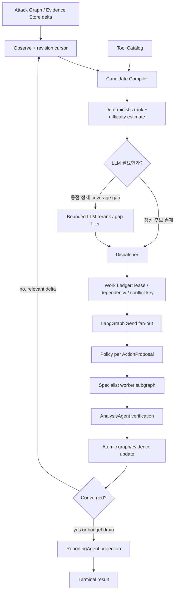

# 오케스트레이션 구체 구현 계획

> 상태: 구현 기준안 1.6 — Phase 1~8 핵심 구현, run-scoped context/ledger 및 Phase 9 reconciliation tick 구현  
> 범위: Agent Team의 **오케스트레이션**만 다룬다. Attack Graph와 Event Bus는 소유 팀의 공개 포트 및 현재 서비스를 사용한다.  
> 기본 전문 에이전트: `ReconAgent`, `WebApiAgent`, `MobileAgent`, `AnalysisAgent`, `ReportingAgent`  
> 원칙: 범용 실행·체크포인트·모델 호출·MCP 연결은 SDK를 최대한 사용하고, 레드팀 성능을 가르는 상태·우선순위·예산·수렴 로직에만 자체 구현을 집중한다.
> 도메인 경계: 오케스트레이션 커널은 금융·의료·공공 등 업무 의미를 소유하지 않는다. 도메인 Agent/provider가 Attack Graph의 사실을 후보와 정규화된 scheduling signal로 변환하고, 커널은 이를 안전하게 스케줄링한다.

## 1. 결론

우리 구현은 **결정론적 오케스트레이션 커널 + 제한된 LLM 의사결정 + 플러그인형 전문 에이전트**로 간다.

LLM이 임의의 도구나 작업을 발명하게 하지 않는다. 코드가 Attack Graph, Tool Catalog, 정책, 예산, 선행조건으로 실행 가능한 후보 집합을 만들고, LLM은 그 집합 안에서만 후보의 우선순위를 조정하거나 하나를 선택한다. 독립 작업은 병렬 실행하되 동일 대상·동일 상태를 변경하는 작업은 충돌 키로 직렬화한다. 모든 실행은 `ActionProposal -> Control Plane -> ALLOW -> ToolInvocation` 경계를 그대로 통과한다.

성능을 위해 직접 힘줄 부분은 다음 여섯 개다.

1. Attack Graph 기반의 후보 생성과 안정적인 중복 제거
2. 실시간 난이도·정보가치·비용을 반영한 분기 우선순위와 예산 재배분
3. 작업 lease, 의존성, 충돌 키를 가진 안전한 제한 병렬 실행
4. 현재 공격 경로와 역할에 필요한 정보만 주는 문맥 투영
5. 증거 변화가 없는 반복을 끊는 정체 감지와 명시적 수렴 판정
6. 독립 `AnalysisAgent` 검증과 부분 결과를 보존하는 종료·보고 흐름

LangGraph 실행기, SQLite 체크포인트, LiteLLM/모델 어댑터, MCP 어댑터, Pydantic 검증, 비동기 SQLite 입출력은 직접 재구현하지 않는다.

금융권 적용도 이 구조를 바꾸지 않는다. 계좌·거래·고객·승인 상태는 Attack Graph/Core 쪽, 허용 거래·금액·횟수·승인은 Control Plane, 금융 도구는 Capability, 원본 증거·보존은 Evidence Store가 소유한다. 오케스트레이션은 금융 ID나 규칙을 `RuntimeState`/`WorkItem`에 복제하지 않고 graph/evidence ID와 범용 signal만 소비한다.

## 2. 성능 근거를 우선한 벤치마크

아래 수치는 동일 조건의 일대일 리그가 아니다. 벤치마크·모델·예산이 다르므로 절대 순위로 해석하지 않고, **각 프로젝트 내부의 구조·절제 실험과 공개 실행 결과가 지지하는 설계 패턴**만 채택한다.

### 2.1 A급: 성능 수치 또는 절제 실험이 공개된 우선 근거

| 프로젝트 | 공개 성능 근거 | 오케스트레이션에서 가져올 것 | 그대로 가져오지 않을 것 |
|---|---|---|---|
| [Excalibur/PentestGPT v2 연구](https://arxiv.org/abs/2602.17622) | 28개 시스템 분석, CTF 최대 91%, 기존 기준 대비 39~49% 상대 개선, GOAD 5대 중 4대 장악 | 남은 단계, 증거 신뢰도, 문맥 부하, 과거 성공률을 이용한 실시간 난이도 추정; 난이도 기반 탐색/활용 전환과 가지치기 | MCTS 전체를 첫 버전부터 복제하는 것 |
| [TermiAgent 연구](https://arxiv.org/abs/2509.09207) | 510호스트·25서비스·30 CVE의 TermiBench; LMA 제거 시 성공률 66.95% 감소 보고 | 현재 host→service→hypothesis 경로와 역할에 맞는 Located Memory Activation; 전역 대화 전문 대신 위치 기반 문맥 | 별도 Penetration Memory Tree를 Attack Graph와 중복 구축하는 것 |
| [CAI](https://github.com/aliasrobotics/cai) | 2025 주요 CTF에서 41/45 flags와 반복 1위 공개 | 중앙 오케스트레이터, 넓게 먼저 탐색 후 좁게 파고들기, 독립 가설 2~4개 제한 병렬화, 작업별 문맥 격리 | 모든 전문 에이전트에게 전체 대화 복사 |
| [Strix](https://github.com/usestrix/strix/blob/main/benchmarks/README.md) | XBEN black-box 100/104(96%), 평균 약 19분 | 루트는 조정만 수행, 독립 작업만 병렬화, 명시적 wait/finish, 부모 통지, 종료 예산 예약 | 에이전트 자유 대화와 무제한 fan-out |
| [PentestGPT](https://github.com/GreyDGL/PentestGPT/blob/main/benchmark/README.md) | XBEN 90/104(86.5%) 공개 | 단일 canonical state, Supervisor가 한 번에 한 `TaskLease` 발급, 재시도·범위·증거 출처는 코드가 소유 | 상시 judge, 투기적 대기열, 무제한 병렬 스케줄러 |
| [PentestKit](https://github.com/lordx64/pentestkit) | 저장소가 XBEN 104/104를 자체 보고하므로 독립 검증 수치로는 취급하지 않음 | 범위별 공정 시간 배분, 후보 finding 병렬 검증, finding 상태 승격, seen/tested coverage, 강한 단서에 남은 예산을 주는 closer | 자체 보고 수치를 근거로 구조 전체 복제 |

두 연구가 주는 핵심은 명확하다. 도구가 없어서 생기는 실패는 typed tool layer로 싸게 해결할 수 있지만, 긴 공격 체인에서의 실패는 **계획·상태·난이도 추정** 문제라 모델만 키워도 남는다. 따라서 우리 독자 구현 예산은 후자에 쓴다.

### 2.2 B급: 구현 패턴이 우수한 설계 근거

| 프로젝트 | 참고할 패턴 | 채택 수준 |
|---|---|---|
| [PentAGI](https://github.com/vxcontrol/pentagi/blob/main/backend/docs/flow_execution.md) | Flow→Task→Subtask→Action 계층, 반복 도구 호출 Adviser, 최대 횟수가 있는 Reflector, barrier | 작업 계층·정체 신호만 채택 |
| [hackingBuddyGPT](https://github.com/ipa-lab/hackingBuddyGPT/blob/main/src/hackingBuddyGPT/usecases/ad/ad.py) | 오래 사는 planner와 일회성 executor 분리, 자식 예산 carve-out, dirty knowledge merge, 예산 종료 요약 | supervisor/worker 수명 분리와 자식 예산 채택 |
| [Ares](https://github.com/dreadnode/ares/blob/main/docs/red.md) | 결정론적 스케줄러 + 주기적 LLM gap filler, single-flight, dedup signature, rejection TTL, fail-open | LLM을 상시 스케줄러가 아닌 gap filler로 제한 |
| [Clinkz](https://github.com/ptkvaibhav/clinkz) | 공유 SQLite, cooperative stop, 중앙 MessageBus, 도착 순서가 아닌 finding 집합 기반 체인 랭킹 | 집합 기반 재계산·부분 결과 보존 채택 |
| [BreachPilot](https://github.com/braydos-h/BreachPilot) | target namespace blackboard, 제한 critic 협상, phase milestone, semaphore 병렬화 | namespace·bounded critic·명시적 결과 milestone 채택 |
| [PenAgents](https://github.com/lzy756/pen-agents) | LangGraph 역할 라우팅, async SQLite checkpoint, 연속 실패 시 adviser, validator 분리 | SDK 연결과 실패 escalation 패턴 채택 |
| [Pentest-Swarm-AI](https://github.com/AmesianX/pentest-swarm-ai) | event-trigger predicate, agent cursor, per-agent budget, finding supersedes | event wake-up·cursor·supersedes 개념 채택 |

### 2.3 의도적으로 버릴 패턴

- 모든 에이전트가 하나의 거대한 메시지 히스토리를 공유하는 구조
- LLM이 `tool_id`, target, capability를 문자열로 발명하는 구조
- `agent_name == ...` 조건문으로 라우팅하는 구조
- 실패한 dependency를 성공 milestone처럼 처리하는 구조
- 먼저 도착한 병렬 결과가 항상 먼저 실행되는 비결정적 우선순위
- verifier가 원 실행자의 자기평가 한 줄만 믿는 구조
- 보고서 생성을 위해 새로운 finding을 만드는 구조
- 재시도 횟수만 있고 같은 입력·같은 결과·그래프 무변화를 감지하지 못하는 구조
- Attack Graph와 별도로 사실을 중복 보관하는 범용 blackboard

## 3. 현재 코드에서 살릴 것과 갈아낼 것

### 3.1 그대로 유지할 자산

| 현재 자산 | 판단 |
|---|---|
| `OBSERVE -> PLAN -> POLICY -> EXECUTE -> VERIFY -> UPDATE -> REPLAN` | 안전 경계로 유지한다. 상위 루프는 깨지지 않는다. |
| `RuntimeState`는 ID와 counter만 보유 | 유지한다. 도메인 객체와 대형 대화를 넣지 않는다. |
| Attack Graph + Evidence Store가 canonical domain state | 유지한다. 새 메모리 DB에 사실을 복제하지 않는다. |
| `ActionProposal -> ControlPlane -> ToolInvocation` | 절대 우회하지 않는다. 병렬 작업도 각 proposal마다 통과한다. |
| `PlanStep`, precondition, `available_steps()` | Candidate Compiler의 초기 자산으로 확장한다. |
| planner가 제공된 `step_id`만 고름 | 유지하고 typed selection과 score 설명을 추가한다. |
| `Expectation -> Verdict -> Finding` | `AnalysisAgent`의 독립 검증 단계로 확장한다. |
| `AgentRegistry` | 플러그인 메타데이터와 활성화 predicate를 갖도록 확장한다. |
| LangGraph graph/checkpoint/replay | SDK를 계속 사용하고 durable saver로 교체한다. |
| EventPublisher와 correlation/causation | worker lifecycle과 scheduling decision까지 확대한다. |

### 3.2 현재 병목과 교체 방향

| 현재 상태 | 문제 | 목표 상태 |
|---|---|---|
| 등록 순서대로 agent 하나를 끝까지 실행 | 새 증거가 생겨도 이미 finished 처리된 agent가 다시 활성화되지 않음 | graph revision과 activation predicate 기반 재활성화 |
| 한 turn에 후보 하나, 실행 하나 | 독립 host/endpoint도 직렬 처리 | 충돌 없는 `WorkItem` 묶음을 제한 병렬 실행 |
| agent 전체가 `finished_agents`로 영구 종료 | 동적 공격 표면에 맞지 않음 | `agent cursor + last_seen_revision`; 새 관련 delta가 생기면 재실행 |
| `PlanStep.tool_id` 하드코딩 | Adapter 교체와 tool discovery를 반영 못 함 | capability/operation/schema로 Tool Catalog에서 후보를 resolve |
| InMemorySaver | 프로세스 종료 시 유실 | `AsyncSqliteSaver`; 배포 확장 시 Postgres saver로 교체 가능 |
| `max_steps`, 연속 실패만으로 종료 | 의미 없는 반복과 미탐 coverage를 구별 못 함 | convergence, coverage gap, active lease, pending approval를 함께 판정 |
| 전체 GraphObservation이 모든 역할에 동일 | 역할과 경로에 무관한 문맥이 누적 | `ContextProjector`로 역할·target·branch별 bounded view 생성 |
| LLM은 후보 첫 선택 수준 | 난이도와 분기 비용이 없음 | 코드 score + 제한 LLM rerank/gap fill |

## 4. 목표 구조



중앙 오케스트레이터는 도구를 직접 실행하지 않는다. 후보 생성, 우선순위, lease 발급, 병렬도, 예산, 정체와 종료만 소유한다. 전문 에이전트는 자신의 `WorkItem`을 받아 `ActionProposal`을 만들고, 결과를 typed `AgentResult`로 반환한다.

## 5. 핵심 내부 계약

다음 타입은 Agent Team 내부 계약이다. frozen core contract를 바로 바꾸지 않고 구현할 수 있다.

### 5.1 `AgentDefinition`

```python
class AgentDefinition(BaseModel):
    agent_id: AgentId
    role: str
    contract_version: str = "1"
    activation_rules: list[ActivationRule]
    capabilities: list[str]
    planner_kind: Literal["deterministic", "llm_rerank", "worker_subgraph"]
    context_profile: str
    max_concurrency: int = 1
    budget_weight: float = 1.0
    priority_band: int = 100
```

- `activation_rules`는 graph node/edge/finding/artifact predicate로 선언한다.
- Registry는 정의만 보관한다. 스케줄 상태는 `WorkLedger`와 graph revision cursor가 보관한다.
- 새 에이전트 추가는 정의, 후보 공급자, context projector, result reducer 등록으로 끝낸다.
- 중앙 router와 기존 에이전트를 수정하게 만드는 역할별 `if`는 금지한다.

### 5.2 `WorkItem`과 `TaskLease`

```python
class WorkStatus(StrEnum):
    PENDING = "pending"
    LEASED = "leased"
    RUNNING = "running"
    SUCCEEDED = "succeeded"
    FAILED = "failed"
    BLOCKED = "blocked"
    CANCELLED = "cancelled"
    STALE = "stale"

class WorkItem(BaseModel):
    work_id: str
    candidate_key: str
    agent_id: AgentId
    graph_revision: int
    target_node_ids: list[GraphNodeId]
    hypothesis_id: HypothesisId | None
    prerequisite_ids: list[str]
    conflict_keys: list[str]
    priority: PriorityScore
    budget: WorkBudget
    status: WorkStatus
    attempt: int = 0

class TaskLease(BaseModel):
    work_id: str
    owner: str
    issued_at: datetime
    expires_at: datetime
    heartbeat_at: datetime
```

`candidate_key`는 다음 canonical tuple의 안정적 hash다.

```text
(contract_version, agent_role, capability, operation,
 target_node_ids(sorted), hypothesis_id, prerequisite_fingerprint)
```

graph revision은 발견 시점을 기록하지만 중복 키 자체에는 넣지 않는다. revision을 키에 넣으면 그래프가 갱신될 때 동일 작업이 무한 재생산되기 때문이다. 재실행은 `repeat_policy`, 입력 fingerprint 변화, TTL로 별도 결정한다.

`conflict_keys` 예시는 `target:host-1`, `session:auth-A`, `artifact:apk-X`, `hypothesis:hyp-7`이다. 겹치는 쓰기 작업은 한 batch에 넣지 않는다. 읽기 전용 분석·보고는 충돌 키를 갖지 않을 수 있다.

### 5.3 `AgentResult`

```python
class AgentResult(BaseModel):
    work_id: str
    outcome: Literal["succeeded", "failed", "blocked", "partial"]
    evidence_ids: list[EvidenceId]
    changed_node_ids: list[GraphNodeId]
    finding_ids: list[FindingId]
    proposed_followups: list[FollowupHint]
    retry_class: Literal["never", "transient", "input_changed", "human_required"]
    graph_delta_count: int
    evidence_delta_count: int
    compact_summary: str
```

요약은 사용자 표시와 다음 planner의 힌트일 뿐 canonical 사실이 아니다. 실제 판단은 ID로 Attack Graph와 Evidence Store를 다시 읽는다.

## 6. 후보 생성과 Tool Catalog 계약

`CandidateCompiler`는 다음 순서로 동작한다.

1. Registry에서 현재 graph delta에 활성화되는 `AgentDefinition`만 찾는다.
2. 각 agent/provider가 자신의 도메인 playbook/template을 Attack Graph에 resolve하여 `CandidateDraft`를 낸다. Compiler 자체는 금융·모바일·웹 업무 의미를 해석하지 않는다.
3. canonical `capability + operation`과 provider가 명시한 preferred ToolId의
   namespace가 일치하는지 검사한다.
4. 현재 structural Tool Catalog에서는 exact ToolId descriptor만 조회해 capability
   tag, schema, health를 검증한다. tag만 같은 다른 Tool로 대체하지 않는다.
   정책 허용 여부의 최종 판단은 이후 모든 `ActionProposal`에 대해 Control Plane이 수행한다.
5. target과 schema를 채워 `ExecutableCandidate`를 만든다.
6. canonical `candidate_key`로 이미 성공·실패·진행 중인 동일 작업을 제거한다.
7. hard constraint를 통과한 후보만 scorer와 LLM에 제공한다.

AI는 Adapter 종류, MCP server 이름, 등록 과정을 모른다. AI가 보는 것은 `candidate_id`, capability, operation, target, 예상 정보가치, 비용, 위험, schema 요약이다. preferred ToolId binding은 worker context 내부에만 보관하고, ALLOW 뒤 EXECUTE에서 action/step/namespace/catalog/health를 다시 검증한 뒤 최종 사용한다.

확정 계약상 `ActionProposal`에는 `tool_id`를 넣지 않는다. 현재 구현은 내부 `ExecutableCandidate/PlanStep.tool_id`를 explicit preferred binding으로 `execute_node`까지 전달한다. 여러 Tool 중 action-aware 선택은 `docs/proposals/tool-selection-port.md`의 Core Port가 PM 승인된 뒤 이 seam에서 교체한다. 그 전에는 오케스트레이션이 외부 core contract를 선제 변경하거나 `<capability>.<operation>`을 ToolId로 추측하지 않는다.

제안된 action-aware port 승인 뒤의 도구 선택 정책도 결정론적으로 유지한다.

```text
healthy > degraded > unknown
schema exact match > coercible match
lower risk > higher risk              (정보가치가 같을 때)
lower historical failure rate
stable tool_id lexical order          (완전 동점 tie-break)
```

## 7. 우선순위·난이도·예산: 가장 힘줄 부분

### 7.1 두 단계 scoring

먼저 코드가 모든 후보에 base score를 부여한다.

```text
priority =
    2.0 * expected_information_gain
  + 1.8 * objective_progress
  + 1.4 * evidence_gap_reduction
  + 1.0 * downstream_unblock_count
  + 0.8 * historical_success
  - 1.4 * estimated_difficulty
  - 1.0 * expected_cost
  - 1.2 * risk_penalty
  - 2.0 * repetition_penalty
```

초기 계수는 설정값이며 마법 상수로 코드에 흩뿌리지 않는다. 점수 구성요소와 선택 사유를 event로 남긴다. 절대 점수보다 동일 batch 내 순위가 중요하다.

각 신호의 **의미와 원천**은 분리한다.

| 신호 | 의미를 만드는 곳 | 오케스트레이션이 하는 일 |
|---|---|---|
| objective/information/evidence gap/impact | domain Agent/provider가 Attack Graph·Evidence ID에서 산출 | 범위 검증 후 정렬에 사용 |
| estimated difficulty/context load/repetition | 오케스트레이션 runtime telemetry | 직접 계산 |
| tool health/schema/cost hint | Capability의 Tool Catalog | 읽어서 후보 binding과 비용 추정에 사용 |
| 허용 여부, 강제 한도, 승인 | Control Plane | 해석하거나 복제하지 않고 결정을 준수 |

`impact`는 범용 정규화 값이지 `monetary_impact` 같은 금융 전용 필드가 아니다. 금융 provider가 업무 영향을 `impact`로 투영할 수는 있지만 scheduler가 계좌·금액·거래 상태를 직접 이해해서는 안 된다. signal에는 `source_ref`, `graph_revision`, `producer_version`을 붙여 출처 없는 LLM 점수가 우선순위를 좌우하지 못하게 한다.

### 7.2 실시간 Task Difficulty Index

Excalibur의 성능 결과를 벤치마킹하되 복잡한 학습 모델부터 만들지 않는다.

```text
difficulty =
    w_h * normalized_remaining_horizon
  + w_f * recent_failure_rate
  + w_c * projected_context_load
  + w_e * (1 - evidence_confidence)
  + w_t * tool_unreliability
```

- `remaining_horizon`: 현재 graph에서 objective까지 필요한 미충족 milestone 수
- `recent_failure_rate`: 같은 capability/target class의 Laplace-smoothed 성공률
- `projected_context_load`: context projector가 산출한 token estimate / 모델 window
- `evidence_confidence`: 현재 branch의 provenance confidence 집계
- `tool_unreliability`: 동일 tool의 최근 retryable/non-retryable failure 비율

난이도가 높다는 이유만으로 즉시 버리지 않는다. `objective_progress`가 높으면 exploit하고, 대체 branch가 있으며 난이도만 높으면 postpone한다. 동일 branch가 두 차례 평가에서 계속 고난도·무진전이면 prune하고 이유를 graph/event에 남긴다.

### 7.3 탐색/활용 정책

- 초반에는 host/service/endpoint/artifact coverage를 넓히는 breadth-first batch를 우선한다.
- 재현 가능한 강한 evidence가 생기면 해당 branch의 Analysis/후속 작업에 예산을 집중한다.
- Control Plane이 허용한 총예산 안에서 검증·보고용 내부 reserve를 최소 20%로 잠근다. 이 reserve는 Control Plane의 금액·횟수·시간 제한을 넓힐 수 없다.
- agent별 고정 quota가 아니라 `budget_weight`, branch promise, 미사용 reserve로 동적 배분한다.
- 한 target/scope가 wall-clock을 독점하지 못하도록 scope slice를 둔다.
- 종료 직전 verified finding이 없고 강한 단서가 하나 있으면 `closer` 1회를 허용하되 reserve를 침범하지 않는다.

### 7.4 LLM 호출 조건

LLM은 다음 조건 중 하나일 때만 개입한다.

- 상위 후보 점수가 epsilon 이내로 동률
- coverage gap은 있는데 playbook 후보가 없음
- 같은 branch가 정체되어 대체 가설이 필요함
- 여러 evidence를 묶어 follow-up 가설을 만들어야 함

LLM 응답은 반드시 제공한 `candidate_id` 선택 또는 typed `FollowupHint`다. `FollowupHint`는 다시 Candidate Compiler를 통과해야 하며 즉시 실행권이 없다. LLM 장애나 schema 오류 시 base score 순으로 계속 진행한다.

## 8. 병렬 실행과 상태 일관성

LangGraph의 `Send` fan-out과 super-step을 사용한다. 직접 worker pool 프레임워크를 만들지 않는다.

1. Dispatcher가 우선순위 순으로 후보를 순회한다.
2. 전역, agent별, target별 semaphore와 budget을 확인한다.
3. 기존 active lease 및 conflict key와 겹치지 않는 작업만 batch에 넣는다.
4. WorkLedger에서 lease를 원자적으로 획득한 작업만 `Send("worker", work_state)` 한다.
5. worker마다 격리된 transient state와 context projection을 사용한다.
6. 성공한 branch는 자체 evidence/graph update를 완료하고, reducer에는 ID와 delta만 반환한다.
7. 합류 시 도착 순서가 아니라 최신 canonical graph 위에서 후보 전체를 다시 계산한다.

중요한 규칙은 다음과 같다.

- 정책 승인과 tool invocation은 작업별로 독립 수행한다.
- 동일 `candidate_key`의 동시 lease는 DB unique constraint로 막는다.
- lease 만료는 무조건 성공/실패로 간주하지 않고 `STALE`로 회수한다.
- 외부 side effect 뒤 worker가 죽을 수 있으므로 `action_id`와 `invocation_id`를 통한 idempotency/reconciliation을 먼저 확인한다.
- dependency는 `SUCCEEDED`뿐 아니라 `FAILED/BLOCKED/CANCELLED`도 명시적으로 해석한다. 실패를 성공 milestone로 위장하지 않는다.
- cooperative stop 신호를 먼저 보내 partial `AgentResult`를 저장하고, hard cancel은 grace period 뒤 최후 수단으로 사용한다.
- reporting은 active lease가 0이 되거나 drain timeout이 끝난 뒤 시작한다.

## 9. 문맥과 기억

별도 범용 vector memory를 1차 구현에 넣지 않는다. Attack Graph와 Evidence Store가 이미 구조화된 기억이다. TermiAgent의 LMA를 다음처럼 **projection**으로 구현한다.

`ContextProjector(agent_id, work_item)`은 다음만 불러온다.

- 해당 target node와 제한 깊이의 ancestor/neighbor
- 현재 hypothesis와 prerequisite chain
- 관련 evidence의 typed excerpt와 provenance
- 같은 candidate/capability의 최근 실패 요약
- confirmed/refuted finding과 supersedes 관계
- agent 역할에 필요한 Tool Catalog schema 요약
- 전역 objective와 남은 예산

역할별 profile은 다음과 같다.

| 역할 | 포함 | 제외 |
|---|---|---|
| Recon | scope, host/service coverage, 이전 probe 결과 | 상세 finding 서술, 보고서 문장 |
| WebApi | 선택 endpoint, auth/session context, linked service, 관련 evidence | 무관 host와 mobile 정적 분석 전문 |
| Mobile | artifact metadata, component/deeplink/WebView, linked endpoint | 무관 네트워크 전체 로그 |
| Analysis | hypothesis, expectation, 원 evidence, 반증 evidence, provenance | 도구 전체 목록, 장황한 대화 |
| Reporting | terminal graph projection, verified/inconclusive findings, scope gap | 새 action 후보와 실행 도구 |

각 projection은 token budget을 넘기면 `IDs + typed facts + 최근 delta`를 우선하고 narrative를 줄인다. 요약문은 캐시 가능하지만 원본을 대체하지 않는다. worker 대화 history는 작업 단위로 격리하고 supervisor에게 전체 transcript를 합치지 않는다.

## 10. 기본 에이전트 5개의 정확한 책임

### 10.1 `ReconAgent`

- 활성화: in-scope Host가 미탐색이거나, 새 Host/Service 후보가 생기거나, 관측이 stale
- 입력: scope와 host/service coverage projection
- 출력: Host/Service/Endpoint/Technology 관측과 Evidence ID
- 하지 않는 일: finding 확정, 장기 exploit chain, 보고서 작성
- 기본 병렬 단위: host; 같은 host의 intrusive 작업은 conflict key로 직렬화

### 10.2 `WebApiAgent`

- 활성화: HTTP(S) Service, Endpoint, API schema 또는 web 관련 open hypothesis 존재
- 입력: endpoint/auth-context 단위 projection
- 출력: 관측, candidate evidence, follow-up hypothesis
- 하지 않는 일: 자기 finding 최종 확정, 무관 host 전체 재정찰
- 기본 병렬 단위: endpoint 또는 독립 auth context

### 10.3 `MobileAgent`

- 활성화: APK/IPA Artifact가 존재할 때만; 없으면 작업을 생성하지 않음
- 입력: artifact와 연결된 endpoint/component projection
- 출력: component/deeplink/WebView/storage/TLS 관측, linked endpoint, candidate evidence
- 하지 않는 일: artifact가 없는데 빈 agent turn 소비
- 기본 병렬 단위: artifact; 동일 artifact 변환/분석 쓰기는 직렬화

### 10.4 `AnalysisAgent`

- 활성화: 미검증 evidence, open/inconclusive hypothesis, candidate finding 존재
- 입력: 기대값, 증거, provenance, 반증, 필요한 최소 재현 context
- 출력: `Verdict`, finding 상태 변화, 추가 검증용 `FollowupHint`
- 원 실행 agent와 문맥을 분리해 confirmation bias를 줄임
- 직접 도구가 필요하면 별도의 `ActionProposal`을 만들며 정책을 우회하지 않음
- finding 상태: `suspected -> corroborated -> reproduced -> impact_proven` 또는 `refuted/inconclusive`

### 10.5 `ReportingAgent`

- 활성화: 정상 수렴, 예산 drain, 사용자 중단, fatal 종료 뒤
- 입력: terminal graph projection과 evidence/finding IDs
- 출력: 보고서 projection 및 미검증/미탐 coverage 명시
- read-only로 운영하며 새 hypothesis/finding을 만들지 않음
- 부분 실행이어도 보고서를 생성하고 종료 이유를 포함

## 11. 재활성화, 정체 감지, 수렴

### 11.1 agent cursor

`finished_agents` 영구 목록을 없애고 에이전트마다 다음을 기록한다.

```text
last_seen_graph_revision
last_candidate_fingerprint
active_work_count
cooldown_until
```

관련 graph delta가 없고 후보 fingerprint가 같으면 다시 깨우지 않는다. 새 Endpoint/Artifact/Evidence가 생기면 해당 activation rule을 가진 agent만 다시 활성화한다. Event Bus는 wake-up 신호이며 canonical queue가 아니다. event를 놓쳐도 다음 graph revision scan에서 복구 가능해야 한다.

### 11.2 정체 신호

아래를 별도 계수한다.

- 동일 `candidate_key` 반복
- 동일 tool/argument/target signature 반복
- `graph_delta_count == 0 and evidence_delta_count == 0`
- 동일 error class 연속 발생
- LLM이 tool-less/invalid structured response 반환
- context load 증가 대비 objective progress 없음

첫 정체는 deterministic fallback, 두 번째는 bounded LLM adviser, 세 번째는 branch postpone/prune으로 처리한다. 전역 run을 곧바로 죽이지 않는다. 다른 branch가 있으면 계속한다.

### 11.3 수렴 조건

아래가 모두 참일 때 정상 수렴이다.

```text
no runnable candidate
and no active lease
and no pending policy approval
and no unprocessed relevant graph revision
and (coverage obligations satisfied or every gap has an explicit blocked reason)
```

예산·시간·사용자 중단은 정상 수렴과 구분된 termination reason을 갖는다. 어느 종료든 `ReportingAgent`로 drain한다. `NO_ACTIONABLE_PLAN` 하나로 모든 상황을 뭉개지 않는다.

## 12. SDK로 쌀먹할 범위와 자체 구현 범위

| 영역 | 선택 | 이유 |
|---|---|---|
| 상태 그래프, 조건 edge, fan-out | LangGraph `StateGraph`, `Send`, subgraph | 실행기와 병렬 합류를 재구현할 이유 없음 |
| checkpoint/replay | 개발·단일 호스트는 `AsyncSqliteSaver`; 규모 확대 시 `AsyncPostgresSaver` | 현재 runner API 유지 가능 |
| 모델 provider | 기존 `LLMClient` 뒤 LiteLLM/LangChain adapter | provider별 SDK 분기 제거 |
| typed output | Pydantic + model structured output | 문자열 marker parsing 금지 |
| MCP discovery/call | `langchain-mcp-adapters`와 Capability 팀 `MCPAdapter` | 외부 MCP 객체는 core 경계 밖에서 normalize |
| SQLite async I/O | `aiosqlite` | lease ledger의 최소 SQL만 자체 작성 |
| retry | LangGraph retry policy + tool error의 `retryable` | 범용 backoff 재작성 금지 |
| schema validation | Pydantic | 수동 dict 검사 금지 |
| orchestration tracing | 기존 EventPublisher/correlation chain | 새 telemetry bus 금지 |
| 후보 compiler/score/difficulty | **자체 구현** | 우리 Attack Graph와 red-team 성능의 핵심 |
| lease/conflict/dependency | **자체 최소 구현** | SDK store만으로 security side effect 일관성 보장 불가 |
| context projection | **자체 구현** | 역할·공격 경로 의미가 제품 핵심 |
| convergence/stuck logic | **자체 구현** | 범용 agent SDK가 도메인 완료를 알 수 없음 |

주의: SQLite checkpointer는 큰 state를 장기간 누적하는 운영 DB가 아니다. GraphState에는 ID/counter만 유지하고 retention을 둔다. 단일 프로세스·개발 단계 이후에는 saver factory만 Postgres로 바꿀 수 있게 한다.

### 12.1 금융권 적용 시 책임 경계

공식 자료는 금융권에서 업무 흐름과 통제의 중요성을 분명히 보여주지만, 그것이 곧 오케스트레이션 커널이 금융 도메인을 소유해야 한다는 뜻은 아니다.

- [금융보안원의 2026년도 취약점 분석·평가기준 개정](https://www.fsec.or.kr/bbs/detail?bbsNo=11848&menuNo=69)은 금융회사 전산시스템과 운영환경 전반을 분야별 기준으로 평가한다. 즉 단일 Agent의 웹 점검 목록이 아니라 여러 소유 영역을 연결하는 평가 문제다.
- [금융보안원의 금융권 Open API 보안점검 가이드 안내](https://www.fsec.or.kr/bbs/detail?bbsNo=6156&menuNo=69)는 이용자·이용기관·운영기관 영역을 구분하고 고위험 거래 접근키, 인증, 유출 완화 등을 다룬다. 이는 Agent 하나가 전부 판단할 내용이 아니라 Graph/Control/Capability/Evidence의 합성 책임이다.
- [OWASP API6:2023](https://api-security.owasp.org/editions/2023/en/0xa6-unrestricted-access-to-sensitive-business-flows/)도 민감 업무 흐름 식별은 business layer, 보호수단 선택은 engineering layer로 구분한다. Orchestration은 이 두 영역에서 생성된 후보와 제약을 실행 순서로 조정한다.
- [PCI DSS](https://www.pcisecuritystandards.org/standards/pci-dss/)는 카드정보를 저장·처리·전송하거나 그 환경의 보안에 영향을 주는 시스템에 기술·운영 기준을 적용한다. 적용 범위와 데이터 분류는 Engagement/Control/Evidence 책임이며 scheduler의 하드코딩 대상이 아니다.

책임 배치는 다음으로 고정한다.

| 금융 관련 내용 | 소유자 | 오케스트레이션 접점 |
|---|---|---|
| 고객·계좌·거래·수취인·업무 상태와 관계 | PM/Core + Attack Graph 담당 | GraphNode/Edge/Hypothesis ID와 projection을 읽음 |
| 허용 거래, 테스트 금액·횟수·시간, 승인, scope/ROE | Control Team | `PolicyDecision`을 그대로 강제 |
| 금융 API/모바일/분석 도구와 안전한 Adapter | Capability Team | Tool Catalog와 `ToolGateway` 포트만 사용 |
| 원본 결과, 민감정보 처리, 보존, 감사 증거 | Evidence/Control Team | Evidence ID와 provenance만 참조 |
| 금융 업무 가설·불변조건·candidate/conflict signal | 금융 domain Agent/provider | 등록된 범용 candidate로 수신 |
| 순위, lease, 병렬도, retry, 정체, 수렴 | Orchestration | 직접 구현 |

따라서 `WorkItem`에 `account_id`, `transaction_stage`, `monetary_limit`를 추가하지 않는다. 금융 provider가 필요하면 graph node ID를 `target_node_ids`, 자원 충돌을 `conflict_keys`(예: `resource:<opaque-id>`), 업무 영향도를 정규화된 `impact`로 제공한다. 커널은 opaque ID의 금융 의미를 해석하지 않는다.

`FinancialBusinessLogicAgent`나 `TransactionIntegrityAgent`는 현재 기본 5개 Agent에 포함하지 않는다. 금융 요구와 graph ontology가 합의된 뒤 **동일 Registry plugin 계약을 사용하는 선택적 domain pack**으로 추가한다. 그때도 중앙 graph/router/scheduler는 수정하지 않는 것이 확장성 완료 조건이다.

## 13. 파일 단위 구현 순서

각 단계는 독립적으로 merge 가능하게 자른다.

### Phase 0 — 현재 동작 고정

- 수정: `docs/agent/orchestration.md`
  - 현재 loop와 새 용어(`candidate`, `work`, `lease`, `revision`)를 연결한다.
- 추가: `tests/orchestration/test_current_behavior_characterization.py`
  - 기존 단일 action, policy deny, verify/update, termination 동작을 고정한다.
- 목적: 구조 교체 중 기존 계약의 의미가 슬쩍 바뀌는 것을 막는다.

### Phase 1 — Registry를 플러그인 계약으로 확장 (구현됨)

- 수정: `src/redteam/orchestration/agents/base.py`
  - `AgentDefinition`, `ActivationRule`, `ContextProfile`, version 추가
  - 기존 `AgentSpec` 입력을 호환 adapter로 유지
- 수정: `src/redteam/orchestration/agents/registry.py`
  - role별 조건문 없는 provider registration
  - 기본 5개 agent definition 등록
- 추가: `src/redteam/orchestration/agents/providers.py` (구현됨)
  - 후보 공급자 protocol과 registration
- 추가: `src/redteam/orchestration/agents/result.py`
  - `AgentResult`, `FollowupHint`
- 완료 기준: 빈 APK/IPA 환경에서 MobileAgent는 turn을 먹지 않고, 새 agent는 중앙 graph 수정 없이 등록된다.

### Phase 2 — Candidate Compiler와 catalog binding (구현됨)

- 추가: `src/redteam/orchestration/candidates/models.py`
  - `CandidateDraft`, `ExecutableCandidate`, `CandidateKey`, `PrioritySignals`, `PriorityScore`
- 추가: `src/redteam/orchestration/candidates/compiler.py`
  - provider draft 검증 + catalog resolve + dedup; 도메인 규칙 해석 금지
- 추가: `src/redteam/orchestration/candidates/scoring.py`
  - provenance가 있는 정규화 signal만 받는 base score와 tie-break
- 수정: `src/redteam/orchestration/agents/base.py`
  - `available_steps()`를 compiler 내부 호환 provider로 이동하되 외부 API는 당분간 유지
- 외부 의존: Capability/PM이 제공할 Tool Catalog port. 준비 전에는 현재 `PlanStep.tool_id` adapter 사용.

### Phase 3 — WorkLedger와 lease (구현됨)

- 추가: `src/redteam/orchestration/work/models.py`
  - `WorkItem`, `TaskLease`, `WorkStatus`, `WorkBudget`
- 추가: `src/redteam/orchestration/work/store.py`
  - 내부 `WorkStore` protocol
- 추가: `src/redteam/orchestration/work/sqlite.py`
  - unique candidate lease, heartbeat, expire/reclaim, dependency query
- 추가: `src/redteam/orchestration/work/memory.py`
  - 빠른 단위 테스트용 backend
- 수정: `src/redteam/orchestration/context.py`
  - `work_store`, `tool_catalog` optional dependency 추가; 호환 default 제공
- 원칙: ledger에는 작업 상태와 ID만 저장하며 evidence/graph fact를 복제하지 않는다.

### Phase 4 — durable checkpoint와 실행 수명 (SQLite 구현됨)

- 수정: `src/redteam/orchestration/checkpointing.py`
  - factory를 memory/sqlite/postgres 선택형으로 변경
  - `AsyncSqliteSaver` lifecycle을 async context로 관리
- 수정: `src/redteam/orchestration/runner.py`
  - `start/resume/drain/close`, thread ID, resource ownership 명확화
- 수정: `src/redteam/orchestration/settings.py`
  - saver URL, retention, global/agent/target concurrency, drain timeout, reserve budget
- 대형 artifact와 raw tool output은 checkpoint에 넣지 않고 ID만 둔다.

### Phase 5 — scheduler + 제한 병렬 fan-out (구현됨)

- 추가: `src/redteam/orchestration/scheduler.py`
  - activation, score ordering, budget, conflict selection, lease issuance
- 추가: `src/redteam/orchestration/nodes/dispatch.py`
- 추가: `src/redteam/orchestration/subgraphs/worker.py`
  - 기존 POLICY→EXECUTE→VERIFY→UPDATE를 작업 단위 subgraph로 감싼다.
- 수정: `src/redteam/orchestration/graph.py`
  - compile/rank→dispatch→`Send` fan-out→join→replan
- 수정: `src/redteam/orchestration/state.py`
  - transient `work_ids`, `completed_result_ids`; 큰 결과 객체 금지
- 수정: `src/redteam/orchestration/router.py`
  - agent 이름이 아닌 상태/후보/lease 기반 edge
- 기존 node 함수는 재사용하고 한 번에 갈아엎지 않는다.

### Phase 6 — 역할별 context projection (1차 구현됨)

- 추가: `src/redteam/orchestration/context_projection/base.py`
- 추가: `src/redteam/orchestration/context_projection/profiles.py`
- 추가: `src/redteam/orchestration/context_projection/budget.py`
- 수정: `src/redteam/orchestration/agents/planners.py`
  - 전체 observation 문자열 대신 typed bounded projection
  - LLM은 candidate rerank/gap fill 때만 호출
- projection cache key: `(agent_id, work_id, graph_revision, profile_version)`

### Phase 7 — 난이도·정체·수렴 (1차 구현됨)

- 추가: `src/redteam/orchestration/difficulty.py`
  - TDI 구성요소와 설명 가능한 score
- 추가: `src/redteam/orchestration/progress.py`
  - graph/evidence delta, coverage, objective progress
- 추가: `src/redteam/orchestration/convergence.py`
  - runnable/lease/approval/revision/gap 판정
- 수정: `src/redteam/orchestration/nodes/replan.py`
  - finished list 호환 유지 + revision cursor·branch pruning·termination reason 확대
- 수정: `src/redteam/orchestration/settings.py`
  - 계수, epsilon, prune threshold, closer budget

### Phase 8 — 5개 기본 agent 실제 연결 (핵심 경로 구현됨)

- 추가: `src/redteam/orchestration/agents/recon.py`
- 추가: `src/redteam/orchestration/agents/web_api.py`
- 추가: `src/redteam/orchestration/agents/mobile.py`
- 추가: `src/redteam/orchestration/agents/analysis.py`
- 추가: `src/redteam/orchestration/agents/reporting.py`
- 각 파일은 definition, activation, candidate provider, context profile, result reducer만 노출한다.
- 도구 구현은 Capability 팀 소유이며 여기서는 catalog selector와 ActionProposal 생성만 한다.
- 금융 전문 Agent는 이 단계에 억지로 추가하지 않는다. 금융 ontology·정책·도구 계약이 확정되면 같은 registration 경로의 선택적 domain pack으로 추가한다.

현재 구현은 Recon/WebApi/Mobile을 catalog-bound 실행 spec으로 등록한다.
Analysis는 독립 `AnalysisVerifier` 포트와 기본 deterministic reviewer로 VERIFY에
연결했고, Reporting은 terminal canonical-state projection으로 연결했다. Web/Mobile은
해당 graph target과 capability tag를 가진 ToolDescriptor가 동시에 있을 때만 실행된다.
~~단, 현재 Control scope checker는 AssetTarget identity를 허용 범위와 대조하지
못해 기본 Control Plane에서 Mobile action을 DENY한다.~~ **해결됨**:
`EngagementScope.allowed_assets`/`denied_assets` (canonical `asset_id` exact
match, host 계열과 별도 규칙 — `redteam.control.scope._check_asset_scope`)로
Mobile action도 이제 명시적으로 ALLOW 가능하다. Scope 밖 asset은 여전히
fail-closed DENY.

### Phase 9 — Event Bus wake-up과 관측성 (reconciliation tick 구현, daemon host 남음)

- 추가: `src/redteam/orchestration/wakeup.py`
  - 관련 graph/evidence/policy event를 run wake-up으로 coalesce
- 수정: `src/redteam/orchestration/runner.py`
  - event-triggered tick + 주기적 reconciliation scan
- 수정: orchestration node 전반
  - candidate score, lease lifecycle, prune, context truncation, convergence event 발행
- Event Bus가 유실돼도 canonical stores를 scan해서 복구한다.

`EventWakeup`은 burst coalescing, event-id dedup, run/engagement filtering을 수행하며
timeout을 `periodic_reconciliation` tick으로 반환한다. `reconcile_once()`는 quiescent
run을 canonical store 기준으로 실제 재실행하되 budget/max-step/failure hard stop은
부활시키지 않는다. 이벤트가 없는 periodic tick은 canonical graph fingerprint가 실제로
달라졌을 때만 run을 깨워 idle 상태가 step budget을 소모하지 않는다. 이 tick을 반복
호출할 daemon/worker host는 배포 계층에 남아 있다.

승인 재개는 아직 연결하지 않는다. 현재 ControlPlane port에는 resolved approval을
조회·소비해 새 `ALLOW` 결정을 얻는 계약이 없으므로 `ActionApproved` event만 믿고
실행하면 정책 gate 우회가 된다. 현재 run은 `approval_pending`으로 종료하고 approval
ID와 blocked/inconclusive 결과를 partial report에 남긴다. Control 팀 계약 전에는
이를 임의로 재개하지 않는다.

공유 Attack Graph node에는 engagement/run namespace가 없으므로 integrity/cleanup은
store 전체 기준이다. 기본 app처럼 engagement별 store를 쓰지 않고 multi-tenant graph를
공유하려면 PM/Attack Graph 팀의 tenancy 계약이 필요하며 orchestration이 label 추론으로
임의 격리하지 않는다.

추가 구현된 안정성 규칙:

- 실행 중인 tool call은 TTL 내 주기적으로 lease를 heartbeat하며, 실행 전
  lease 상실은 Tool Gateway 호출 전에 fail-closed 처리한다.
- enqueue 후 acquire 전 크래시나 dependency 대기로 남은 기존 `PENDING`
  후보를 다음 PLAN에서 다시 결합한다. terminal failure dependency는 자식을
  원인 포함 `BLOCKED`로 전파해 영구 pending 교착을 막는다.
- `actions_by_agent`로 fan-out에서도 Agent별 action ceiling을 강제한다.
- active role은 `priority_band` 순서와 round-robin으로 교대해 Recon frontier가
  specialist를 굶기지 않으며, fan-out slot은 활성 role의 `budget_weight` 비율로 제한한다.
- WorkLedger는 non-repeatable candidate의 terminal history까지 영구 dedup하고,
  repeatable candidate도 이전 작업이 terminal이 된 뒤에만 다시 받는다.
- runner 예외·취소 시 `drain_timeout_seconds` 안에 해당 run의 pending/self-owned
  lease를 FAILED로 abandon하고 원래 예외를 다시 올려 orphan active work를 막는다.
- ledger history·convergence·report는 `run_id`로 격리하되 conflict key lease는
  공유 store 전체에서 충돌시켜 동시 run의 동일 자원 조작을 막는다.
- role context projection은 bounded LRU를 공유하되 graph revision을 key에 포함하고
  deep copy를 반환해 stale context와 mutable aliasing을 막는다.
- finished-agent cursor는 전역 graph hash가 아니라 role `ContextProfile` 범위로
  계산해 무관한 delta가 모든 specialist를 깨우는 문제를 막는다.
- Evidence excerpt는 candidate target과 명시적으로 연결된 record만 포함하고,
  raw payload 대신 ID·source·digest·summary만 role별 상한 내에서 전달한다.
- role별 `max_candidates`로 graph target 확장 이후의 frontier를 제한해 대형
  playbook/공격표면이 projection traversal과 LLM prompt를 폭발시키지 않게 한다.
- 고난도 repeatable branch가 같은 stable candidate key로 연속 실패한 경우에만 prune하며,
  objective progress가 강한 후보는 override하고 `CandidatePruned` event로 근거를 남긴다.
- terminal report는 canonical ledger/evidence/finding에서 successful work/action,
  evidence/action, verified finding/action, dead-end work ratio를 계산한다.
- fan-out `WorkerOutcome` reducer는 AGGREGATE 직후 명시적으로 비워 장기 실행
  checkpoint가 과거 batch 결과를 선형 누적하지 않게 한다.

## 14. 구현 테스트·검증 설계

이 절은 구현 안전을 위한 필수 작업이다. 다만 사용자의 지시대로 아래 17장 자기평가 점수에는 **단 1점도 배정하지 않는다.**

### 14.1 단위 테스트

- candidate key가 graph revision 변화만으로 바뀌지 않는지
- precondition/schema/health/policy 가능성이 없는 후보가 LLM에 도달하지 않는지
- score tie가 stable lexical order로 재현되는지
- lease unique/expiry/reclaim과 heartbeat race
- dependency의 success/failure/blocked 전파
- conflict key가 같은 작업은 같은 batch에 안 들어가는지
- role별 projection이 허용되지 않은 context를 포함하지 않는지
- TDI 각 요소와 prune threshold
- 새 graph revision이 관련 agent만 재활성화하는지
- ReportingAgent가 domain mutation을 시도하면 거부되는지

### 14.2 통합 테스트

- 두 host recon 병렬 실행 후 도착 순서가 달라도 다음 후보 순서 동일
- 새 Endpoint 생성이 WebApiAgent를 깨우고 ReconAgent 전체를 재실행하지 않음
- APK 없음/있음에 따른 MobileAgent 활성화
- worker crash after invocation에서 중복 side effect 없이 reconcile
- policy `DENY/REQUIRE_APPROVAL` 작업이 execute로 새지 않음
- SQLite checkpoint + WorkLedger로 프로세스 재시작 후 resume
- budget exhaustion에서 active worker drain 후 partial report 생성
- Event Bus wake-up 유실 뒤 periodic graph revision scan으로 복구

### 14.3 성능 검증

동일 모델·동일 tool set·동일 seed에서 최소 다음 ablation을 비교한다.

| 비교 | 주요 지표 |
|---|---|
| 직렬 vs 제한 병렬 | wall-clock, duplicate actions, policy violations |
| 전체 context vs 위치 기반 projection | token cost, context truncation, task completion |
| base score vs difficulty-aware score | objective completion, dead-end spend, verified findings |
| self-verify vs AnalysisAgent 분리 | false positive, reproduced finding 비율 |
| fixed agent order vs event/reactivation | missed surface, unnecessary turns |

성공률만 보지 않는다. `verified findings / tool call`, 중복 action 비율, dead-end 예산, context token, resume 성공률, 부분 보고 완성도를 함께 기록한다.

## 15. 외부 팀과 확정해야 할 최소 계약

오케스트레이션 구현을 막는 합의는 아래뿐이다.

1. Tool Catalog read port
   - capability/operation/target kind/schema/health로 조회
   - 안정적인 `tool_id`와 descriptor version 제공
   - Capability 팀 제안은 `docs/proposals/tool-selection-port.md`에 보존되어 있으며
     PM 승인 전까지 frozen Core Port는 변경하지 않는다.
2. Adapter `discover_tools()` 결과의 정규화 규칙
   - Adapter 종류와 server 내부 이름은 AI에 노출하지 않음
3. `tool_id`를 `ActionProposal`에 넣을지 내부 candidate에 둘지
   - PM 확정: `ActionProposal`에는 canonical intent만 둔다.
   - 현재 호환 구현은 내부 candidate의 explicit preferred binding을 사용하고,
     capability tag 기반 임의 fallback을 금지하며 ALLOW 뒤 실행 직전에 재검증한다.
4. Attack Graph revision/delta 조회 방식
   - 없다면 Agent Team 내부 monotonic revision wrapper로 시작하고 계약 변경은 제안서로 분리
5. finding supersedes와 verification stage를 기존 metadata로 둘지 core contract로 승격할지
6. candidate scheduling signal의 내부 계약
   - domain provider는 `impact/information_gain/objective_progress/conflict_keys`와 출처 ID를 제공
   - Orchestration은 정규화·범위·버전만 검증하고 도메인 의미를 재판정하지 않음

1~5는 외부 팀/PM 합의 사항이고, 6은 Agent Team 내부 계약이다. 그 밖의 scheduler, agent lifecycle, context projection, Control Plane이 허용한 예산 안의 내부 배분, concurrency는 Agent Team 내부에서 진행한다.

PM Action Naming Convention 반영 상태:

- `capability`: `recon`, `web`, `mobile`, `analysis`
- `operation`: canonical tool-independent intent
- graph/ROE action key: `<capability>.<operation>`
- ToolId: `<namespace>.<remote_tool_name>`인 별도 실행 식별자
- 기본 실행 mapping: `recon.service_discovery`, `web.http_request`,
  `mobile.static_analysis`

Control 팀의 현재 `dev-control` 구현은 operation 단독 비교를 사용하므로
canonical action key 비교로 수정해야 한다. 추적 문서는
`docs/control/issues/0001-capability-operation-naming.md`다.

## 16. 완료 정의

- [x] 기본 5개 agent가 Registry plugin으로 등록되고 중앙 router에 역할별 조건문이 없다.
- [x] 새 agent 추가에 필요한 수정이 새 agent module + bootstrap registration으로 제한된다.
- [x] 금융 같은 새 도메인 pack을 추가해도 `graph.py`, `router.py`, `scheduler.py`, `WorkItem` schema가 바뀌지 않는다.
- [x] LLM은 catalog/compiler가 제공하지 않은 tool/target/candidate를 실행할 수 없다.
- [x] 독립 작업은 병렬, 충돌 작업은 직렬이며 모든 action은 정책 gate를 통과한다.
- [x] 프로세스 재시작 후 checkpoint와 lease를 reconcile해 이어갈 수 있다.
- [x] 관련 graph delta가 생긴 agent만 재활성화된다.
- [x] 같은 무진전 작업이 무한 반복되지 않는다.
- [x] verified/inconclusive/refuted가 구분되고 report는 evidence ID로 추적된다.
- [x] 정상 수렴, 예산 종료, 승인 대기, 사용자 중단, 실패 종료가 서로 구분된다.
- [x] 어떤 종료에서도 partial report를 만들 수 있다.

구현 완료 정의는 11/11 충족한다. 아래 네 항목은 "외부 팀/PM 합의가 먼저
필요하다"는 이유로 미룬 것이었는데, 이번 Live Integration Gap 작업에서
전부 구현되었다 — 상태만 갱신한다.

- [x] **승인 해소 후 안전한 재개** — `ControlPlane.approval_outcome(approval_id)`
  (Core Port, read-only)가 resolved approval을 rate-limit/budget만
  재평가해 ALLOW/DENY로 돌려준다 (Scope/ROE/Policy는 같은 불변 proposal에
  이미 한 번 결정론적으로 적용됐으므로 재실행하지 않는다 — 재실행하면
  REQUIRE_APPROVAL을 다시 발급해 버린다). `orchestration.nodes.replan`이
  APPROVAL_PENDING 종료 시에만 `action_proposal`/`plan_step`을 체크포인트에
  보존하고, `orchestration.graph`의 조건부 START edge가 그 상태를
  OBSERVE/PLAN을 건너뛰고 POLICY로 바로 재진입시킨다
  (`orchestration.state.resume_graph_state`). `policy_node`는
  `runtime.pending_approval_id`가 이 proposal과 일치하면 `evaluate()` 대신
  `approval_outcome()`을 호출해 두 번째 Approval이 생기지 않게 한다. 재개된
  실행은 원래 WorkItem lease를 재사용하지 않는 단발성 실행이다(의도적
  단순화 — 아래 참고).
- [x] **action-aware 동적 Tool 선택** — `docs/proposals/tool-selection-port.md`
  참고. `ToolGateway.list_tools_for_action` Core Port 추가, PM 승인 완료.
- [x] **multi-tenant shared graph 격리** — `attack_graph.stores.namespaced.EngagementScopedAttackGraphStore`.
  `AttackGraphStore` Core Port 시그니처는 그대로 두고, id를 스토어
  경계에서만 네임스페이스 처리하는 decorator. `app.bootstrap`이 기본으로
  감싸서 배선한다.
- [x] **상시 reconciliation loop** — `AgentLoopRunner.reconcile_once()`
  자체는 이미 있었다(event wake-up + periodic fallback). 이번에 추가됐던
  `orchestration.reconciliation.run_reconciliation_loop`(그걸 반복 호출하는
  최소 host 루프)는 이후 감사에서 실제 runtime/CLI caller가 전혀 없는 것으로
  확인되어 제거됐다 — `reconcile_once()` 자체와, 그걸 실제로 구동하는
  `commands/run.py`의 폴링(`_wait_for_approval`/`_wait_for_pause`)은 영향
  없음. 별도 상시 host 루프가 다시 필요해지면 그때 추가한다.

의도적으로 남겨둔 단순화 (다음 이터레이션 후보, 지금 fake로 채우지 않음):

- 재개된 실행은 Work Ledger lease를 재사용하지 않는다 — 원래 WorkItem은
  REQUIRE_APPROVAL 시점에 `BLOCKED`로 이미 종료 처리되고, 재개 실행은
  `current_work_id=None`으로 렛저 밖에서 한 번만 도는 단발 실행이다.
  reporting의 work-ratio 지표가 이 건을 "실행됨"이 아니라 "blocked"로
  셀 수 있다는 게 유일한 부작용이며, 정확성/안전성 문제는 아니다.
  `AgentLoopRunner._resume_pending_approval`에 근거와 함께 적어 두었다.
- `approval_outcome`의 `_pending_proposals`는 프로세스 메모리에만
  있다 — 프로세스 재시작 후에는 "stale approval"로 fail-closed DENY
  된다(추측 재구성 금지). 진짜 durable resume(재시작을 넘는)은 이번
  범위 밖이다.
- reconciliation host의 CLI 진입점은 만들지 않았다 — 이번 작업 지시에
  "CLI 구현은 범위 아님"이 명시됨.

### 16.1 2026-09-21 상태 갱신 — Recon→Web 파이프라인 배선 완료, 콘텐츠 gap 발견

**이번에 구현된 것:**

- **Tool Result → Attack Graph Mutation** (`orchestration/observations/`):
  `ResultMapperRegistry`가 `tool_id`별로 정확히 등록된 mapper만 실행 —
  `update.py`엔 `if tool_id == ...` 없음. `recon.http_probe` mapper가
  실제 HTTP 응답을 읽어 HOST 속성 갱신에 더해 SERVICE/ENDPOINT 노드와
  `HOSTS`/`EXPOSES` edge(기존 `GraphEdgeType` 재사용, 신규 문자열 없음)를
  생성한다. Port는 그 tool의 output에 원래 없어서 의도적으로 안 채움.
- **`WEB_API_AGENT` 실행 가능화** (`agents/base.py`,
  `agents/builtin.py`): 기존 `$target_ref` placeholder 인프라를
  `$path`까지 일반화(`_PLACEHOLDER_RESOLVERS` dict). `EndpointTarget`에
  없는 필드를 요구하면 `PlanStep.bound_to()`가 `None`을 반환해 후보
  자체를 만들지 않는다(추측 금지). 결과: SERVICE/ENDPOINT가 생기면
  `WEB_API_AGENT`가 activation → 실제 `target_ref`/`path` resolve →
  진짜 `web.http_request` 호출까지 end-to-end로 이어짐(VulnBank
  실측 확인, `run.actions_executed`가 recon 1건에서 멈추지 않음).
- **`AgentNoExecutableCandidates` 이벤트** (`orchestration/events.py`,
  `nodes/plan.py`): agent가 activation은 됐는데 draft가 있어도 전부
  compile에서 버려지면(tool 없음/schema 불일치) 기본 로그(verbose
  아니어도)에 경고 노출 — 이전엔 조용히 묻혔음.

**이번에 고치지 않고 남긴, 새로 확인한 콘텐츠 gap** (배선 문제가 아니라
"에이전트가 실제로 뭘 할 수 있는가"의 문제 — 별도 작업 필요):

1. **빌트인 playbook이 구조적으로 Violation/Finding을 만들 수 없다.**
   `Verdict.VIOLATION`은 `Expectation.violation_if_met=True`일 때만
   나오는데(`orchestration/expectations.py`), `RECON_AGENT`/
   `WEB_API_AGENT`/`MOBILE_AGENT`의 어떤 step도 `violation_if_met`/
   `anomaly_if_unmet`을 설정하지 않는다. `WEB_API_AGENT`의 두 step은
   `expectation` 필드 자체가 없어 `verdict_for()`가 항상 `PASS`를
   반환한다 — 응답이 401/500/시크릿노출이어도 마찬가지. 10장이
   서술하는 "candidate finding"/"finding 상태 변화" 산출 경로가
   현재 코드엔 전혀 없다.
2. **10.4의 `AnalysisAgent`, 10.5의 `ReportingAgent`는 스케줄링
   가능한 실체가 아니다.** `definition.py`에 정의는 있고
   `default_provider_registry()`엔 `"reporting"` provider_id조차
   없는데, `registry.py`의 `default_registry()`가 실제로 등록하는
   `AgentSpec`은 `[RECON_AGENT, WEB_API_AGENT, MOBILE_AGENT]`뿐이라
   `AgentRegistry.next_agent()`가 이 둘을 절대 뽑지 못한다. 실제
   Analysis는 `verify.py`가 `deps.verifier`를 매 액션마다 직접
   호출하는 별도 경로(`DeterministicAnalysisVerifier` = `verdict_for()`
   재호출 래퍼, 독립 재검증 로직 없음)로 동작 — 10.4가 서술하는
   "원 실행 agent와 문맥 분리" 같은 설계는 미구현.
3. **`docs/contracts/actions.md`의 canonical operation 12개 중 3개만
   실제 playbook에서 쓰인다** (`service_discovery`/`http_request`/
   `static_analysis`). `capability/servers/`에 이미 동작하는
   `active.py`(nmap), `proxy.py`(HAR replay), `nuclei.py`, `zap.py`,
   `recon.py`의 `openapi_inventory`/`oidc_inventory`/`tls_inspect`,
   `mobile.py`의 `device_shell` 전부 이걸 호출하는 playbook step이
   없어 연결 불가능한 상태 — 6장의 "Tool Catalog에서 후보를 resolve"
   설계 자체는 맞게 동작하지만, 애초에 그 앞단(provider draft)이
   이 도구들을 제안한 적이 없다.
4. **Playbook은 전부 1회성·비분기.** `PlanStep.repeatable` 기본
   `False`, 빌트인 step 어느 것도 안 바꿈. 결과 내용(예:
   `status_code=401`)을 보고 다른 operation(`auth_attempt`)을
   후속 제안하는 메커니즘 자체가 없다 — 11장의 "관련 delta가 생긴
   agent만 재활성화"는 *다른 agent*를 깨우는 것뿐이고, *같은 agent*가
   방금 본 결과로 다음 수를 두는 경로는 없다.
5. **`planner_kind="llm"`이어도 LLM은 고정 목록에서 고르기만 한다**
   (`agents/planners.py`: "Do not invent steps, tools, or targets").
   7.4장이 서술하는 "coverage gap 발견 시 LLM 개입"/`FollowupHint`
   경로는 미구현 — 지금은 매 turn 정적 playbook이 만든 후보 중
   순서만 LLM이 고르는 정도.

즉 이번 작업은 "파이프라인 배선"(그래프 뮤테이션, activation, argument
resolution) 문제였고, 위 1~5는 "에이전트 콘텐츠"(뭘 발견할 수 있는가,
확장 가능한가) 문제로 범주가 다르다. 1번이 가장 심각함 — 나머지를 전부
고쳐도 Finding이 안 나오면 이 프로젝트가 실질적으로 "보안 테스트
결과"를 낼 방법이 없다.

## 17. 블라인드 자기평가와 보정 기록

### 17.1 평가 방식

평가자는 이 문서만 받고, 대화 기록·작성 의도·이전 설명을 보지 않는다고 가정한다. 각 항목은 문서 안에 명시된 근거만으로 채점한다. **테스트, 검증, QA 설계는 0점 영역이며 총점에 포함하지 않는다.** 14장이 아무리 좋아도 점수는 오르지 않는다.

| 평가 항목 | 배점 | 100점 조건 |
|---|---:|---|
| 현재 아키텍처·팀 경계 적합성 | 18 | 보존 계약, 변경 경계, 외부 합의가 구체적 |
| 재사용 극대화와 자체 구현 최소화 | 17 | SDK/기존 코드/자체 구현이 항목별로 분리됨 |
| 성능 차별화 설계 | 20 | 공개 성능 근거가 priority/context/budget/concurrency로 연결됨 |
| agent 확장성 | 15 | 역할 조건문 없이 등록 가능하고 재활성화·versioning 포함 |
| 상태·동시성 정확성 | 15 | lease, idempotency, conflict, dependency, deterministic join 포함 |
| 비용·문맥·수렴 운영성 | 10 | difficulty, reserve, projection, stuck, partial termination 포함 |
| 구현 구체성·이행 가능성 | 5 | 파일과 단계, 호환 경로, 완료 정의가 명시됨 |
| 합계 | **100** | 테스트/검증 점수 없음 |

### 17.2 블라인드 평가 이력

| 판 | 점수 | 문서만 보고 발견한 결함 | 보정 |
|---|---:|---|---|
| 초안 A | 84 | 성능 좋은 프로젝트와 단순 참고 프로젝트가 섞임; 병렬화는 있으나 충돌·lease가 약함; 새 agent 재활성화가 불명확 | 근거를 A/B급으로 분리, WorkLedger와 conflict key, revision cursor 추가 |
| 초안 B | 95 | 난이도 score는 있으나 candidate key에 revision을 넣으면 중복 재생산 가능; Event Bus 유실 복구가 없음 | revision을 dedup key에서 제외, repeat policy 분리, periodic reconciliation 추가 |
| 확정안 C | 94 | 단일 프로젝트 문맥만 보면 완결됐지만, domain signal의 생산자와 Control/Capability/Attack Graph 책임이 모호하여 금융 같은 수직 도메인을 scheduler가 소유할 여지가 있음 | `CandidateDraft/PrioritySignals` 생산자 분리, Control의 강제 예산과 내부 배분 구분, 금융 domain pack 경계 추가 |
| 확정안 D | **100** | 배점 항목 기준의 미기재 사항 없음 | 현재 문서 |

확정안 D 채점:

```text
현재 아키텍처·팀 경계 적합성   18/18
재사용 극대화                 17/17
성능 차별화 설계              20/20
agent 확장성                  15/15
상태·동시성 정확성            15/15
비용·문맥·수렴 운영성         10/10
구현 구체성·이행 가능성        5/5
테스트·검증                    0/0  (의도적으로 비배점)
합계                         100/100
```

이 100점은 “구현이 이미 완성됐다”는 뜻이 아니라, **정의한 설계 평가표에서 문서가 빠뜨린 항목이 없다는 뜻**이다. 실제 성능 우위는 14.3의 동일 조건 ablation으로만 확정한다.

## 18. 바로 착수할 첫 세 묶음

1. Phase 1: Registry plugin 계약과 기본 5개 `AgentDefinition`
2. Phase 2: Candidate Compiler를 만들되 Tool Catalog가 오기 전에는 기존 `PlanStep.tool_id` 호환 adapter 사용
3. Phase 3~4: WorkLedger/lease와 `AsyncSqliteSaver`를 먼저 넣어 이후 병렬화의 상태 기반을 고정

이후에만 fan-out을 연다. lease·충돌·resume 없이 병렬화부터 넣으면 속도는 잠깐 빨라져도 중복 실행과 상태 꼬임이 바로 생긴다.
