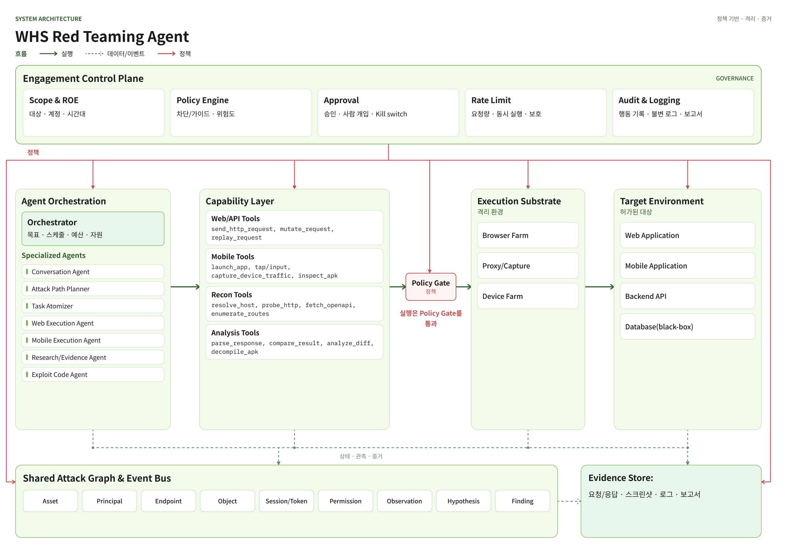
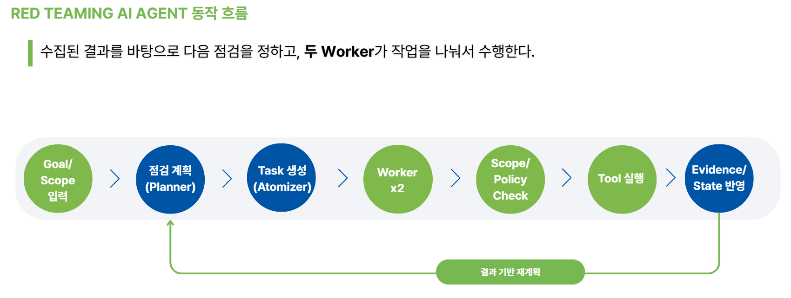

# 아키텍처와 의존성 규칙

전체 데이터 흐름은 다음과 같다.

```text
User/Operator
  → Engagement Config (Scope / ROE / Limits)
  → Agent Orchestration (Planner → 작업 원자화 → 경계가 정해진 Worker)
       각 Worker: MODEL → TOOLS → SETTLE
  → Engagement Control Plane  [모든 도구 호출 전 필수 관문]
       (Scope / ROE / Policy / RateLimit / Budget / Approval / Audit)
  → Capability Layer (ToolGateway → MCPToolRegistry → MCPAdapter)
  → Execution Substrate (MCP Server)
  → Target

원본 결과 → Evidence Store
Task, 결과, 실행, 그래프, 요청 회계 → 중앙 state.sqlite3 (schema 3)
```

의존성 규칙은 정적 테스트로 강제한다. `redteam.core`는 이 저장소의 그 무엇도, 어떤 프레임워크 라이브러리도 import하지 않는다. 다른 모듈은 `core.contracts`와 `core.ports`만 의존하고 서로의 구현 클래스를 직접 참조하지 않는다. 단, 같은 팀 모듈끼리는 예외다. `app`만 여러 팀 구현을 동시에 import하는 조립 루트다. `orchestration`이 `capability`나 `control`을 import하지 못한다는 사실은 `tests/unit/test_control_plane_bypass.py`가 정적으로 검사한다.

| 모듈 | 책임 |
| --- | --- |
| `core/contracts`, `core/ports` | Pydantic 도메인 스키마와 Protocol 포트. 단일 진실 공급원 |
| `orchestration`, `attack_graph`, `event_bus` | LangGraph 실행, 플래너와 워커, 공격 그래프, 이벤트 버스 |
| `control`, `evidence` | Control Plane(범위, 정책, 예산, 승인, 감사)과 증거 저장소 |
| `capability`, `deploy` | ToolGateway, MCP Registry와 Adapter, MCP 서버 배포 |
| `llm`, `intake`, `app` | LLM 클라이언트, 자연어 설정 작성, 조립 루트(bootstrap)와 CLI |



*전체 아키텍처. 정책 기반 통제 아래 Orchestration, Control Plane, Capability, 실행, 대상 계층이 연결된다. Web/API와 Recon이 중심이다.*



*전체 동작 흐름. Goal/Scope 입력 → 점검 계획(Planner) → Task 생성(Atomizer) → Worker ×2 → Scope/Policy Check → Tool 실행 → Evidence/State 반영. 수집된 결과를 바탕으로 Planner로 돌아가는 재계획 루프가 돈다.*
