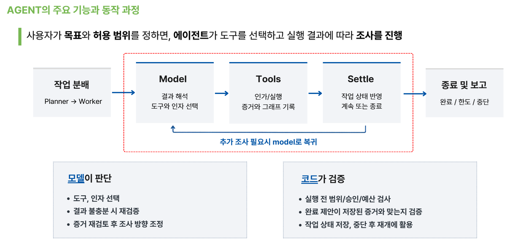
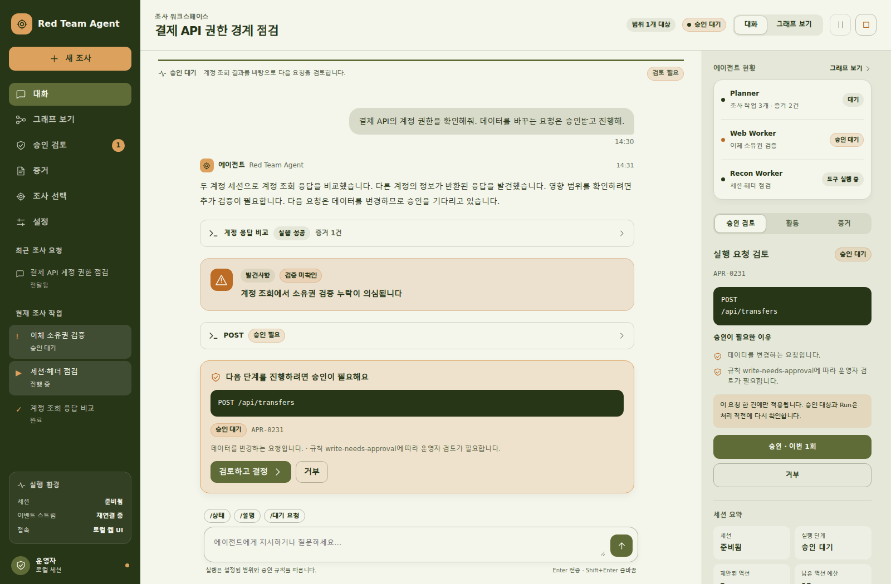

# 개요

> 가설 수립부터 실행과 증거 관리까지 연결하는 AI 보안 점검 시스템

| 항목 | 내용 |
| --- | --- |
| 저장소 | [zkfla/WHS-Red-Teaming-Agent](https://github.com/zkfla/WHS-Red-Teaming-Agent) |
| 상태 | 개발 중, v0.1.0, Web/API와 Recon 실연결 |
| 대상 범위 | 허가된 대상 한정. Scope, ROE, 예산, 승인으로 통제 |
| 실행 환경 | CLI(redteam)와 로컬 웹 UI |
| 기술 스택 | Python 3.10+, LangGraph, MCP, LiteLLM, SQLite, Pydantic v2 |
| 단일 진실 공급원 | `redteam.core` (contracts + ports). 다른 모든 모듈이 의존하며 역방향은 없다 |

WHS Red Teaming Agent는 허가된 대상과 범위 안에서 보안 점검을 수행하는 멀티 에이전트 프레임워크다. 사용자가 점검 목표를 제시하면 플래너가 확인할 가설과 검증 작업을 구성하고, 워커가 도구를 선택해 실행하며, 실행 결과를 바탕으로 후속 조사와 완료 여부를 판단한다. 설명은 Web/API와 Recon을 중심으로 한다.

핵심 설계 원칙은 역할 분리다. LLM은 의도와 계획, 행동, 해석을 제안하고 코드는 입력과 참조, scope, 승인, 예산, 정합성, 상태 전이를 검증한다. 모델이 선택한 행동이라도 범위와 정책, 승인, 예산을 통과하지 못하면 실행으로 변환되지 않는다.

!!! note "모델은 제안하고 코드는 검증한다"
    도구 성공, 원본 관측, 가설, 검증된 Finding, 작업 완료, 목표 달성은 서로 다른 상태이며 코드가 이 경계를 강제한다.

설계 목표는 세 가지다.

- **통제된 자율성.** 에이전트는 자유롭게 가설을 세우되, 모든 도구 호출은 operator가 소유한 정책으로 target, method, path 단위까지 허용 목록에 올라야 하고 Control Plane이 게이트한다.
- **병렬 개발 가능한 경계.** `redteam.core`의 Pydantic 계약과 Protocol 포트만 알면 각 팀이 서로를 깨뜨리지 않고 개발한다.
- **하지 않는 것.** payload 데이터베이스, 범용 exploit 라이브러리, 무제한 도구 호출, 자동 공격 승격은 설계에서 제외했다.

*작업 인스턴스는 MODEL(판단), TOOLS(인가와 실행), SETTLE(상태 반영) 루프를 돌며 추가 조사가 필요하면 Model로 복귀한다. 모델은 도구와 방향을 판단하고 코드는 실행 전 범위와 승인, 예산을 검증한다.*

*웹 인터페이스의 조사 워크스페이스. 조사 범위와 실행 설정을 준비한 뒤 에이전트에게 목표를 전달한다. 실행은 설정된 범위와 승인 규칙을 따른다.*
