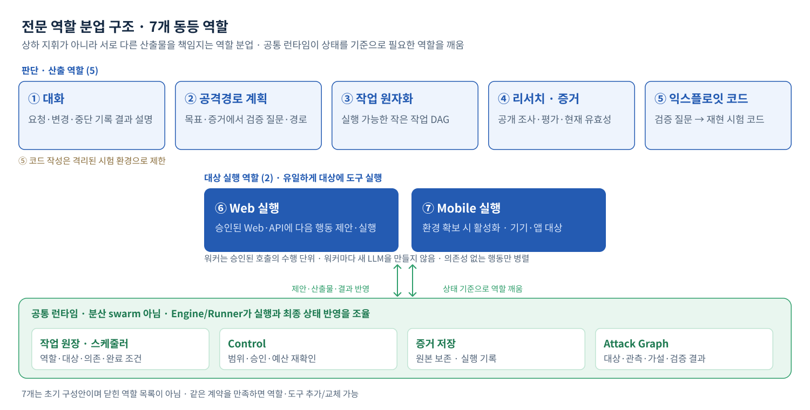
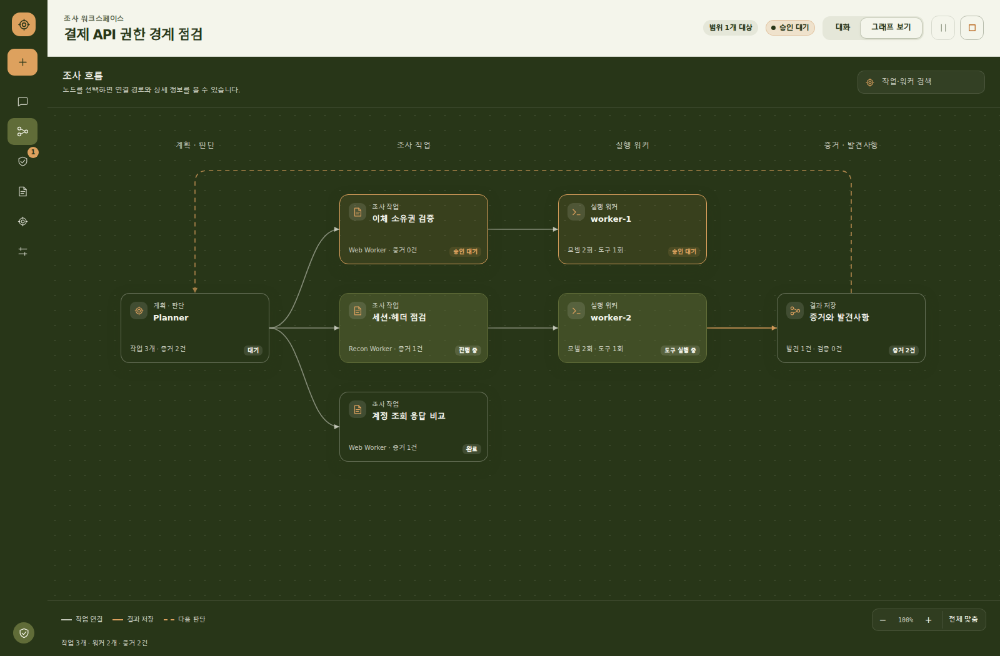

# 실행 모델

플래너가 공격 경로를 제안하고, 원자화 역할이 가설을 검증 가능한 작업으로 분해하며, 워커가 실행한다. LangGraph는 워크플로 런타임으로만 쓴다.

## RuntimeState와 GraphState

`orchestration.state.RuntimeState`는 도메인 객체가 아니라 ID와 phase, 회계 값만 담는다. 인접 노드 핸드오프를 위해 LangGraph 전용 `GraphState`가 `RuntimeState`에 전이 필드(`action_proposal`, `policy_decision`, `tool_result`)를 더해 감싸지만, 이 전이 필드는 체크포인트되지도 다른 모듈에 노출되지도 않는다.

노드 그래프는 `BOOTSTRAP → OBSERVE → PLAN → POLICY → EXECUTE → VERIFY → UPDATE → REPLAN`으로 이어지고 종료 시 `FINISHED` 또는 `FAILED`가 된다. `POLICY` 노드만 `route_after_policy`를 통해 ALLOW일 때 `EXECUTE`로 보낸다.

## 작업 인스턴스와 동시성

각 작업 인스턴스는 MODEL → TOOLS → SETTLE 네이티브 ReAct 루프를 반복한다. MODEL은 다음 행동을 판단하고, TOOLS는 요청을 검증해 정책 검사와 도구 호출을 수행하며, SETTLE은 실행 상태를 정리해 계속할지 종료할지 결정한다.

역할 수와 실행 인스턴스 수는 다르다. 기본 프로필은 두 워커(`max_instances: 2`, `max_activations: 8`)를 쓰며, 같은 역할도 동시성 한도 안에서 여러 인스턴스로 동작한다. 동시성 한도는 세 겹으로 작동한다. `max_instances`(프로필)는 워커 인스턴스 수를, `RateLimitPolicy.max_concurrent_actions`는 동시에 진행 중인 행동 수를, `RuleOfEngagement.max_parallel_actions`는 ROE 차원의 병렬 상한을 제한한다. 등록 성공은 실행 권한이 아니다. 가용성, 선택, admission, 실제 실행을 구분한다.

*역할 분업 구조. 전체 프로필은 7개 역할이며, 이 글은 Web 배포 기준 6개 역할(대화, 공격경로 계획, 작업 원자화, Web 실행, 리서치와 증거, 코드)을 중심으로 설명한다.*

## 역할별 책임

`config/agents`의 프로필이 역할과 담당 단계(stage)를 연결한다.

| 역할 | 책임 | 담당 단계 |
| --- | --- | --- |
| 대화 (conversation) | 사용자 요청 해석, 실행 문맥 연결 | conversation_decide |
| 플래너 (strategy) | 공격 경로와 가설 제안, 후속 조사 판단 | attack_path_proposal |
| 작업 원자화 (atomization) | 가설을 검증 가능한 Probe로 분해 | task_atomization |
| Web 실행 (web_execution) | Web/API와 Recon 도구로 관측 수집 | native_action |
| 리서치와 증거 (research_evidence) | 관측과 증거 유효성, 완료 판정 검토 | analysis_verify, task_completion_review, goal_completion_review 등 |
| 코드 (code_artifact) | 근거를 참조하는 재현 코드 산출 | 코드 산출 단계 |

중요한 구분이 하나 있다. 이 중 동시성 한도 아래 여러 인스턴스로 실제로 도는 것은 **Web 실행(web_execution)뿐**이다(schedulable). 나머지는 특정 단계에서 호출되는 전문 역할이라, 앞에서 말한 "두 워커"는 사실상 두 개의 Web 실행 인스턴스를 뜻한다. 전체 프로필은 여기에 Mobile 실행이 더해져 7개이지만 Mobile 역량은 아직 후보다.

## 진행 보증과 종료 조건

런타임은 무한 루프와 자원 낭비를 막기 위해 진행 상태를 추적한다. `RuntimeState`는 `step_count`, `retry_count`, `consecutive_failures`, `no_progress_turns`, `last_progress_fingerprint`, `remaining_budget`을 들고 다닌다. 같은 지문이 반복되면 진행 없음으로 간주하고, 연속 실패와 무진행 턴이 한도를 넘거나 예산이 소진되면 `termination_reason`을 남기고 종료한다. 종료 사유는 보고와 감사 소비자가 읽는다.

## 모델 사용량 회계

예산은 도구 호출뿐 아니라 모델 호출과 토큰도 추적한다. `RuntimeState`의 `model_requests_used`, `model_tokens_used`, `model_usage_unknown`이 그 값이고, `MeteredLLMClient.complete_structured_with_usage`가 사용량과 함께 결과를 반환한다. 사용량을 알 수 없는 호출은 0으로 숨기지 않고 `model_usage_unknown`으로 분리해 기록한다.

## 재계획 피드백

워커의 결과와 중간 증거는 플래너의 재계획을 촉발할 수 있다. `planning_feedback`에 구조화된 피드백이 쌓이고, `planning_diagnostic`(`DecisionDiagnostic`)이 판단 근거와 거절 사유를 남긴다. 재계획은 자유 서술이 아니라 원본 상태와 진단을 근거로 한다.

## 조사 모델: 가설과 Probe

플래너는 목표와 관측으로 확인할 후보(가설)를 제안하고, 원자화 역할이 이를 검증 가능한 원자 작업(Probe)으로 분해해 워커에 할당한다. 가설은 확인하려는 가능성이고 Probe는 그 판단에 필요한 관측을 확보하는 작업이다.

작업마다 행동 수와 모델 요청 수에 상한을 둘 수 있고, 워커는 허용된 도구와 실행 한도 안에서 방법을 선택해 관측과 함께 한계나 미해결 사항을 반환한다. 이 분리로 작은 관측 작업이 전체 취약점 입증까지 떠맡지 않게 한다. 관측과 가설, Finding은 서로 다르다. 응답 헤더 존재를 확인한 Probe가 끝나도 취약점이 확정되지는 않는다.

*조사 흐름 그래프. 가설(Planner)에서 검증 작업(Probe)과 실행 워커, 증거로 이어지는 흐름과 각 작업의 상태(승인 대기, 진행 중, 완료)를 보여준다.*
