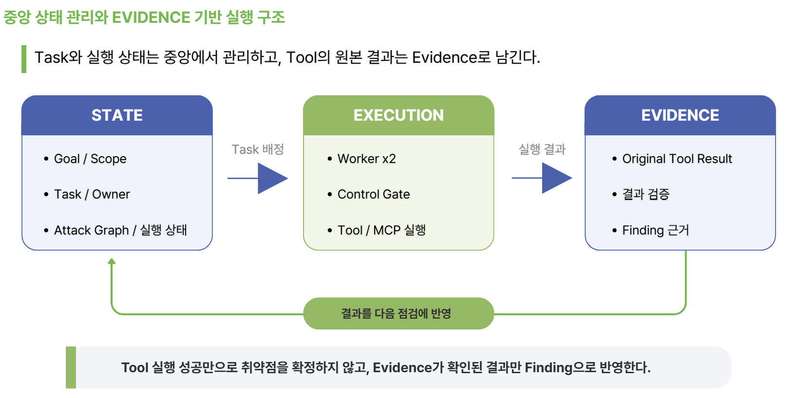

# 상태 관리와 중단, 재개

중앙 상태는 SQLite(schema 3)로 목표와 실행, 작업 소유권, 도구 호출, 자원 사용을 관리한다. 공유 공격 그래프도 같은 DB를 쓰고, Evidence와 Audit, Approval, SDK 체크포인트는 각자 저장소를 유지한다.



*세 저장 영역(STATE, EXECUTION, EVIDENCE)의 분리를 보여준다. 상태는 중앙 DB에, 실행 원본은 Evidence에 남고, 결과가 다음 점검으로 되돌아간다.*

| 주요 테이블 | 의미 |
| --- | --- |
| `state_missions`, `state_runs`, `state_tasks` | Mission과 Run, Engagement 식별, 원본 scope와 구성 바인딩, Task 목적과 상태, 소유 |
| `state_registrations` | 등록 요청 ID에서 원본 Task, batch와 불변 요청 해시로 |
| `state_executions`, `state_execution_resources` | action, invocation, model 호출 ID, proposal과 approval, reservation, result 참조, job 대기와 자원 상태 |
| `state_evidence_refs` | 외부 증거 ID와 검사 레코드 해시 (본문 복사 없음) |
| `state_requests`, `state_activations`, `state_outbox` | 요청과 쿨다운 회계, 인스턴스 예약과 진입, 반환 증명, outbox 전달 계약 |
| `state_graph_nodes/edges/mutations` | Engagement 네임스페이스 공격 그래프와 변경 영수증 |

원자성은 `state.transaction(callback, write=True)`가 동기 콜백을 `BEGIN IMMEDIATE`로 감싸 보장한다. 커밋과 롤백을 소유하고, 참가자는 외부 I/O나 이벤트 발행, 추가 커넥션을 열 수 없다. WAL과 제한된 락 재시도, 1초 busy timeout, 취소 안전 완료로 부분 저장을 줄인다.

Run 바인딩은 `state.bind_run(mission_id, scope=..., binding_hash=...)`로 묶으며 불변이고, Mission은 한 Run에 속한다. 바인딩이나 scope가 바뀌면 새 Run이 필요하다.

멱등성과 미확정 실행을 구분한다. `input_digest`는 정확한 proposal을 식별하며 의미적 중복이 아니고, 같은 요청이 다시 들어오면 기존 처리 결과를 식별한다. 결과가 불명확한 실행은 단순 실패와 구분하며, 취소나 타임아웃만으로 실행이 없었던 것으로 처리하지 않는다.

```python
class ExecutionRecoveryAnswer(BaseModel):   # frozen
    state: ExecutionState        # PENDING/RUNNING/SUCCEEDED/FAILED/CANCELLED/UNKNOWN
    verified: bool = False
    uncertain: bool = True
    result_available: bool = False
    error: ToolError | None = None
```

`ExecutionReference`(provider 핸들과 `input_digest`)는 승인된 invocation을 provider 상태와 연결하되 실행 권한을 부여하지 않는다. `TaskExecution`의 `ownership_version`과 `goal_revision`으로 소유와 세대를 추적하며, 종료 상태만으로는 `resource_execution_pending`을 해제하지 못한다. 복구 근거가 부족하면 무조건 재시도하지 않고 보류한다(resume refusal 기록).

## Event Bus와 알림

상태 변경은 `state_outbox`에 함께 커밋되고, 커밋이 끝나면 워커와 플래너에게 알림(wakeup)이 전달되어 재계획이나 기준 검토로 이어진다. 트랜잭션 안에서 외부 발행을 금지하고 커밋 후 outbox를 통해 전달하므로, 일부만 저장되거나 저장 없이 이벤트만 나가는 상황을 피한다. 이벤트 본문은 `EventEnvelope.payload`에서 비밀값이 자동 마스킹된다. 백엔드는 현재 in-memory이고 Redis, NATS, Kafka는 포트 뒤에 두어 보류했다.

## 운영자 개입

운영자는 실행 중에도 에이전트에 개입할 수 있다. 개입은 `OperatorIntent`로 표현되며, 승인(Approval)과는 별개의 경로다.

| Intent | 동작 |
| --- | --- |
| `PAUSE`, `RESUME`, `STOP` | 실행 일시정지, 재개, 중단 |
| `REPRIORITIZE`, `FOCUS`, `EXCLUDE` | 작업 우선순위 변경, 특정 대상 집중, 특정 대상 제외 |
| `GUIDANCE` | 자연어 지침 전달 (실행 권한을 대신하지 않음) |
| `STATUS_QUERY`, `EXPLANATION_QUERY` | 진행 상태 조회, 판단 근거 설명 요청 |

`RuntimeState.operator_intent_id`가 적용 중인 개입을 가리킨다. 개입의 적용과 거부는 `OperatorIntentApplied`, `OperatorIntentRejected` 이벤트로 남고, 단일 권위 있는 적용 결과를 `state_intents`에 기록한다. 자연어 지침이나 모델의 추정이 scope, 승인, 예산을 대신하지 않는다. 개입도 같은 통제 경계를 따른다.
